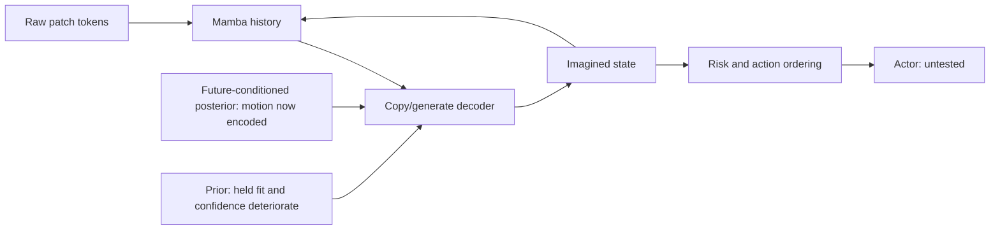

# Research review and CPU diagnostics, 2026-10-09

The present patch-token Mamba campaign has a credible experimental repair path. D's loss improves health from real history; motion-aware allocation lets the stochastic posterior encode moving hazards. The current binding failures concern the prior's held-out probability estimates and the interaction between decoding and self-feeding. Canonical Raw/TC and an imagination-trained actor remain unvalidated.

This review left the GPU, training sources and running jobs untouched. Four CPU diagnostics use frozen inputs, two threads and an empty CUDA device list. Results and input/source hashes are in [cpu_review_20261009.json](evals/cpu_review_20261009.json) and [the source manifest](evals/cpu_review_20261009_sources.json). These are exploratory checks on the opened diagnosis panel.

## Results that survive the review

- **Health learning:** D from scratch emits 647/1,211 ordinary hits and 62/207 fresh hits, against M16's 60 and 0, with 5/1,728 false drops. Teacher-forced simulator-truth damage capture is 81.9%; self-fed capture is 7.2%. The earlier food penalty disappears from scratch: depth-16 food R² 0.875 versus M16 0.881. Source: `health_chain_v1/evidence_scratch_d.json`, notebook's test-3 entry and the scratch damage/teval reports.
- **Stochastic allocation:** motion-weighted E22M improves posterior-conditioned random-move localization from 1.1% to 80.4%, close to the label-derived diagnostic's 82.1%. This is direct intervention evidence for the channel's objective, rather than a general failure of Mamba memory.
- **Memory:** the completed E17 worlds retain old same-slot terrain better than attention, replicated across two seeds. Coordinate registration remains weak. This capability should be checked explicitly whenever the state interface or objective changes.

## New CPU finding: prior confidence explains much of a real held-out regression

The published E22MP held metric worsens from CE 2.3072 / accuracy 0.4698 at 20k to CE 3.5717 / accuracy 0.4047 at 60k. CPU FP32 reproduces it to approximately 0.00021 CE and 0.00014 accuracy. Average maximum confidence rises 0.5461→0.6888, while predictive entropy falls 1.7814→1.0207.

Temperature is selected on 20 validation episode clusters and evaluated on 43 disjoint test clusters. To check the result is relevant to live imagination, the primary follow-up excludes the three observed-context transitions and all future frames after first death, retaining the first terminal target: 4,528 test transitions, four codes each.

| prior | temperature | test CE | test accuracy |
|---|---:|---:|---:|
| 20k | 1, validation-selected | 2.229868 | 0.485038 |
| 60k | 1 | 3.543180 | 0.415857 |
| 60k | 2, validation-selected | 2.587520 | 0.415857 |

Paired episode-cluster intervals: raw 60k−20k CE +1.313311 [1.141229, 1.491826]; calibrated +0.357653 [0.306848, 0.408980]. Temperature removes approximately 73% of the excess CE on this panel, while class ordering remains worse. This measures code-probability fit under true prefixes. Sampled rollout benefits from temperature have not been tested.

The predeclared interpretation “held CE does not fall, therefore capacity convergence” does not follow from this result. Poor generalization and excessive confidence are observed; their origins in training support, regularization or code semantics remain to be separated before making the prior larger.

**Input check:** a grouped linear readout from the actual compressed global frame token reads adjacent zombie positions at AUC 0.999526 / AP 0.981222 at 20k, and AUC 0.999948 / AP 0.997950 at 60k. Local 8-D tokens lose substantial whole-map precision, but the complete frame input retains adjacent hazard location. This argues against redesigning the encoder solely because its first projection has width eight. It does not establish sufficiency for cooldowns, motion probabilities or arbitrary nonlinear readouts.

**Conditional code fit:** on 1,654 alive, no-scroll, single-zombie transitions, CE worsens 2.514→4.272. On 173 non-stay/non-max-axis-toward moves, CE worsens 4.586→7.903. These are region-code errors: the selected code also describes content other than the zombie.

## New CPU control: agreement with one realized future has a stochastic baseline

Four other real simulator futures, keys 1–4, are scored against key 0 using the E22 ordinary-damage/alive masks. Across 337 hits, 15,387 unchanged transitions and 143 episode clusters, independent real futures capture 38.5% [33.9%, 43.0%] of recorded hits. At depths 9–16 they capture 24.3% [19.9%, 29.1%]. Overall false agreement is 1.28% [1.11%, 1.47%].

This control uses `caught_all`, without camera-alignment conditioning, so it does not adjudicate the existing aligned gate. It demonstrates why recorded-event agreement alone cannot measure the fidelity of a sampled world. Retain agreement as a diagnostic and add probability scores and conditional calibration against multiple real futures. [Gneiting and Raftery](https://sites.stat.washington.edu/raftery/Research/PDF/Gneiting2007jasa.pdf) supply the proper-scoring framework; [Guo et al.](https://proceedings.mlr.press/v70/guo17a.html) provide the temperature-calibration precedent tested above.

## E22MS landed during review: soft improves, hard decoding reverses its benefit

Both reports use the same scratch stage-A model, 20k prior, four samples and initial RNG seed. Soft: localization 57.57%, aligned damage capture 13.24%, false 1.29%. Hard interior: 27.67%, 10.41%, 1.03%. At depth 16, the four soft thresholded zombie censuses are 0.168/0.199/0.209/0.193; hard gives 0.137/0.169/0.138/0.146, versus truth 0.294.

Hard decoding changes subsequent frame inputs and therefore subsequent prior samples. The comparison measures the intervention on the complete feedback pipeline; it does not isolate a particular routing branch. The evaluator saves aggregates, discarding per-root codes, routing decisions and generated states. Those files cannot recover the mechanism or a paired interval. The next separating check should retain these rows and compare soft/hard with identical supplied codes before another training change.

On scratch soft rollouts, damage given imagined adjacency is 17.52–20.57%, versus real 18.12%; adjacency occurs only 5.69–5.95%, versus real 8.68%. The remaining deficiency is strongly associated with insufficient hazardous adjacency. These probe-derived rates require an independent semantic reader before being treated as literal entity counts.

## Corrections and retained leads

**Current-best reference lineage:** the 70.5% localization / 25.2% damage capture substitution belongs to E22M on D continued, with hard interior decoding. The 57.57% / 13.24% sampled result belongs to E22MS on D scratch, with soft decoding. No E22MS `postcodes` result is saved. Those values cannot quantify the current best pipeline's prior gap.

**Additional CPU sampler census:** `review_prior_terminal_positions.py` verifies that all 7,501 terminal rows place the prior's positive end target exclusively at scored transition 20. All 43 legal starts of the 12,288 main rows contain no positive targets. This reproduces a position-alias opportunity in the current continuation supervision. It establishes the layout bias, while head exploitation requires a separate probe. The E22 imagination evaluator discards the returned termination probability, so this cannot explain its health/localization scores; it matters before actor use. Input/source hashes and counts are appended to the CPU review JSON.

1. **Gradient interpretation:** `health_gradient.py` reports a gradient norm ratio, not an additive share of the optimizer update. D continued's ratio is 7.557%, with cosine −0.0337 to the total gradient; its signed projection is −0.2547%. Scratch D: 4.5777%, cosine 0.0104, projection 0.0476%. Adam adds another transformation. D's observed effectiveness stands; the separate roles of L2, L1 and worst-element weighting have not been isolated by those ratios.
2. **Zombie substitution:** restoring zombie-neighborhood cells closes 75.4% of the full self-fed→teacher gap, leaving 16.91 percentage points. It closes 96.1% of the full-map substitution gain. This localizes a dominant contribution, while preserving the measured residual.
3. **Canvas read addressing:** zero direct matches at 2,018 entering-cell addresses, and correctly remembered residuals reducing generator MSE 0.382472→0.297505, justify retaining the addressed-read lead. Routed-output improvement remains unresolved. Preserve slot-Mamba memory, correct reads and off-screen convolution handling before another canvas run. [Neural Map](https://arxiv.org/abs/1702.08360) separates spatial writes and retrieval.
4. **New/unmatched content:** motion weighting cannot mark entering zombies without a source. Seventy true entries are present; E22M and E22MS render none above the existing probe threshold. Keep generic novelty/entry modeling alongside motion allocation; entries alone cannot explain the entire fade.
5. **Decision ordering:** E17's late readout training reduces Brier 0.126193→0.092199 while safe choice falls 0.657265→0.634850. Code fit and health calibration must therefore be paired with within-root action-order checks before actor training.

[DyMoDreamer](https://arxiv.org/html/2509.24804v1) is a close precedent for dedicating stochastic capacity to differential motion signals. Camera compensation matters in this project because egocentric scroll otherwise dominates differences. [ITC](https://arxiv.org/html/2605.16457v3) motivates discrete copy/generate commitments with structured transport, but our local continuous-token decoder is an adaptation. The reversal on E22MS makes transferring its inference rule without checking the learned candidates especially risky.

[DeltaWorld](https://arxiv.org/html/2604.04913v1), released in April 2026, supplies a relevant feature-space generative alternative: compress temporal changes and train multiple future hypotheses. Its appendix explicitly identifies two remaining issues: best-of-many training provides no guarantee of correct outcome probabilities, and decoding deltas against true frames can drift when applied repeatedly to reconstructed frames. Those limitations match the distinction this campaign needs between plausible motion, calibrated risk and stable recursion. It remains a fallback after the current prior/decoder diagnosis, rather than evidence that replacing the dynamics architecture will resolve these problems.

The immediate research order is conditional prior fit/calibration, a matched-code diagnosis of the scratch decoder, independent semantic validation and action ordering. Registration and generic entering-content modeling remain useful secondary leads. More training or another broad architecture sweep is not yet justified by the current measurements.

## Reproduction

Run from the repository root with `.venv/bin/python`; the scripts force CPU and two threads. `review_prior_fit.py` writes reusable per-root posterior-target scores; `review_prior_calibration.py` consumes those rows. `--reuse-rows` re-summarizes previously computed fit rows. Runtime stdout should be redirected into `artifacts/eda/levers_logs/`; numerical outputs go into the existing `artifacts/eda/health_chain_v1/` store. `review_prior_input.py` and `review_real_keys.py` are independent. No script writes the notebook.
