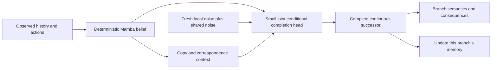

# Direct conditional innovations: assessment before implementation

2026-10-13. Proposal only. The existing optimization control is complete; no new training was launched.

The most useful next question is whether completed continuous successors can learn the right conditional distribution
directly, without first discovering a future-conditioned code. I recommend a small proper-score generator study before
another inverse-encoder repair. This is a choice of the next informative test, not evidence that this generator will
outperform diffusion, a successful posterior model, or an actor baseline.

## What the completed control establishes

Four daytime FIT roots, 26 distinct encoded futures, 2,000 matched updates. The exact conditional-mean MSE floor is
0.0048010583. Final MSE/floor is 1.05126 without a channel, 1.05237 with learned hard codes, 1.04719 with learned soft
probabilities, and **0.015229 with supplied outcome IDs**. The supplied-ID forecasts select their own real future in
26/26 cases; a previously fitted real-state reader recovers all 32 skeleton and 15 cow occupancies, with no false positives.
There are no zombies in these four roots. The soft arm's actual within-root output variance is only 0.001054% of truth's.

Thus this continuous completion model can express these futures when distinctions are supplied. Its learned interfaces
failed to discover/use those distinctions, including without quantization. This localizes an optimization/coadaptation
failure of this implementation. It does not establish the full cause, generalization, probabilities, or a necessary
categorical representation. The supplied IDs are arbitrary case identifiers; their maximum five-bit capacity is not a
measurement of physical innovation entropy. Negative milestones and the complete final state are retained.

Evidence: `oracle_v1/learned_innovation/optimization_control/{contract,result,completed_analysis}.json` and
`innovation_overfit_analysis.py`. The broader 3,000-update learned posteriors remain constant on all 155 mob-variable roots
in the 200-root, 32-key evaluation fan. Their prior likelihood is consequently not a chance-model success.

## What the primary papers support

| source | actual learning route | implication for our choice |
|---|---|---|
| [Stochastic MuZero, §4](https://openreview.net/forum?id=X6D9bAHhBQ1) | Afterstate; future-observation chance encoder; fixed one-hot codes; predicted chance probabilities. Value/policy/reward supervision, without image reconstruction. | Supports deterministic computation followed by chance and completion. Its successful chance encoder does not make that encoder necessary. |
| [LPWM, §3 and A.4](https://arxiv.org/html/2603.04553v1) | Per-particle Gaussian inverse latent actions and history-conditioned Gaussian policy/prior, KL alignment, image reconstruction. | Local factorization is relevant; innovations need not be categorical. The inverse/prior mismatch and reconstruction obligations remain. |
| [FLAM, §4.2](https://arxiv.org/html/2602.16229v2) | Factored inverse/forward dynamics, Gaussian latent actions regularized to a fixed normal prior; reconstruction-pretrained visual features. | Factorization avoids a monolithic joint action space. This is principally action-free video/control learning, not evidence of separating physical chance from nuisance given known actions. |
| [JEDI, §3](https://arxiv.org/html/2605.13013v1) | Conditional latent denoising; observations encode targets; sampling begins from noise. No separately learned inverse chance encoder. Reward/termination losses also update the encoder. | Demonstrates a reconstruction-free, direct generative world with actor results. Its whole-latent iterative generator and representation learning do not establish sparse local chance discovery. |
| [Flow-JEPA, §4 and limitations](https://arxiv.org/html/2608.29029v3) | Gaussian-to-future-trajectory conditional flow matching, with JEPA/SIGReg. | Another direct route. Its experiments primarily establish planning robustness; trajectory prediction and flow training are not isolated. It does not answer our rare-event distribution question. |
| [ITC, §3](https://arxiv.org/html/2605.16457v3) | Structured copy/new-token assignment at decoding, including a source-use constraint and wildcard creation; discrete visual tokens. | Correspondence is a completion property, independent of how chance is learned. Our per-destination soft copy weights currently do not enforce its source-use constraint. |

[Pacchiardi et al.](https://www.jmlr.org/papers/v25/23-0038.html) provide the most direct objective precedent:
noise-conditioned forecasting generators trained with proper energy/kernel scores, including patched spatial scores.
[EAR](https://arxiv.org/html/2505.07812v1) and its [actual loss](https://github.com/shaochenze/EAR/blob/main/models/scoreloss.py)
implement a noise-conditioned continuous-token head with two-sample energy training. EAR's visual tokenizer is
reconstruction-trained; only its generator/objective is a precedent here. Its temperature/guidance modifications should
not be borrowed into a calibration study. [FGN](https://arxiv.org/html/2506.10772v1) supports shared noise modulation and
autoregressive training, while demonstrating that good marginal scores alone are not a general proof of joint fidelity.

None of these results demonstrates automatic discovery of all four WHITEBOARD categories.

## The candidate learning principle

Compute causal Mamba features once. A small spatially coupled head modulates **both routing and generated content** with
noise, then forms the complete continuous successor using the copy candidates. There is no codebook, inverse model or
separately fitted chance prior. The observed successor is a training target, never a generator input. Fresh chance is
sampled at each step; sampled persistent hypotheses must remain in that branch's memory.

Locality should constrain the source of innovation, not force the final embedding delta to be spatially sparse. A local
mob move can change health, and contextual patch tokens can change throughout the frame. A lightweight spatial mixer
must propagate a sampled cause to its consequences. Noise must also affect routing: predicting a deterministic route
and adding random texture afterwards cannot represent a random object move coherently.

For two independent completed draws X and X', the unbiased energy objective is

`L = 0.5*d(X,Y) + 0.5*d(X',Y) - 0.5*d(X,X')`.

Use Euclidean distances with exponent one. Squared-distance energy only identifies the mean. Ordinary independent-noise
MSE/L1 has a deterministic optimum; it does not train the desired law. Positive fixed local-patch scores plus a global
score can emphasize local discrepancies while retaining joint sensitivity. Patch definitions and scales are fixed from
TRAIN data; weights must not depend on which future happened. See
[aggregation/transformation scoring rules](https://ascmo.copernicus.org/articles/11/23/2025/).

This eliminates our learned code target and its prior mismatch. It does **not** eliminate mode collapse in finite-budget
optimization. Initialize a live, nonzero noise path, check actual output dependence, and keep the correct diversity
coefficient. Do not add an early sparsity/rate penalty that makes ignoring chance cheaper. Deterministic regions have a
point-mass conditional optimum under a proper score; extra random variation there is penalized. That is the first test of
learned selectivity, rather than an imposed movement mask.

## What this objective cannot solve by itself

- **Nuisance:** a proper score on Raw tokens rewards reproducing the renderer variation those tokens contain. It cannot
  declare that variation irrelevant. Ultimately the target needs retained consequence information and nuisance
  invariance, with explicit semantic retention checks. SIGReg/non-collapse alone did not protect mobs in our CLS runs.
  [Denoised MDPs](https://proceedings.mlr.press/v162/wang22c.html) motivates relevance-based abstraction, not discarding
  every uncontrollable feature. Lighting/sleep cannot be removed indiscriminately.
- **Forgotten history:** a short-history conditional generator should express uncertainty about unknown timer phases.
  Calling that physical randomness would be wrong. Longer learned memory and persistent branch-specific beliefs are
  necessary; changing the stochastic objective supplies no missing observations.
- **Unseen terrain:** it belongs to a persistent uncertainty mechanism, not a repeatedly resampled residual. It must be
  sampled/assimilated once and retrieved on return. Excluding it from a feasibility score controls a confound; it does not
  repair navigation or the failed canvas read path.
- **Rare consequences:** propriety does not prevent starvation. For a binary event of probability p, the excess
  energy/Brier score of always saying absent is p². Fixed local normalization helps allocation but supplies no guarantee
  of reward relevance. Real logged rewards/termination and longer predictive consequences can supply relevance signals
  without simulator labels. Independently sampled branches must not each receive the recorded branch's realized label.
- **Correspondence:** shared noise couples routing and content, but the existing soft copy mixture can still duplicate
  source evidence. ITC-style partial transport with creation/deletion is a possible structural remedy. Hard assignment
  over contextual continuous patches is not automatically correct and is not assumed in this first comparison.

## Smallest separating study to discuss

One-step, two matched arms using the same unconditioned parent, frozen continuous encoder, trainable Mamba/backbone,
small noise-conditioned completion head, TRAIN transitions, optimizer, noise draws and update budget:

1. **Point-distance control:** the two attraction terms above, without the diversity term.
2. **Proper-score candidate:** exactly the same terms and metric, with the diversity term.

The comparison isolates the distribution-learning term. Existing deterministic/E22MS results are historical references;
they cannot substitute for this matched control or establish superiority over every posterior method. No new inverse
encoder campaign is needed.

Begin with a nuisance-controlled observed-image subset and a fixed interior evaluation domain whose immediate sources
are visible. Selection must use observations/actions, not simulator fields, future mob movement, or event masks. Verify
the subset on data before choosing a training budget. Keep history identical between arms; the study tests direct
one-step chance completion, not the entire memory hypothesis. The full-frame/night/unseen-content extension would
require the corresponding representation/persistence mechanisms.

Only recorded TRAIN successors enter optimization. Multi-future forks are evaluation-only. The existing 200×32 fan
permits an exploratory feasibility reading; its prior inspection prevents calling it a fresh sealed judgment.
Measure per-root mob-location distributions, count and source/target consistency, stable-cell false changes, joint/local
proper scores, and adjacency/damage probabilities where conditioning is identifiable. Use real-to-real fan comparisons
to quantify finite-sample resolution, and a frozen real-state reader plus nearest-real-feature sensitivity to separate
semantic diversity from reader artifacts. Forks condition on full simulator state: unresolved hidden phases mean their
law is not necessarily the law conditioned on the model's history. Stratify that limitation rather than rejecting valid
belief uncertainty as overdispersion.

The mechanism fails this study if noise changes tokens but not actual outcome alternatives, if diversity comes from
static corruption or invalid counts, or if held conditional scores/frequencies do not improve over the matched control.
Only interpret a negative after checking optimization curves and the live sampling path. A positive establishes direct
conditional completion on this scope; it establishes neither actor benefit nor four-way separation. One first seed;
fresh-root/seed confirmation follows promising evidence, rather than launching a replication unconditionally.

Reuse deterministic Mamba computation across the two small heads; retain BF16, checkpointing, microbatching and atomic
optimizer/RNG/evaluation resume. The present three-arm pilot peaked at 1.778 GiB, providing useful local feasibility
evidence. Measure the new head's actual peak before launch; this is not a promise about long contexts or actor batches.

## Potential contribution

Direct energy-score generation, stochastic JEPA and learned local actions already exist. Combining their names is no
novelty claim. A defensible contribution would be evidence that a reconstruction-free recurrent model can **allocate
stochastic computation to consequential conditional uncertainty**, couple it to correspondence-preserving completion,
and retain sampled facts in memory, with better control per unit compute. The proposed small study tests the first
necessary mechanism. The rest remains an explicit research obligation.
