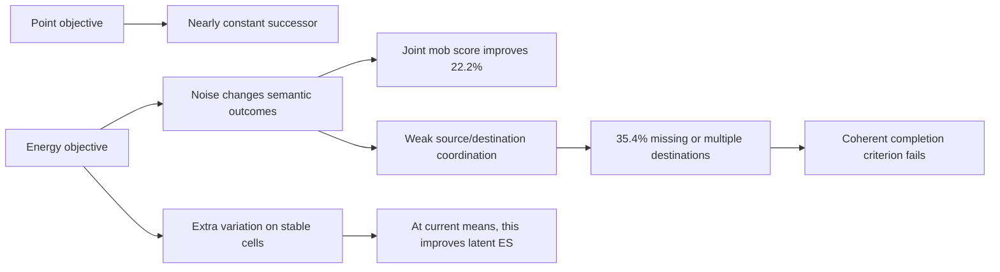

# Direct stochastic completion: completed two-arm study

2026-10-14. The preregistered result is **coherent_completion_not_established**. Direct noise-conditioned learning
produced meaningful stochastic alternatives and improved joint distribution scores, but did not assemble reliably
valid source/destination outcomes. No fresh confirmation, recursion, larger generator or further training ran.

## Verified execution and scope

Both arms completed exactly **3,000 updates and720,000 targets** from identical initial weights, paired input/noise
draws, optimizer settings and backbone. Reconstructing every sampled batch and both noise draws reproduced the final
ledger and sampler RNG states exactly. All14 training source/input pins, seven frozen-criterion pins and saved
evaluation/checkpoint identities match. The TRAIN ledger and200-root evaluation panel have zero episode overlap.
The same encoder and real-fitted readers were used throughout; no simulator labels supervised training.

The input-only brightness rule leaves104 exploratory roots; strict joint physics is read on14 isolated source roots,
including8 cows, each with64 generated and32 simulator futures. Confidence intervals cluster by root/episode.
These are previously inspected exploratory roots and one training seed. The failed physical test correctly blocked
the reserved fresh-seed collection. The full-state simulator fan is narrower than an H15 partial-history belief;
hidden-phase movement probabilities must not be interpreted as an exact target belief law. Cow movement is the
cleanest visible-conditioned case. Neither the actor nor the WHITEBOARD uncertainty separation is tested here.

## Declared results

| Measure | Point | Energy | Real fan reference |
|---|---:|---:|---:|
| Joint scored35 mob occupancy energy score, lower better |0.031417|**0.024439**|0.021161|
| Valid registered single-destination outcomes |78.57%|64.62%|100%|
| Absent source object |21.43%|15.18%|0%|
| Multiple destinations |0%|20.20%|0%|
| Source retained plus another destination |0%|15.63%|0%|
| Mean distinct valid outcomes per source |0.786|3.071|3.643|
| Valid cow movement |0%|8.20%|41.02%|
| Valid cow stay |100%|59.77%|58.98%|

The primary paired energy-minus-point score is **−0.006978 [−0.009680,−0.004326]**, a22.2% improvement. Both
independent readers agree on307 of the896 source draws being invalid; event agreement is97.55%. The bank reader
also finds35.60% invalid and16.63% source/destination duplicates. This cannot be explained by the tiny disagreement
guard alone. Semantic interpretations remain frozen-reader measurements, rather than rendered pixels.

The energy arm has317/896 invalid draws (136 absent,181 multiple), including140 source-retained duplicates.
Its valid alternatives occur in12/14 source roots; the coverage lower95 bound64.29% misses the preregistered88.62%
minimum. Camera mismatch is zero. Scored static terrain corruption is low:0.2664% point,0.2724% energy,0.1794%
real-reader reference. Paired static fidelity passes. Physical coherence fails by a large margin; this is not a
borderline failure created by the small alternative-coverage stratum.

## Post-hoc separating diagnostics

### Joint dependence

Independently permuting each destination across samples preserves every empirical cell occupancy marginal exactly.
It changes real-future validity **100%→54.10%**, but energy validity only **64.62%→61.89%**. The model's dependence
contributes2.73 percentage points[0.39,5.14] of validity; real dependence contributes45.90[39.19,51.31]. Coordination
is weak, not zero. The energy count variance across five possible destinations is0.43080; the independent-marginal
variance is0.45961. The mean per-root conservation fraction is5.33%, versus100% for reality (cow-only9.58%).

This directly localizes the semantic problem: matching location frequencies is insufficient when source clearing
and one destination must occur together. It does not identify why optimization failed to learn that dependence.
Evidence: `direct_generator/diagnostics/joint_shuffle/{analysis,paired_intervals}.json`.

### Deployed routing and generation paths

The frozen world was replayed at the original batch shapes and noise seeds. Every base prediction reproduces the
saved forecasts exactly (maximum difference0.0). Inference-only interventions change one completion path; these
outputs are diagnostics and were never trained or selected as repairs.

| Frozen intervention | Invalid draws /896 | Source-retained duplication |
|---|---:|---:|
| Original |317|15.63%|
| Fix routing at first noise draw, vary generation |242|7.14%|
| Fix generation at first noise draw, vary routing |300|11.94%|
| Hard candidate choice independently per destination |307|13.39%|
| Remove off-source copies of this source token |311|15.40%|
| Copy candidates only, renormalized |214|8.93%|
| Generation candidate only |666|0% (other multiple-destination errors58.26%)|

Both routing and generation contribute. Removing off-source source copying rescues9 invalid samples but creates3
new ones: it leaves most failures intact. Hardening destination choices also leaves34.26% invalid. Consequently,
neither simple copy suppression nor soft-versus-hard selection alone is a demonstrated remedy. Generation-only
was not trained as a valid standalone state, so its poor performance is a path diagnostic, not a capacity ceiling.
Holding a path at a single draw is conditional on that reference, not a retrained deterministic-path comparison.
Exact linear-reader score attribution through LayerNorm is retained with source-copy weights and generation terms.
Evidence: `direct_generator/diagnostics/paths/{contract,analysis}.json`.

### Local versus shared noise

Four original reference draws were used to hold one noise channel fixed while varying the other64 times. Varying
only the shared channel gives62.72% valid outcomes, with alternative outcomes in26.79% of source/reference cases.
Varying only local noise gives64.70% valid outcomes, with71.43% alternative coverage. Neither frozen substitution
restores conservation. This does not test retraining a shared-noise-only model; it rules out treating that inference
change as an already-working fix. Evidence: `direct_generator/diagnostics/noise_channels/analysis.json`.

### Where stochastic variation goes, and what the objective rewards

The energy model's total token variance is1.860× this real fan. Scored mob-uncertain cells have0.982× real variance,
but contain only33.23% of generated variation, versus62.97% for the fan. Scored semantically stable cells carry
53.09× real token variance; unscored HUD carries7.54×. These are feature variation, not automatic physical corruption
or an established nuisance decomposition. Local facts can be unchanged while contextual tokens vary legitimately.

Suppressing only the excess stable-cell spread while preserving model sample means and all other outputs makes
held latent ES worse:

| Stable-cell deviation scale | Latent ES | Paired change from original |
|---|---:|---:|
|1.00|0.027940|—|
|0.50|0.028418|+0.000478[0.000293,0.000722]|
|0.25|0.028944|+0.001004[0.000661,0.001442]|
|0.00|0.029638|+0.001698[0.001194,0.002319]|

At zero spread, attraction improves0.055893→0.051242, while the subtracted half-pair distance falls more,
0.027953→0.021604. Thus their difference worsens. Stable-cell means remain biased (MSE0.000415 energy versus
0.000328 point). This is an exact local property of the trained outputs: their current latent objective rewards
some extra stable-cell spread. It does not establish that such spread belongs to the true distribution optimum,
or that mean bias alone caused conservation failure. Suppression leaves sample means unchanged and only slightly
changes token RMS0.999995→0.999585; it is not a physical-repair or normalization experiment.
Evidence: `direct_generator/diagnostics/stable_spread/result.json`.

### Objective sensitivity to real joint dependence

A model-free counterpart permutes each cell's intact192-D real tokens across branches. Per-cell feature
distributions and decoded marginals remain exactly unchanged. Two16/16 fan directions and16 fixed permutations
per root were evaluated. On the same14 source roots, validity falls100%→55.45%, while latent ES changes only
0.037699→0.039936 (**+5.93%**, paired+0.002237[0.001898,0.002566]). Joint decoded occupancy ES rises6.78%; cow-only
latent ES rises7.08%. This directly measures modest dependence sensitivity even without dilution by the other90
roots. The metric detects incoherence, but a large physical deficit carries a relatively small score penalty.
It does not prove this sensitivity was the sole cause of the learned model's convergence. Evidence:
`direct_generator/diagnostics/dependency_sensitivity/{result,source_strata}.json`.

## Literature and interpretation

[EAR](https://arxiv.org/html/2505.07812v1) and
[Pacchiardi et al.](https://www.jmlr.org/papers/v25/23-0038.html) support our two-independent-draw, first-power
energy estimator. Strict propriety identifies the population optimum; it does not make every improving finite
generator physically valid. A correct two-location single-object law can have ES0.353553, while independent
Bernoulli locations score0.426777 with50% invalid draws and still beat a deterministic mean at0.707107.

[Scheuerer and Hamill](https://repository.library.noaa.gov/view/noaa/22327/) directly study limited energy-score
sensitivity to dependence errors. This is relevant to our measured covariance failure, but does not prove the
training loss was its sole cause. A biased generator can also prefer extra spread locally under a globally proper
score: for deterministic truth0 and a fixed mean of magnitude mu, symmetric orthogonal noise of magnitude epsilon
gives ES sqrt(mu²+epsilon²)−epsilon/2, minimized at epsilon=mu/sqrt(3), below the deterministic biased score.

[ITC](https://arxiv.org/html/2605.16457v3) explicitly identifies Craftax duplication/disappearance and introduces
joint source-use constraints during discrete decoding. Its precedent motivates coherent completion, but our source
copy-removal result prevents attributing all failures to repeated source copying. Contextual continuous features
and generation require their own treatment. [FGN](https://arxiv.org/html/2506.10772v1) uses globally shared
low-dimensional noise to encourage coherence; our fixed-noise tests do not establish that retraining this choice
would succeed or fail.

## Compute and decision

Peak allocated training memory was1.40GiB. The completion head has580,294 of6,962,134 parameters (8.34%). The
existing inference implementation computes the L16 completion shape even though only its last output is used.
Median synchronized batch4 inference takes17.91ms for one sample,50.20ms for16 and154.62ms for64, with the backbone
computed once. Incremental completion is about2.17ms per batch4 sample. These costs exclude encoding/loading and
device-to-host copies; initial compilation makes summed arm timing unsuitable for a speed comparison.

Keep the direct-generator learning principle as partial evidence: noise use and some semantic alternatives learned
without a future-looking inverse encoder. Preserve this implementation as a negative for coherent completion.
The next method must couple source clearing, destination appearance and generated content, and must justify how
stochastic capacity avoids irrelevant spread. No inference intervention above solved that. Further recursion,
larger generators, categorical necessity, actor success and full uncertainty separation are not established.
