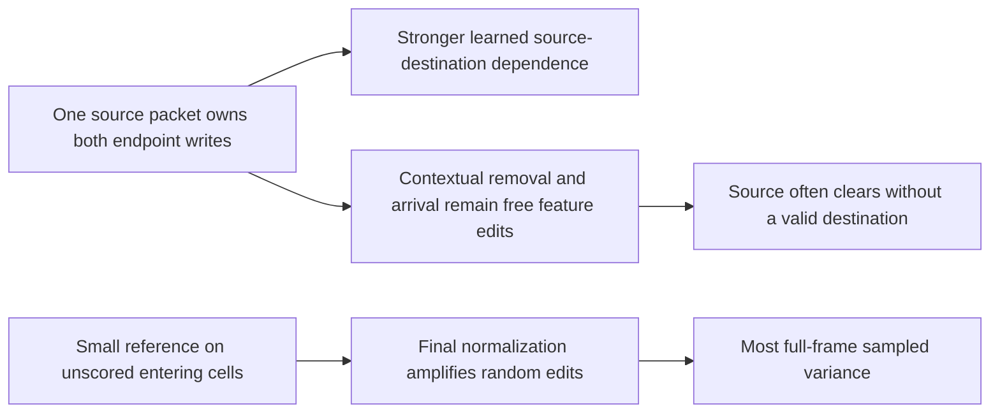

# Paired event completion: stronger coordination, coherent completion fails

2026-10-14. Registered verdict: **`coherent_completion_not_established`**.
Fresh confirmation is withheld by the original rule. Both matched arms completed
3,000 updates; the final checkpoint is the scientific endpoint. Earlier milestones
and all negative results remain available.

**2026-10-15 matching correction:** the arms used the same AdamW settings but
different weight-decay groups on18 shared Mamba parameter tensors (72 scalars).
Direct initialization's parameter deepcopy lost `_no_weight_decay`; the paired
initialization preserved it. The saved direct optimizer has163 tensors at
weight decay0.01; paired has149 at0.01 and18 at0. Its outcome effect is unmeasured.
The statement below that the optimizer was identical must be read with this
correction. Preserve the3k result and all within-arm interventions; the contrast
does not isolate architecture alone. Evidence:
`artifacts/eda/oracle_v1/paired_event/diagnostics/optimizer_group_audit.json`.

The packet factorization helped coordination, but failed its movement,
joint-distribution and absolute coherence criteria. A separate diagnostic
localized most full-frame variance to tiny entering-cell references followed by
normalization. Suppressing those unscored packets leaves interior source validity
and cow-movement counts unchanged. The two failures must be interpreted separately.

## Matched experiment and validity

The preregistration is `PAIRED_PREREG.md`, committed as `108469a8` before
implementation. The final criteria ID is
`0270895371fa8356764b7243a7d7789864f569be15828dccd61c6a6546c6033a`.

Exactly two arms share the frozen Raw encoder, original unconditioned D parent,
live corrt/fmamba backbone, stochastic spatial trunk, initialization, optimizer,
TRAIN windows, noise draws and first-power energy objective. The control is the
existing direct energy generator. The intervention changes the completion
factorization to source-associated packets with a shared gate and five soft
destination weights. Removal and arrival are contextual continuous feature writes;
there is no hard assignment, codebook or physical-content conservation constraint.

Each arm received **720,000 next-state targets**, batch16 and L16, over
3,000 updates. The input-only brightness selection retains 367,619 windows from
6,109 TRAIN episodes, with all17 actions. There are no simulator labels,
future-event masks or terminal oversampling in training. The fixed objective scores
35 interior tokens; HUD and entering map-edge tokens are excluded.

The final decoder preserves a full192-rank output map. The initial rank64 decoder
was corrected before main optimization or semantic evaluation; its four-update
fixtures remain in `preflight_history/v1`. This correction changes neither the
registered numerical criteria nor the final matched training budget.

Verification checked all29 pinned source/input hashes, reconstructed the complete
3,000-update window/noise ledger and all31 stored ledger milestones, and verified
saved checkpoint identities. Sampler/noise endpoints match exactly; model and
optimizer tensors are finite. This did not replay3,000 optimizer updates.
The interrupted2→4 versus uninterrupted4 execution check gives model difference0
and optimizer difference7.05e-12 with exact RNG and ledger streams. Both independent
noise draws influence the output. These checks support execution validity; they
do not establish semantic fidelity.

The exploratory evaluation contains104 bright roots and32 real futures/root,
with64 generated samples/root. Strict source/destination analysis has only
**14 clean variable sources, including8 cows**. These14 cases have stationary
cameras; the full104-root panel includes29 scrolling roots. Two frozen real-fitted
readers are retained. Intervals below are paired episode/root-cluster bootstrap
95% intervals,2,000 draws. This is one training seed and an exploratory panel.

## Registered outcome

Primary reader; invalid samples stay in every denominator:

| Reading | Direct | Paired | Real fan |
|---|---:|---:|---:|
| Exactly one valid destination | 560/896 =62.50% | 613/896 =68.42% | 100% |
| Source absent or multiple destinations | 336/896 =37.50% | 283/896 =31.58% | 0% |
| Source remains and another destination appears | 154/896 =17.19% | 85/896 =9.49% | 0% |
| Valid cow movement | 33/512 =6.45% | 49/512 =9.57% | 41.02% |
| Scored35 joint occupancy energy score, lower better | 0.02429479 | 0.02487611 | — |

Valid-source improvement is **+5.92pp [0.33,10.72]**. The second reader's
improvement is **+3.24pp [−2.46,8.04]**, unresolved. Cow movement improves
**+3.13pp [−1.17,7.23]** under the primary reader and only
**+0.20pp [−3.13,3.13]** under the second reader (35→36/512).

Primary joint occupancy energy score changes **+0.0005813
[−0.0003182,+0.0014735]**, with no improvement. The second reader's joint score
becomes worse: **+0.0024078 [+0.0009367,+0.0039676]**. Cow registered event-law
improvement is unresolved; the second reader changes in the opposite direction.

Camera, scored static fidelity and alternative coverage conditions pass. Physical
absence/multiplicity, duplication, movement improvement, joint event-law improvement,
primary distribution and reader-sensitivity conditions fail. The absolute
absence/multiplicity cap remains0.00669643, compared with observed0.31585.
The negative does not depend on that strict cap alone: movement and distribution
improvements also fail. `allows_confirmation=false`; no reserved fresh roots were
collected or evaluated.

## What the paired structure actually learned

A matched128-shuffle diagnostic independently shuffles the five cells' occupancy
draws while preserving every cell's marginal frequency exactly. The difference in
validity before/after shuffling measures the contribution of joint dependence.

| Dependence contribution to validity | Primary reader |
|---|---:|
| Current matched direct control | 2.83pp |
| Paired editor | 10.27pp |
| Paired minus direct | **+7.45pp [1.45,13.23]** |

The second reader independently resolves the increase:
**+8.98pp [3.99,13.90]**. The real fan's contribution is45.90pp. Thus the paired
factorization made coordination easier to learn on this panel. Overall source
count variance remains **0.467 direct /0.461 paired /0 real**. Aggregate count
conservation remains unresolved and reader-sensitive.

The frozen packet intervention fixes the reference, backbone and every other
post-attention packet, then replaces only the true source packet with independent
draws. Under the primary reader, across896 source/draw combinations:

| Single-packet effect | Count |
|---|---:|
| Joint event classification changes | 146 |
| Source clears | 103 |
| Destination is created | 43 |
| Both source clearing and destination creation | 27 |
| Valid stay→move | 18 |

Only **8/896** interventions produce the same valid stay→move under both readers.
All eight belong to **one cow root**, source32→destination33. Both endpoint
ablations eliminate all eight agreed moves. RIGHT is supported by4/32 real
futures; eligible neighborhood terrain remains correct; nearest-real local
retrieval agrees with RIGHT in7/8. However, local feature distances0.170–0.220
exceed the real split reference, which is0 on this repeated daylight support.
These are supported paired semantic changes, with full physical/manifold fidelity
and generalization still unestablished.

All eight cow references are valid STAY under both readers at the final checkpoint.
The full14-source paired reference is valid on11/14 separately under each reader,
and10/14 jointly; the readers disagree on which additional source is valid.
An invalid deterministic cow baseline therefore cannot explain the cow failure.
The reference can still need systematic correction on other cases. Exactly zero
effect outside an intervened packet's write neighborhood is an architectural
property; it is not independent evidence that the model identified a physical cause.
Packets are measured after spatial attention, so this test also does not identify
independent underlying noise causes.

## Frozen routing intervention

On primary-reader valid movements, the source gate averages0.916, maximum route
weight0.297 and entropy1.439. Mean routes are approximately
`[self .027, up .200, down .266, left .252, right .255]`; route argmax matches the
decoded movement21.24% of the time. Direction could also be encoded in contextual
feature writes, so route concentration alone is insufficient evidence.

Replacing source routes by one-hot argmax, with every learned feature and gate fixed:

| Reading | Original paired | Hard source routes |
|---|---:|---:|
| Primary-reader valid sources | 613/896 | 619/896 |
| Primary-reader multiple destinations | 190/896 | 204/896 |
| Primary-reader valid cow movement | 49/512 | 58/512 |
| Second-reader valid sources | 568/896 | 551/896 |
| Second-reader multiple destinations | 290/896 | 320/896 |

Source-wise inference hardening does not repair this frozen model. It also changes
write magnitudes relative to their trained soft weights, so failure of this
intervention does not isolate the upstream contribution of soft splitting or reject
a retrained hard-assignment method. Both endpoint feature writes remain unconstrained
semantic predictions; sharing their packet has not made source clearing and arrival
reliable counterparts. Whether the remaining learning shortfall originates primarily
in the loss, optimization, target geometry or their interaction is still unisolated.

## Where the large sampled variance comes from

Aggregate predicted/real-fan token variance is **7.917× paired /1.705× direct**
over all81 tokens, but only **1.369×/1.268×** in the scored35 domain.
Unscored map-edge tokens contribute87.03% of paired total variance. HUD contributes
2.02%. Scrolling roots carry86.61% of paired variance; this is not a uniform
interior noise increase. Within scored semantic-stable cells, variance is
62.44× real fan for paired versus46.27× direct; the real denominator is small,
but the paired variance-amount increase is resolved.

The post-hoc diagnostic was declared in `PAIRED_FAILURE_PREREG.md` before its
computation. It reproduces the original outputs exactly, then separates actual
pre/post-normalization variation and source-domain interventions.

| Unscored map-edge variance sum | Before final LN | After final LN |
|---|---:|---:|
| Direct | 17.803 | 9.281 |
| Paired | 7.576 | 90.813 |

The paired output has **less raw edge variation**, but much more normalized
variation. The final operation is
`LN(b + edits) = centered(b + edits) / sqrt(var_feature(b + edits) + 1e-5)`.
There are164 reference cells with centered RMS<0.1. Exact recorded camera offsets
establish that **all164 are newly entering cells**, with zero elsewhere. They
represent1.95% of the full104×81 token panel and account for **81.28% of its sampled
post-LN variance**. Their pre-LN variance sum is **0.257581**, becoming
**84.813538**, an empirical amplification of **329.27×**. All237 entering cells
together carry81.54% of post-LN variance. Entering here means newly entering the
current view; previous exposure in the15-frame history has not been ruled out.

Suppressing only unscored-source packets reduces edge post-LN variance from
**90.813 to17.482 (−80.75%)**, while preserving all primary/second-reader interior
valid-source and cow-movement counts. The unscored-only variant retains edge
variance90.598 and produces zero valid cow movement. Some scored-source writes
still reach edge recipients, explaining why the first intervention does not remove
all edge variance.

In the scored35 region there are no low-reference cells, and final LN **compresses**
sample variation (post/pre ratio0.777). The normalization fault is therefore a
localized entering-cell problem; it cannot account for the interior movement
failure. Full-state real-fan variance and uncertainty conditional on15-frame
observations are different quantities, so every excess latent variation should not
be called nuisance or physically invalid by definition.

## Optimization and efficiency limits

| Update | Direct valid | Paired valid | Direct cow move | Paired cow move | Paired joint ES |
|---|---:|---:|---:|---:|---:|
| 0 | 85.71% | 85.71% | 0% | 0% | 0.035342 |
| 500 | 66.63% | 90.18% | 2.93% | 0% | 0.031649 |
| 1,500 | 59.93% | 70.42% | 8.01% | 6.25% | 0.027167 |
| 3,000 | 62.50% | 68.42% | 6.45% | 9.57% | 0.024876 |

The500-update paired checkpoint's high validity accompanies zero cow movement;
it cannot be substituted as a successful stochastic model. The final paired score
is still improving. This budget establishes a failed feasibility endpoint, not
convergence or impossibility of learning coherent continuous events.

Paired scored-domain sample-mean MSE is slightly lower:
**0.00123026→0.00110110**, paired difference
**−0.00012916 [−0.00030533,−0.00000516]**. Better means and learned dependence
can coexist with invalid individual samples and a wrong joint law.

Parameters are6,962,134 direct and6,971,350 paired (+0.132% total; +1.588% completion).
Measured training components total938.833s direct and1,058.620s paired (+12.76%).
Completion time increases55.871→105.089s (1.881×). Peak allocated memory is
1.590GiB with both models resident, within6GB. Stochastic processing remains dense
over the grid; computational concentration on uncertain events is unestablished.

## Literature and next decision

[Scheuerer and Hamill (2015)](https://repository.library.noaa.gov/view/noaa/22327/)
show limited energy-score sensitivity to misspecified correlations. This motivates
retaining joint movement and physical-validity tests. It does not establish the
energy objective as the sole cause of this model's failure.

[ITC](https://arxiv.org/html/2605.16457v3) assigns actual discrete content using
partial transport and a conflict-resolved binary correspondence, with wildcard
generation. Our paired editor instead predicts signed contextual endpoint edits.
Sharing the event therefore provides a dependency bias without ITC's content
assignment. The hard-route intervention demonstrates why merely choosing one
destination from our current edits is insufficient. It does not establish that
categorical tokens or hard assignment are required for continuous JEPA.

[Layer Normalization](https://arxiv.org/html/1607.06450) rescales centered features
by their feature standard deviation. The entering-cell amplification follows that
operation and is directly measured here; it is not a generic objection to LN or a
claim that normalization explains the entire scientific negative.

Do not integrate this editor, open fresh confirmation, or advance it to H16/actor
training on these results. Retain two useful findings: observation-only direct
learning avoids the earlier constant stochastic channel, and paired factorization
increases learned dependence. Any successor intervention should distinguish
coherent content assignment from correlated signed feature writes and explicitly
handle the known low-reference/unscored-domain output behavior. These results do
not establish nuisance separation, longer memory, persistent epistemic terrain,
recursive coherence or actor improvement.

## Evidence and reproduction

All paths below are relative to `artifacts/eda/oracle_v1/paired_event/`:

- `training/{training.json,state.pt,*_u0000.pt,*_u0500.pt,*_u1500.pt,*_u3000.pt}`
- `eval_exploratory_u{0000,0500,1500,3000}/analysis.json` and saved predictions
- `diagnostics/training_cpu_verification.json`
- `diagnostics/matched_joint_shuffle.json`
- `diagnostics/variance_outlier_breakdown.json`
- `diagnostics/u3000/{analysis,dual_reader_packet_agreement,dual_reader_supported_event}.json`
- `diagnostics/failure_localization/{contract,analysis,entering_reference_ln_localization}.json`
- `evaluation_resume_compatibility.json`

`paired_resume_analysis.py` preserves every frozen evaluator/source pin. Its
compatibility proof normalizes only four tuple/list metadata fields and requires
exact agreement of the entire initial cached scientific report, with zero numeric
differences and unchanged initial evidence bytes. The evaluation-only
`run_paired_evaluation.sh` resumes all milestones and diagnostics and retains the
original result-dependent fresh-data rule. It performs no training. Runtime logs
belong under `artifacts/eda/levers_logs/`.
