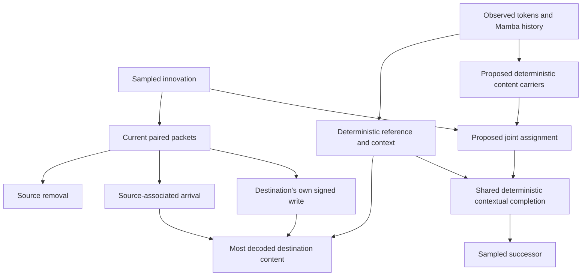

# What S5–S6 establish, and the next discriminating comparison

2026-10-15. Assessment only. No new architecture implemented or training launched.
The3k→6k continuation is held at the user's instruction. Original negative results,
thresholds and fresh-confirmation reservation remain unchanged.

## The measured mechanism

S5 and S6 localize how these trained implementations produce incompatible
endpoints. They do not prove that energy training, continuous states or
posterior-based innovations cannot learn coherent transitions.

On14 clean sources ×256 frozen-model noise draws, direct source-local noise
changes its own occupancy in29.69% of draws but neighboring destination flags
in at most0.06%. Destination-local noise changes that destination in9.51–16.02%
of draws; source flags change in0.28–0.39%. Shared noise has measurable common
effects, so the joint law is not literally independent. The measurement is
local-noise dominance with very weak useful endpoint coupling.

The paired editor couples routing coefficients, but its signed removal and
arrival decoders remain arbitrary contextual feature writes. Subtracting a vector
can add a mob-readout direction. A destination's nominal removal packet therefore
creates content without receiving it from the true source.

S6 decomposes the linear reader score at decoded valid-movement destinations,
using the final token's actual LayerNorm denominator:

| Contribution | Mean score |
|---|---:|
| Reference |0.009|
| Destination's own packet |**0.413**|
| True source's arrival |**0.070**|
| Other arrivals |−0.002|
| Sum, excluding reader bias |0.490|

These are additive reader-score contributions, not fractions of physical content,
variance or causal effect. Removal of a component can also change normalization.
The independent noise intervention corroborates the path: destination noise flips
its flag about10–15%, while source noise flips destination flags1.56–3.26%.
The source route's argmax matches decoded movement24.13% of the time. This is
poor observed alignment, not a mutual-information bound or proof that routes
contain no directional information.

Evidence: `audit_s6_paired.py`, `paired_event/audit_attrib.json`,
`direct_generator/audit_noise_{energy,direct_replicate,paired}.json`, and S5–S6
in NOTEBOOK. Independent CPU recomputation of saved occupancy outputs reproduced
the S6 milestone and endpoint values. No new optimizer steps were taken.

## Corrections to the strongest audit interpretations

1. **Movement also improved.** From1,500→3,000, paired valid movements rose
   52→113/896 (+6.81pp [2.46,11.16]); duplication fell162→85 and absence rose
   27→93. The extra61 movements include36 skeleton,17 cow and8 zombie draws.
   Dependence changed11.21→10.27pp, with interval[−5.65,+3.51] for that change.
   There is no resolved late coordination improvement, but the results do not
   show only disappearance or prove convergence. Cow movement remains far below
   the real41.02% frequency.
2. **The energy objective notices joint incoherence.** Independently permuting
   five endpoint tokens across real futures preserves each token's marginal
   exactly but lowers validity100%→52.59%. The actual continuous-token objective
   rises0.036499→0.038769, penalty0.002270 [0.001341,0.003205]. This is6.22% of
   the coherent score, consistent in scale with S5's5.6% on its different panel.
   It is insufficient evidence that finite-budget gradients effectively teach
   coordination; it rules out the literal claim that the objective applies no
   penalty. The comparison includes full contextual features and uses a finite
   ensemble, not an exact population calculation.
3. **Training variance remains unmeasured.** The two direct executions share
   initialization and data/noise ledgers and diverge numerically. They are not
   independent training seeds. Paired validity gains3.8/5.9pp exceed the observed
   two-direct spread2.12pp, so describing all gains as within that spread is too
   categorical. Root-bootstrap intervals still do not cover training variance.
4. **Optimizer matching was incomplete.** CPU inspection of the full saved3k
   optimizer and fresh initialization gives direct163 decayed tensors versus
   paired149 decayed +18 exempt tensors. Deepcopy loses upstream Mamba parameter
   attributes. The18 tensors contain72 scalars (`dt_bias`, `A_log`, `D`). Other
   settings agree: weight decay0.01, final LR1e−4, betas(0.9,0.999), eps1e−8.
   Its outcome effect has not been isolated. It does not invalidate frozen
   within-model noise/packet interventions. Future comparisons must match shared
   parameter groups explicitly. Do not change the historical checkpoint.

Evidence: `diagnostics/curve_reassessment{,_raw,_shuffle}.json`,
`objective_sensitivity{,_contract,_scale}.json`, `optimizer_group_audit.json`.

The entering fault is separate. Its164 small-reference cells put97.85% average
copy weight on zero padding. Final normalization amplifies their variation329×.
They are excluded from the35-token objective; saved-output gradients there are
exactly zero. The numerical output fault cannot explain interior teacher-forced
learning through those final outputs, though unscored intermediate packets have
other paths into scored outputs. Low deterministic scale is not itself proof of
correct terrain prediction. Keep output-support repair separate from a structural
comparison.

## The learning principle supported by this evidence

Sample a change to retained state, then compute its compatible effects together.
The evidence specifically favors testing content-dependent application of an event
over another shared-noise/free-write arrangement. It does not prove explicit
provenance is necessary: a sufficiently expressive joint generator could learn
the same law.

There are two independent choices: how an innovation is discovered or sampled,
and how its effects are applied. S4's global attention pool diluted local future
differences: a flat classifier memorized26/26 control outcomes while mean pooling
managed5/26 at500 updates. That supports a spatial-access diagnosis of that
implementation. It leaves local continuous posterior/prior methods available.

| Mechanism | Relevant evidence | Remaining obligation here |
|---|---|---|
| Correspondence/transport | [ITC](https://arxiv.org/html/2605.16457v3) limits reuse of a source and resolves destination competition | Its copied discrete visual tokens differ from contextual JEPA features; soft routing alone can split content |
| Structured transition operator | [Finn et al.](https://arxiv.org/html/1605.07157v2) transform retained appearance and compose it with background; [LPWM](https://arxiv.org/html/2603.04553v1) applies per-particle latent actions | Learn content/background separation and compatible effects; LPWM uses reconstruction and inverse/prior inference |
| Joint stochastic generation | [JEDI](https://arxiv.org/html/2605.13013v1) learns predictive representations with conditional denoising | Joint expressiveness does not force provenance; measure physical validity, selective variation and actual6GB cost |

ITC's token correspondence is a close precedent, rather than evidence of novelty
for transport alone. JEDI's joint-latent ablation also keeps representation learning
as a serious alternative if a controlled operator cannot express real changes.

## One proposed two-arm test

**Question:** does limiting stochastic completion to joint reassignment of retained
content improve coherent movement compared with free stochastic content synthesis?

Both arms use the same frozen encoder, Mamba backbone, deterministic reference,
TRAIN observations, data/noise schedule, energy objective and fixed budget. Both
receive the same new deterministic carrier extractor and contextual renderer;
compare the arms after training, with the old generators retained as historical
references. Adding the renderer only to treatment would confound attribution.

For current token/content carrier `c_i = C(z_i,h_i)`, use the common completion:

\[
\hat z_j=\operatorname{LN}\{b_j+D(h_j,c'_j)-D(h_j,c_j)\}.
\]

- **Free arm:** the stochastic network synthesizes `c'_j`.
- **Operator arm:** noise determines a joint correspondence `T`, and
  `c'_j = sum_i T_ji c_i`. Source-use and destination competition are coupled.
  No endpoint has a separate stochastic content writer. Keep the same continuous
  operator in training and evaluation; do not substitute inference-only argmax.

Transport learned content coordinates; let `D` compute destination-dependent
contextual features. Do not assume a complete JEPA token is a movable object or
that latent vector mass equals physical object count. Do not introduce an untested
low-rank carrier bottleneck. Identity correspondence returns the reference exactly.
Soft doubly-stochastic routing preserves carrier sums, not their multiset or
semantic object counts; soft splitting remains a testable failure.

This is a hypothesis about factorization, not a built-in physical guarantee.
`C` can retain terrain/context and `D` can infer content from redundant history,
using routing merely as a chance code. Consequently inspect the trained content
path: hold routing and recipient context fixed, substitute the source carrier,
and test destination semantic changes; intervene on one assignment and test
compatible source/destination changes. Recipient noise with assignment fixed
must have exactly no independent output path. Interpret carrier interventions
alongside real reader controls because substituted carriers may be out of support.

**Adequacy before optimization:** the existing paired reference is valid STAY on
all8 cow roots under both readers (full14 jointly valid10/14). That supports this
narrow test; continue reporting reference drift. A small observation-only fitting
check must show the new common renderer/operator can express recorded endpoint
changes with a supplied case/assignment index. This uses observed targets, not
simulator labels, and validates the restrictive parameterization rather than
testing innovation discovery. A failure there stops this proposal before a
stochastic-training negative could be misread.

A closed transport mechanism does not generally cover births/deaths or entering
terrain. Quantify unsupported examples in the common training data; do not add
an unrestricted stochastic creation path that reopens S6's bypass. If unsupported
examples are appreciable, define and disclose an observation-derived feasibility
subset common to both arms before launch. This proposal remains a retained-content
movement test and cannot establish the full conditional world law.

**Decisive reading:** retain original physical validity, valid movement, joint
outcome distributions, reader agreement and static-content criteria, together
with the original reserved fresh confirmation. Success must improve compatible
movement under both readers while preserving alternatives. Always-stay, fewer
duplicates paid for by disappearance, sharper routes, carrier bookkeeping or a
lower energy score alone fail. If expressibility passes but this comparison is
negative, return to joint generation/representation or the objective; do not
automatically extend this decoder campaign.

Record parameters, training/sampling time and peak memory; require measured6GB
fit. This study does not establish sparse compute, nuisance invariance, long
memory, epistemic persistence, coherent recursion or imagination-trained control.
Novelty would require evidence that learned event application preserves continuous
contextual state efficiently and improves recursive decisions; this one-step
mechanism check alone would not support that claim.
