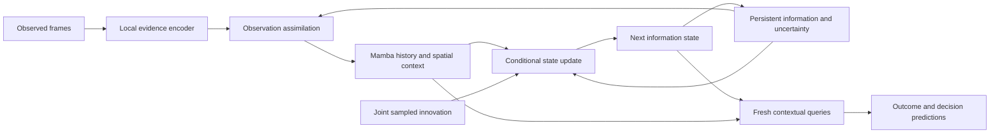

# Architecture research after R38

2026-10-15. Research assessment, not an implementation or preregistration.
Read against WHITEBOARD sections8–14 and NOTEBOOK R1–R38 at commit8019a6e1.
Neither document was edited. No training or GPU computation was launched.
Four independent subagents covered empirical constraints, representation learning,
stochastic dynamics, and an adversarial architecture/novelty review. This document
combines their findings with direct source inspection and primary-literature review.

## Main judgment

The next architecture should learn a state that can preserve information while
updating its contextual interpretation. The current frozen Raw observation chart
should cease to be the object that imagination must reproduce and copy forever.
It can remain useful observation evidence and a historical diagnostic reference.

The most promising scaffold is an evolving predictive information state, with a
Mamba temporal carry, spatially accessible continuous evidence, and joint sampled
updates. The research lever is how that state learns selective, compatible updates.
This does not require named entities, discrete tile classes, a categorical codebook,
or a handcrafted Craftax transition function.

An ordinary reconstruction-free RSSM with Mamba is an essential reference, rather
than a novel method. A stronger alternative is a jointly learned generative JEPA;
it should remain available if explicit selective updating contributes little.

## What changed empirically

| Latest result | Measured scope | Consequence for architecture |
|---|---|---|
| IC/PI achieve100% valid one-step source outcomes; PI cow movement34% vs41% real | Two seeds,14 strict exploratory sources, frozen readers | Compact learned chance and coherent application are feasible; replacing the posterior is no longer the central question |
| PI raises depth16 persistent-mob score0.37→0.71–0.73; cow-adjacency AUC0.79→0.88–0.89 | Two seeds; copy-shortcut guards included | Identity persistence is useful, provided the world still changes |
| Stale reconstruction lowers chase0.40→0.27 and0.45→0.25; map-change error1.63→2.54 and1.56→2.46 | R34 paired training-window substitution,14-step reconstructed context,4+ scrolls | Retained information and the representation consumed by the next prediction need compatible evolution |
| Additive position correction has negligible downstream effect; stale augmentation fails at both seeds | One additive estimator;1k-update continuation | Those repairs failed; nonlinear equivariant representations and learned belief updates remain open |
| Canvas reduces revisited-terrain error14%→0.1%, but phantoms rise0.028→0.094 at seed1 | Evaluation-only addressed cache | Addressing works; hidden content needs learned evolution/uncertainty rather than unconditional replay |
| Sampling only at never-seen entering sites restores cow arrivals0.002–0.023→0.106–0.144/frame | Bright recursion; real0.259/frame; two seeds | Where a conditional sampler is applied matters; this is not yet learned universal uncertainty separation |

R34 uses inferred scroll/correspondence/edit decisions, not exact simulator
transformations. It is strong evidence of input-age sensitivity conditional on
that construction, rather than an exact intervention on representation alone.
Its no-camera-scroll subset still includes local mob swaps, so it does not isolate
rendering from all source-position effects. R35's fresh-input health-change gate
AUC0.97–0.98 is a useful positive control; it does not isolate cooldown memory
from present configuration or establish accurate health magnitude.

R15 rejects previous-delta and linear-extrapolation rendering predictors. It does
not establish information-theoretic unpredictability from arbitrary history.
R36 rejects a mean slot-offset correction; that estimator also mixes position
with differences in which content occurs in each slot.

These qualifications change the architectural necessity claim, not the observed
performance deficits. The requirement is transition/readout compatibility.
An entirely context-free representation is one possible sufficient construction.
It is not necessary: for an invertible contextual chart z=E_c(s), a correct
transition can implement E_c'(F(E_c^-1(z),a,u)). Copying z fails even though such
a contextual state can preserve everything.

## Three architecture families worth exploring

### 1. Learn an update-compatible spatial state and recompute context

Use a modest local encoder with fresh coordinates supplied to the spatial/Mamba
reasoning layers. Retain continuous information carriers, rather than frozen
contextual readouts. Correspondence and sampled changes operate on the learned
state; query-dependent layers compute current relations, action effects and value.

Translation equivariance can be imposed by a convolutional/local encoder without
absolute positions, away from boundaries. More general view transformations can
use a learned contextual operator U_g, with identity/composition consistency.
The desired relation is E(g o) approximately U_g E(o), rather than copying every
coordinate unchanged. This preserves position information in explicit addresses
and the belief instead of demanding positional invariance of the whole agent.

This family most directly targets the new measurements. Its main risks are
occlusion/background mixing and non-identifiability of the learned factorization.
Removing absolute positional embeddings does not remove rendering or separate
an occluder from what lies behind it. That hidden information belongs in memory
or uncertainty, rather than in an assumed universally transportable patch.

[SIE](https://proceedings.mlr.press/v202/garrido23b.html) provides a learned
transformation-conditioned predictor precedent. [seq-JEPA](https://arxiv.org/html/2505.03176v2)
separates per-view equivariant features from sequential aggregation. Both rely on
known transformations/correspondences; neither establishes our full stochastic
control decomposition. Their practical lesson is to design what changes with
view separately from what must remain available.

### 2. Advance a learned belief, rather than regenerating observation tokens

Separate observation assimilation from imagined state evolution. Real frames are
evidence for the state. During imagination, actions and innovations advance that
state directly; visual feature predictions become supervision or transient queries.
Mamba's carry is retained instead of reconstructing a15-frame prefix every step.

This avoids making an observation encoder's coordinate chart the deployment
contract of the recurrent dynamics. The state may remain contextual and change
in every coordinate if its predictions remain compatible.

This scaffold already exists in relevant baselines:

- [R2-Dreamer](https://arxiv.org/html/2603.18202v2): separate observation/prior
  steps; Barlow-style feature alignment replaces the image decoder.
- [Drama](https://arxiv.org/abs/2410.08893): Mamba/Mamba2 recurrent latent imagination
  with cached state; its representation uses reconstruction.
- [NE-Dreamer](https://arxiv.org/abs/2603.02765) and
  [Dreamer-CDP](https://arxiv.org/html/2603.07083v2): predictive latent objectives
  supplement recurrent stochastic models. CDP retains its categorical stochastic
  state and KL, despite the deterministic prediction in its title.

Direct code checks:
`third_party/sources/NM512__r2dreamer/rssm.py:158–228`,
`NM512__r2dreamer/dreamer.py:383–432`,
`realwenlongwang__Drama/sub_models/world_models.py:553–612`, and
`fmi-basel__Dreamer-CDP/dreamerv3/rssm.py:84–146`.

This is a strong general reference, but not a discovery by itself. A dense latent
refresh can still forget information, consume unnecessary stochastic capacity, or
drop a rare prerequisite. The state-learning/update mechanism must earn its value.

### 3. Jointly generate predictive latent futures

Train representation and a conditional stochastic generator together, optionally
over short trajectories rather than independent next-frame targets. This allows
joint outcomes without prescribing swaps or object structure.

[JEDI](https://arxiv.org/html/2605.13013v1) is the strongest direct reconstruction-free
precedent: denoising and outcome heads train predictive latents jointly. Its
representation ablation supports reconsidering permanently frozen targets.
[Flow-JEPA](https://arxiv.org/html/2608.29029v1) predicts a future latent sequence;
its goal-planning evidence is largely near-deterministic and does not establish
compact consequential innovations or long-memory control.

This is the serious alternative to selective operators. A diffusion/flow model
need not generate pixels, and its costs should be measured rather than dismissed.
However, joint expressiveness does not guarantee physical coherence, nuisance
removal, persistent hidden facts, or selective stochastic computation.

## Recommended research direction

Use family2 as the general recurrent scaffold, with family1's representational
discipline. Investigate selective continuous state updates as the specific
mechanism. Keep family3 as the generative comparison. These are design dimensions,
not commitments to three independent architecture campaigns.

Addresses can be learned correspondences or spatial coordinates; payloads are
continuous features. No named mobs, hand-coded counters or terrain/mob expiry
rules are required. Camera transforms must be learned rather than wired to the
meaning of Craftax's four movement actions. Exact identity is an available state
update, not the default interpretation of all off-screen content.

There are three different things to preserve:
1. Information already established by observation.
2. Temporal evidence needed to predict future changes.
3. Correlated uncertainty about hidden information.

A point-valued feature cache alone is not a belief. Starting mid-episode can leave
multiple timer phases possible; an off-screen feature can change while unseen.
An information state must represent these hypotheses or a sufficient distribution
over their consequences. A sampled hypothesis persists within its branch until
evidence or dynamics revise it; persistence must not prevent Bayesian correction.

## What the learning rule must do

An architecture makes useful operations possible. It does not identify which
operations are correct from arbitrary passive data.

The most defensible ingredients are:
- dense local predictive evidence plus observed consequence supervision, protecting
  rare distinctions beyond rank/non-collapse;
- conditional transition learning on realized innovations, or proper distribution
  matching, instead of unconditioned point regression on stochastic futures;
- explicit temporal and view compatibility, with carefully justified pairs;
- a conditional information/update cost encouraging compactness only after
  predictive fidelity, with sufficient history available.

An imagined update and an observed update should support compatible *future
predictions* under the same realized transition. They need not reproduce the same
stale Raw vector. If a posterior supplies the realized innovation, compare the
corresponding branch. If noise is sampled independently of the recorded future,
point alignment recreates the conditional-mean failure.

The conditional information cost KL(q(u|history,actual transition)||p(u|history))
is useful but insufficient: it can discard rare consequences, encode nuisance
if the target demands it, or spend bits on history the recurrent state forgot.
It is not automatically an observation likelihood/ELBO without a specified model.

The particularly relevant new paper is
[Mikulasch & Zenke,2026](https://arxiv.org/html/2609.37789v1). It separates predictive
information retention from latent distribution matching and proves signal recovery
under observation-private nuisance, exponential-family conditionals, conditioning
variation and exact optimization. It also explicitly permits nuisance leakage
when latent capacity exceeds the signal. Borrow the learning principle; its
Gaussian experiments and assumptions do not solve our multimodal, partially
observed problem automatically.

[SplitJEPA](https://arxiv.org/html/2610.12349v1) is another relevant new result,
but its invariant blocks depend on supplied same-state/matched pairs, Gaussian
dynamics and normalization/variation assumptions. Our adjacent frames are not
automatically nuisance-only pairs. Likewise, temporal positives selected by our
own posterior can erase the very changes it misses.

Treat invariances according to role: appearance-only nuisance can be discarded;
view/position changes require compatible equivariance; state changes require
sensitivity. Even lighting should not be erased indiscriminately if its appearance
also reveals a phase affecting future dynamics. The rendering style and that
predictive phase are different information roles.

## Prior art changes the novelty boundary

[Variational Sparse Gating,NeurIPS2022](https://arxiv.org/abs/2210.11698) already
learns binary latent update gates, exact carry for inactive dimensions, sparse
gate regularization and imagination actors under partial observability. It uses
reconstruction. Thus exact latent persistence or sparse updates alone cannot
be our novelty claim.

[Scope-WM](https://arxiv.org/html/2609.33218v1) already combines selective expensive
prediction with cheap contextual background updates. Its Push-T ablation drops
88%→56% success when background refresh becomes copying. This independently
supports the retention/context distinction. Its selector distills gradients of
a dense teacher's latent MSE, which could repeat our nuisance/allocation problem.
Its6.97× speedup also includes planning-budget changes, not only sparse dynamics.

[LpWM](https://arxiv.org/html/2608.22764v1) learns sparse reconstruction-free
representations, but explicitly finds that sparsity alone can make support track
motion rather than meaningful interaction regimes. Sparse activation, sparse
updates and sparse consequential innovations are separate properties.

Static-memory systems offer useful structure with stronger assumptions:
[PERSIST](https://arxiv.org/html/2603.03482v2) separates persistent3D state from
camera/rendering but uses geometric labels and VAEs;
[Mirage](https://arxiv.org/html/2606.09828v1) retrieves latent memory as conditioning
for a fresh generated view and filters dynamic content with external models.
Neither supplies observation-only, reconstruction-free dynamic memory.

The possible contribution is a learned update rule selecting and applying
consequential innovations to a continuous predictive memory, with compatible
contextual interpretation and demonstrated decision/computation benefits. That
claim is still unestablished. A collection of these modules is not sufficient.

## An overlooked control boundary

A sampled hidden world and the agent's information are different objects.
Do not expose a branch's invented hidden terrain/timer as known information to
the policy before observations could reveal it. If the state is a predictive
belief over observations, maintain that interpretation. If hidden-world particles
are used, keep their private state separate from the policy's available history.
This can use shared networks; it does not require two independent world models.

Analytic example: a reward is behind one of two indistinguishable doors, uniformly.
A legal first choice has value max_a E[R(a,x)]=0.5. A policy allowed to see the
sampled hidden world has E[max_a R(a,x)]=1. Thompson sampling is legal if its
hypothesis is independent of the actual hidden state; falsely using that same
hypothesis as both policy information and simulator truth credits it with1.
This is a design risk, not an observed D4MJ actor bug.

[POMCP](https://proceedings.neurips.cc/paper_files/paper/2010/file/edfbe1afcf9246bb0d40eb4d8027d90f-Paper.pdf)
keeps the distinction explicit: sampled simulator states versus history-indexed
decision values. Decision rules at indistinguishable histories are shared;
candidate actions are evaluated over hidden-state uncertainty. Subsequent policies
can diverge after different observable evidence.

## The five whiteboard questions remain the design tests

| Question | Architectural response worth exploring | What remains unproven |
|---|---|---|
| Separate uncertainty roles without labels | Predictive state learning, history-conditioned innovations, compatible evidence updates | Unique causal factorization; correct nuisance removal and rare-fact retention |
| Learn chance at an appropriate granularity | Local/region/feature innovations with shared interaction context | Entities, categories and adjacent swaps are not necessary; general compactness is unmeasured |
| Retain fast, sparse-reward information without reconstruction | Local dense evidence and observed consequence gradients | Non-collapse does not prove retention of future prerequisites |
| Address memory during imagination | Persistent recurrent carry plus explicit learned memory read/write/query | Long-horizon pose/address uncertainty, hidden changes, correlated hypotheses |
| Gain decision value efficiently | Shared deterministic prefixes, selected updates, expectation-aware readouts/actor | Full actor result, complete6GB cost and genuine sparse-compute savings |

Compact noise does not imply cheap consequences. After outcomes alter camera,
health or pursuit, each branch's Mamba state can diverge. Shared computation is
exact only before divergence or under a validated incremental update.

Our own PI_ENTER currently computes4096 logits for all81 sites before selecting
sampled sites (`pi_canvas.py:133`). It also rebuilds the15-frame prefix each step.
Selective variation is demonstrated; selective compute is not. A64×64×192FP16
feature cache alone is1.5MiB per branch, but this excludes Mamba carries,
activations, optimizer, encoder and actor. No full-system6GB claim follows.

## Priority and stopping point for this research pass

Prioritize the state/interpretation interface over another chance-channel repair.
The most informative architectural distinction is a learned update-compatible
local state versus ordinary contextual evidence, on the same evolving-belief
scaffold. Preserve the successful chance mechanism initially as an experimental
tool; neither a categorical implementation nor exact swaps are the final method.

Before a whole new system, the relevant evidence is whether learned persistence
retains local facts *and* fresh pursuit/consequence predictions as information
ages. Identity-only stability, improved rank or one-step token loss cannot settle
that question. If explicit selective state updates add little beyond a small
reconstruction-free Mamba baseline, accept that result and compare joint stochastic
representation learning rather than extending another decoder repair campaign.

No run is queued by this document. Open questions are stated as research risks,
not converted into a new publication-scale gate suite.
