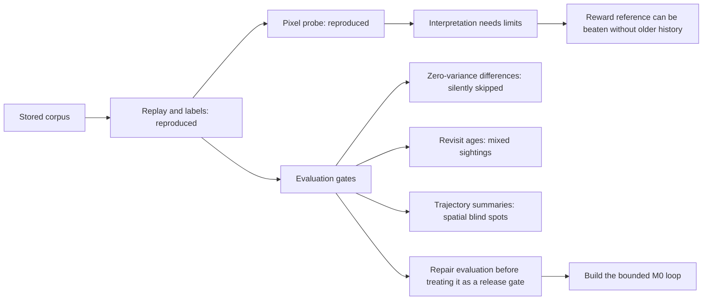

# Independent review of saccade at 4c615dc4



**Assessment.** The package move is clean and the reported reproduction is accurate. The harness is small and useful. It is not yet a sufficiently reliable gate for the claims attached to it: there are two concrete numerical/measurement defects, a train/test grouping defect for the planned paired use, and several conclusions stronger than the evidence. None requires an architecture redesign or an elaborate evaluation framework. Preserve the measured results, fix the small contracts, and proceed with the minimal M0 build. S0 has not demonstrated that the proposed world model learns entities, memory, coherent imagination, or useful decisions; that code does not exist yet.

**Scope and verification.** I inspected all six evaluation modules and the living design documents, re-extracted both label archives, reran every S0 step, independently checked stored pixels against replay, and ran the targeted experiments declared in [PROTOCOL.md](PROTOCOL.md). Original package code, design documents, saved S0 results, replay.py and the legacy packages were left unchanged. Existing unrelated work was preserved. No final-split evaluation or new world-model/actor training was performed.

| Reproduction | Independent result |
|---|---|
| Dev labels | 1,009 episodes, 304,898 transitions; all 32 arrays identical |
| Train labels | First 400 episodes, 128,564 transitions; all 32 arrays identical |
| Gates, revisits, oracle, pixel probe | All JSON values identical |
| Calibration | Maximum absolute difference 1.1276e-17 |
| Replay against stored pixels | 12 dev episodes, spanning all four epsilon groups and short/median/long episodes; 5 frames each; maximum pixel difference 0 |
| GPU probe | Both original seeds; 254.85 seconds on RTX 3060 Laptop; peak allocated 1.67 GiB, reserved 2.05 GiB |

The full oracle reproduction used 2,236 windows and 16 simulator samples per window, as originally specified. CPU reproduction took approximately 9.6 minutes across its commands; it overlapped GPU work. [verification.json](verification.json) records array/JSON comparisons, source and manifest SHA256s, dependency versions and the reviewed commit. [cpu_reproduction.json](cpu_reproduction.json) and [gpu_reproduction.json](gpu_reproduction.json) record execution outcomes and resource use.

**1. High priority: deterministic disagreements silently pass the numerical gates.**

Source: [gates.py:313](/home/antithetical/EPITA/PERSO/DynamicHorizons-Mamba-JEPA/saccade/eval/gates.py:313), especially the `se > 0` guard at line 318.

I took the real odd dev half and reversed LEFT/RIGHT and UP/DOWN while preserving its outcomes. This makes every moved movement-action transition have the wrong direction. The even reference has direction agreement 1.0 over 55,968 exposures; the corrupted half has agreement 0.0 over 51,686 exposures. Both bootstrap standard errors are zero. All 43 numerical gates reject nothing because the guard skips precisely that case. This is an actual failure on real data, not just a hypothetical floating-point corner case.

This experiment does not establish that the separate classifier would accept the corruption; that classifier was not fitted for this case. The failure is in the numerical decision rule that is meant to guard self-motion.

Small repair: handle a nonzero difference with zero estimated uncertainty explicitly, with a declared numerical tolerance. Keep no-exposure cases distinct from passing cases. Add this reversal as a regression case, and rerun the existing real-half and corruption checks. There is no need for a new statistical framework. Evidence: [structural_checks.json](structural_checks.json).

**2. High priority before paired S1 evaluation: the classifier split can put the same physical episode in train and test.**

Source: [gates.py:181](/home/antithetical/EPITA/PERSO/DynamicHorizons-Mamba-JEPA/saccade/eval/gates.py:181), especially the artificial `+ 10**6` episode offset.

The function gives real and generated versions of an episode different grouping identifiers, then splits those identifiers independently. Reproducing the split on matched versions of 128 physical episodes places 59 physical episodes in both training and test, across the two domains. This breaks the intended episode separation for TEST_SPEC's future matched-history classifier test.

The current S0 real-half comparison uses disjoint even and odd episodes, so this does not invalidate its reported 0.495 accuracy. The defect appears when the helper is reused as specified for paired real/generated data.

Small repair: carry the original physical episode identifier through both classes, split it once, and place both versions on the same side. Preserve a separate domain label only for classification. Evidence: [structural_checks.json](structural_checks.json).

**3. The reward ladder does not establish memory; a bounded experiment directly refutes that reading.**

Sources: [calib.py:33](/home/antithetical/EPITA/PERSO/DynamicHorizons-Mamba-JEPA/saccade/eval/calib.py:33), [RESULTS.md:122](/home/antithetical/EPITA/PERSO/DynamicHorizons-Mamba-JEPA/artifacts/experiments/20261027_s0_harness/RESULTS.md:122).

The statement “below R2 means the belief carries unlock memory” is false. R2 is an achieved LightGBM result using a selected frame-pair feature set; it is neither a Bayes limit nor the full set of information in the model's percepts.

| Memory-free learner | Dev NLL | Reading |
|---|---:|---|
| Published R2, reproduced: 31 leaves | 0.02434158 | Reference |
| Same exact inputs, 127 leaves | 0.02556591 | Worse; the predeclared capacity experiment was negative |
| R2 plus visible entity/terrain counts from the same frame pair, 31 leaves | 0.02107462 | Better without older history or achievement flags |

The last arm uses the same training/held-out/dev episode split, learner settings and early-stopping rule, adding only counts across the two existing frames. Terrain counts exclude entity-covered cells and the player cell. Paired episode-bootstrap NLL difference to R2 is -0.00326697, with 95% interval [-0.00366050, -0.00287843] across 1,009 dev episodes. That is a 13.4% improvement without an episodic memory input. These are simulator-derived diagnostic features, not evidence that a neural encoder acquires them from noisy pixels.

The first capacity experiment and the separate, explicitly declared visible-context follow-up are both retained. This is not a search over an open-ended collection of models. See [memory_free_capacity.json](memory_free_capacity.json), [memory_free_visible_context.json](memory_free_visible_context.json) and [audit.py](audit.py).

Small repair: report R2/R3 as finite-learner references and the value of adding achievement flags to that learner. Use the already planned matched current/window/belief controls and direct achievement probes to establish memory. Also label R2's information budget accurately: it uses exact simulator quantities, including neighbouring terrain even under entity occupancy, whereas the pixel probe masks such terrain.

Before comparing a learned logistic reward head to this ladder, define the same outcome bins for both. `calib.py` currently assigns mass to reward values rounded to tenths; LOSSES specifies uniform bins in symlog space. Point mass in one scheme and mass over a different-width bin in another are not comparable NLLs. The helper accepts probabilities but does not yet implement the adapter from the proposed head. Integrate the head's density over declared common bins; do not compare a density value directly to a categorical probability.

**4. Revisit timestamps and compared values can come from different sightings.**

Source: [gates.py:229](/home/antithetical/EPITA/PERSO/DynamicHorizons-Mamba-JEPA/saccade/eval/gates.py:229).

`last_t` advances even when an entity covers a cell; `last_v` advances only when the terrain is clear. On re-entry the code compares an older clear terrain value but reports the age of the more recent occluded sighting. This differs from the documented “entity-covered cells excluded both times” comparison.

In the real dev data, 6,970 of 484,782 included revisit comparisons (1.44%) have this mismatch; 544 would move gap strata if aged from the value's actual sighting. The extra age is usually small, but reaches 1,687 steps. A minimal four-frame example also reproduces it. Evidence: [revisit_age.json](revisit_age.json), [structural_checks.json](structural_checks.json).

Small repair: either store the timestamp alongside the last clear value and report a last-clear gap, or exclude a revisit whose last in-view sighting was occluded. State which question the metric answers, then recompute the reference and forgetting power check.

The “only changes are the player's own edits” statement also needs narrowing. The installed Craftax 1.6.1 source [game_logic.py:1335](/home/antithetical/EPITA/PERSO/DynamicHorizons-Mamba-JEPA/.venv/lib/python3.12/site-packages/craftax/craftax_classic/game_logic.py:1335) matures plants after 600 steps and changes their map block. Most terrain is static; legitimate changes should remain in the real reference rather than being called memory failures.

**5. The trajectory score measures its summary, not full spatial coherence.**

Sources: [gates.py:248](/home/antithetical/EPITA/PERSO/DynamicHorizons-Mamba-JEPA/saccade/eval/gates.py:248), [gates.py:276](/home/antithetical/EPITA/PERSO/DynamicHorizons-Mamba-JEPA/saccade/eval/gates.py:276).

The energy-score implementation has the correct distance and unbiased pairwise term. Flattening time jointly is useful. But each kind is reduced to count and mean row/column; persistence accepts any same-kind entity in an expanding square. Neither retains individual trajectories or the full spatial arrangement.

I constructed a stationary two-zombie trajectory and another that alternates both zombies diagonally, which is impossible under Craftax's cardinal movement. Counts and centroids stay identical. The summary vectors are exactly equal, energy score is zero against the clean path, persistence is identical, and every one-step event array is identical. The classifier and additional spatial probes are outside this counterexample; I am not claiming every possible evaluator is blind.

This is information discarded before scoring, not merely a low-powered estimate of correlation. A proper score on a summary cannot distinguish futures mapped to the same summary. Small repair: keep the cheap score, name its scope accurately, add the balanced spatial counterexample, and include a spatial diagnostic that can reject it. Avoid building a full Craftax rules engine. Specify the actual differentiable, label-free summary used for P2 training separately from these simulator-derived evaluation summaries; the training map is not currently defined precisely enough to audit.

**6. The operational multi-step power claim is incomplete.**

Sources: [oracle.py:194](/home/antithetical/EPITA/PERSO/DynamicHorizons-Mamba-JEPA/saccade/eval/oracle.py:194), [RESULTS.md:79](/home/antithetical/EPITA/PERSO/DynamicHorizons-Mamba-JEPA/artifacts/experiments/20261027_s0_harness/RESULTS.md:79).

For delayed consequences the oracle report has `es_rejects=true`, `persistence_rejects=false`, and `count_rejects=false`. The result is reproducible, but energy score is explicitly never an operational pass/fail gate. The remaining operational family, one-step conditional events applied to rollouts, is not run in this multi-step power check. Therefore “all six rejected” establishes detection by at least one reported diagnostic, not yet detection by the declared operational S2 gate set.

Small repair: apply the intended conditional-event gates to these same oracle/corrupted rollouts and record their power, including delayed outcomes. Do not manufacture an energy-score cutoff against the full-state oracle. It is possible those event gates already suffice; that is unmeasured here. Evidence: [s0_oracle.json](s0_oracle.json).

**7. Tighten the remaining interpretations and the current specification.**

- The pixel probe establishes achieved readability for this architecture and training recipe. Its night failures do not prove an irreducible single-frame information limit, despite [RESULTS.md:101](/home/antithetical/EPITA/PERSO/DynamicHorizons-Mamba-JEPA/artifacts/experiments/20261027_s0_harness/RESULTS.md:101). Keep the measured seed spread and per-ring results; remove the stronger inference.
- A common frozen reader makes comparisons consistent but does not make its errors cancel under generated-data shift. [RESULTS.md:133](/home/antithetical/EPITA/PERSO/DynamicHorizons-Mamba-JEPA/artifacts/experiments/20261027_s0_harness/RESULTS.md:133) overstates this. TEST_SPEC's newer language that generated-reader outputs are diagnostics is more accurate. A reader's real-data error does not bound its error on arbitrary generated tokens.
- DECISIONS still calls categorical chance codes agreed at line 61 and the separate energy-score observation stage agreed at lines 66–69, while line 88 approves v3 without either. PERCEPTION still contains the superseded stage without a clear supersession banner. RECORDS retains older world/code wording alongside its v3 update. Keep history, but give the implementer one short current M0 contract and mark the rest superseded. No new documentation hierarchy is needed.
- CURRICULUM line 23 describes the immediate carried state as at most one update old. Its recurrent ancestry was produced under earlier parameter versions too; TBPTT does not refresh the whole history. That is a normal approximation to measure, not a reason to add a state-rebuild subsystem now.
- CURRICULUM line 42 overclaims that reconstruction-based switching makes the recorded continuation a valid target. JEDI's Algorithm 1 does use a denoised version of the same recorded latent as later conditioning, with random switching; this is a sensible robustness precedent, not a theorem that lossy reconstructed conditioning preserves every future conditional distribution. Keep it as a heuristic and test it as such. Source checked: [JEDI, sections 3.2 and A.3](https://arxiv.org/html/2605.13013v1).
- Before a training run, resolve the listed stage budgets, two S3 blocker bounds, and the P2 summary/gradient contract. These are small experimental commitments; they do not require another architecture literature pass.

**Cleanliness and efficiency.** The six modules are approximately 900 lines and directly readable. The move avoids copying the shared replay utility, leaves the legacy packages separate, and preserves the old evidence. There is no reason to add registries, config inheritance, a general tracker framework or a new launcher. The GPU probe fits comfortably on this machine. The main engineering work is a handful of well-scoped correctness fixes and regression examples.

One reproduction caveat remains: the project venv did not contain LightGBM. I installed version 4.6.0 into `/tmp/saccade_review_deps` without changing the project environment. The package's local path shim removes new absolute paths, but the shared `artifacts/eda/replay.py` still embeds the checkout root, so the complete replay path is not portable yet. A short runtime/dependency note and one root-resolution correction at the shared boundary would suffice; no packaging overhaul is warranted. Label extraction also continues scanning remaining shards after `MAX_EPISODES` is reached; an early outer-loop exit is a straightforward optional efficiency fix.

**Recommended disposition.** Keep the migration. Fix zero-variance rejection and paired episode grouping before relying on S1 gates; correct revisit ownership/age before relying on S2 memory strata; repair the memory interpretation and shared reward-bin contract before claiming a reward-memory result. Close the operational rollout power check and add one balanced spatial corruption. Then build M0 under the bounded schedule with its actor budget reserved. Store, records, particles and additional architecture remain later diagnosed comparisons. The findings localize weaknesses in the evaluator and its claims; they do not show the proposed architecture has failed.

**Reproduction commands.** Run from the repository root with the existing `.venv`; LightGBM must be available. This review used `PYTHONPATH=/tmp/saccade_review_deps:.` and `OMP_NUM_THREADS=12` for the CPU commands. GPU probe execution requires a CUDA-visible host environment.

```text
.venv/bin/python artifacts/experiments/20261026_saccade_review/reproduce.py cpu
.venv/bin/python artifacts/experiments/20261026_saccade_review/reproduce.py gpu
.venv/bin/python artifacts/experiments/20261026_saccade_review/audit.py structural
.venv/bin/python artifacts/experiments/20261026_saccade_review/audit.py calibration
.venv/bin/python artifacts/experiments/20261026_saccade_review/audit.py calibration_context
.venv/bin/python artifacts/experiments/20261026_saccade_review/audit.py revisit_age
.venv/bin/python artifacts/experiments/20261026_saccade_review/verify.py
```

Calibration-context uncertainty is paired across episodes at one fixed learner seed. It measures this diagnostic feature intervention; it does not establish robustness across learner seeds or acquisition by the proposed neural world model. Reproduction and gate falsification are separate results throughout this review.
