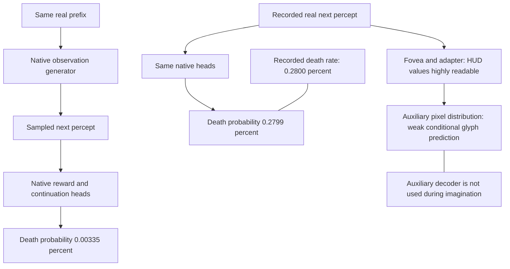
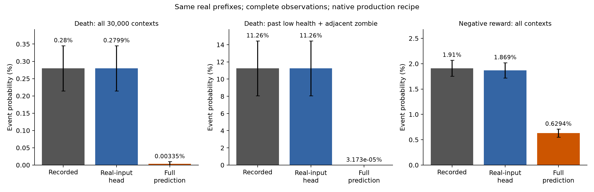
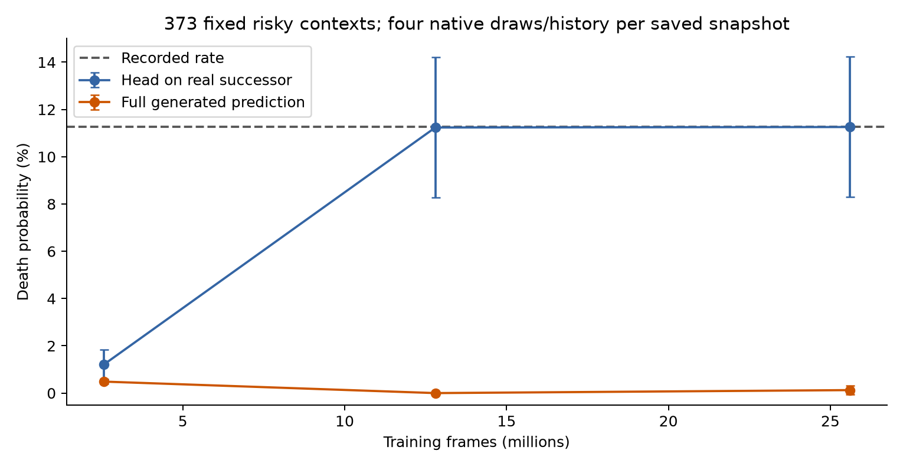
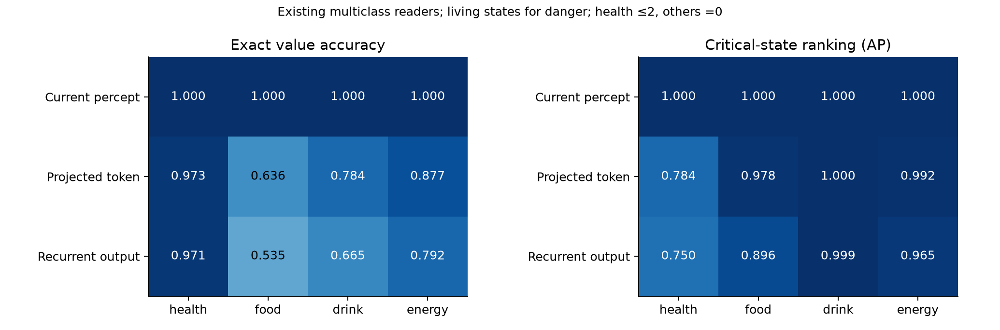
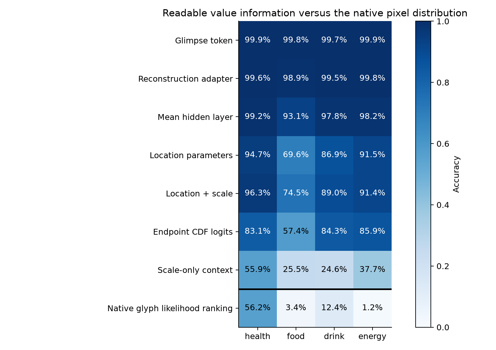
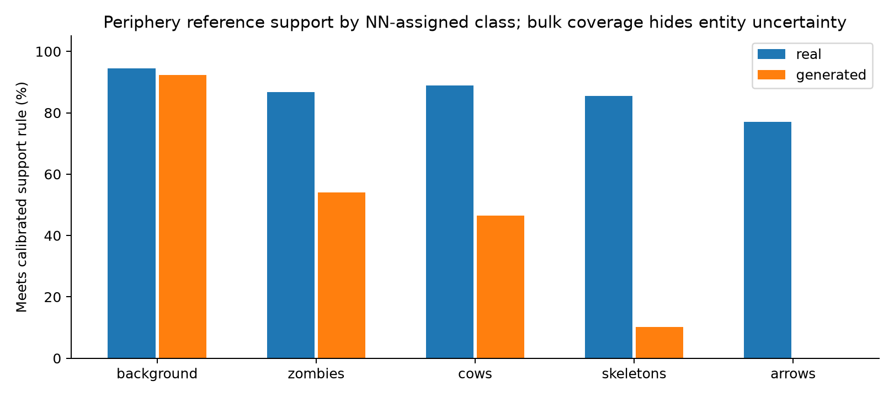
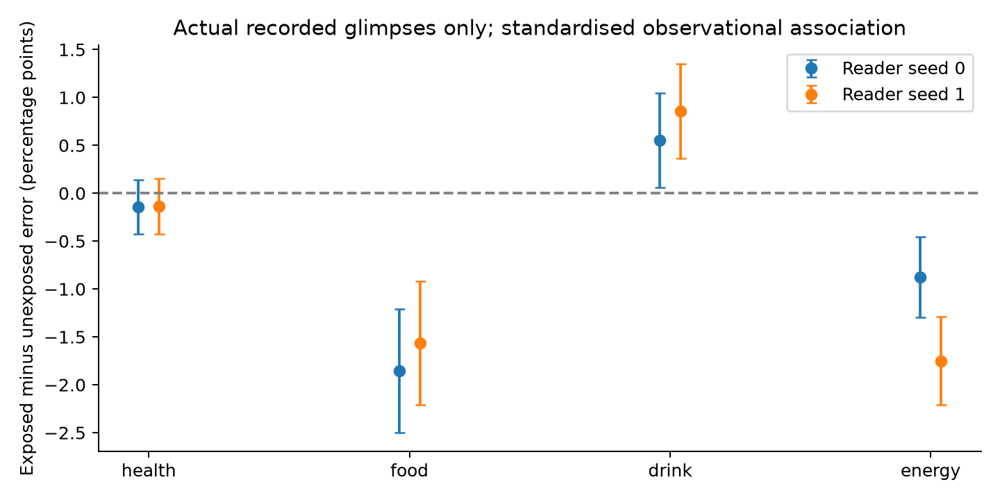

# Observational diagnosis: causes, relevance and limits

2026-10-28. Continuation of the frozen P1/S1 dissection. No model interventions or fixes.



**The clearest problem is now a native predictive-consequence error, not an interpretation of a latent probe.**
The model recognizes death when given the recorded successor, but its complete generation pipeline predicts much
too little death and negative reward. Several other worrying numbers need qualification: exact drink-level errors
coexist with excellent dehydration ranking; huge logistic scales have a mathematical endpoint explanation; bulk
reader agreement hides poor entity-specific support.

## What we tested

| Question | Measurement | What it can establish |
|---|---|---|
| Is a symptom a real predictive error? | Native sampled rewards/termination and probabilities versus matched recorded successors | One-step predictive calibration on the data distribution |
| Where does it appear? | Native heads on complete real and complete generated observations | A conditional-versus-prior-predictive gap; no swapped inputs |
| When did it appear? | Actual checkpoints 1,5,10, each with its own encoded history and unchanged sampler | A longitudinal phenotype, not an isolated training-choice cause |
| Are weak state scores important? | Critical-state AP and errors on living states, alongside exact-value scores | Accessible distinctions under finite readers, not actor value |
| Does the fovea lose the values? | Readouts along its actual adapter/decoder pathway and full glyph likelihood | Available information versus the native probability assignment |
| Is scale growth an arithmetic defect? | Independent float64 scores/derivatives, normalisation, endpoint-mass analysis | Numerical correctness at captured outputs and local mathematical incentives |
| Can entity readers be trusted on samples? | Real-calibrated reference distances and per-class support/agreement | Which readings are supported, ambiguous or unsupported |
| Do recorded glimpses help? | Actual random-fixation exposure associations, stratified by value/light/behavior | Observational associations, without alternate crops |
| Is history handling grossly incompatible? | Saved carries versus fresh replay of identical recorded histories | A limited mechanical train/evaluation compatibility check |

The [protocol](PROTOCOL.md) states the initial questions and result-triggered follow-ups before execution. Only
post-hoc readers were fitted. All world weights, inputs, fixations, sampler settings and losses remained unchanged.
Derivatives were inspected without applying updates. No P2, actor, new world seed or final-split evaluation occurred.

## 1. Native predictive consequences are severely biased toward safety



On the **same 30,000 real contexts** used by S1:

| Event | Recorded rate | Native head on recorded successor | Native head on generated successor |
|---|---:|---:|---:|
| Death | 0.2800% | 0.2799% | **0.00335%** |
| Negative reward, r < -0.05 | 1.9100% | 1.8690% | **0.6294%** |

There are **84 recorded deaths and one sampled generated death**. The summed native death probability on generated
percepts is about **1.005 expected deaths**, so the discrepancy is not just bad luck in the final Bernoulli draw.
The paired death-rate difference is -0.2767 percentage points, episode-bootstrap SE 0.0332 points. Negative-reward
samples are 183 versus 573 recorded; their predicted probability also shows the deficit.

The successor in each bundle is complete: the real percept is evaluated with the real reward, and the generated
percept with its already sampled reward. Nothing was substituted between bundles. The real-input head is recognizing
an already-realized consequence; its excellent calibration does not by itself demonstrate forecasting ability.

Contexts selected only by their **preceding real state** also expose the problem:

| Preceding context | Histories | Recorded deaths | Sampled generated deaths | Recorded negative-reward rate | Generated negative-reward rate |
|---|---:|---:|---:|---:|---:|
| Health 1–2 | 1,276 | 51 | 0 | 4.15% | 1.33% |
| Adjacent zombie | 2,336 | 74 | 0 | 17.94% | 4.32% |
| Health 1–2 and adjacent zombie | 373 | 42 | 0 | 11.26% | 3.49% |
| Random-behavior episodes | 3,733 | 24 | 0 | 3.00% | 0.72% |

Some context labels use simulator facts, which need not be perfectly recoverable from pixels. The overall marginal
discrepancy does not rely on conditioning on those facts. The random-behavior result also prevents explaining the
entire discrepancy solely through expert actions reacting to hidden state.

This is a genuine failure of the current **one-step predictive pipeline** on these data. It does not require an
entity probe, a decoded image, a long imagination horizon or an actor to reveal it. Its eventual actor harm remains
unmeasured, but accurate risk prediction is plainly relevant to an imagination model.

### What the health trace does and does not localize

On all 84 real fatal successors, the local periphery HUD reader and nearest-real-code reference identify health zero;
the native death head assigns mean death probability 99.944%. On generated successors, those two readers identify
health zero only three times in 30,000 samples, and the native head almost always predicts survival.

However, the HUD reference's strict support test fails even on real terminal examples, despite correct labels, and
rejects the generated HUD codes. It is therefore **not qualified to certify generated health semantics**. Missing
health-zero evidence under these readers is suggestive, not a proof that the generated world is alive. The safe
localization is a gap at the **generated-observation/consequence-head interface**, including the prior's distribution
and the heads' compatibility with it. The study does not isolate one of those as the unique cause.

### Fewer recognizable threats are not the whole observed pattern

Within the preceding-adjacent-zombie group, the successor reader sees an adjacent zombie in 81.21% of real observations
and 64.55% of generated ones. Conditional on that reader evidence, native negative-reward probability is **21.89% on
real observations versus 4.93% on generated observations**. Without that evidence it is 0.48% versus 3.04%.

Thus there is both a change in threat evidence and a change in how threat evidence co-occurs with consequences.
Generated reader labels have the support limitations below, and these are associations between jointly produced
variables. No causal share of the risk error is assigned to missing entities.

Evidence: [saved outcome rates](production_outcomes.json), [native probabilities and health trace](native_outcome_trace.json),
[joint observations](joint_observations.json). The native S1 sampler is unconditioned; these are not the later
actor's deliberately survival-conditioned branches.

## 2. The training trajectory separates observed-outcome learning from predictive risk



Each actual saved snapshot re-encoded the full real history with **its own** encoder/Mamba and used the unchanged
native sampler. The fixed panel includes 1,024 population contexts, all 373 preceding-low-health/adjacent-zombie
contexts and up to 512 preceding-food-zero contexts; selection never uses the successor outcome. There are four
independent native draws per history. The risky group's recorded death rate is 11.26% throughout.

| Checkpoint | Frames | Head on real successor: death probability | Full generated prediction |
|---|---:|---:|---:|
| 1 | 2.56M | 1.207% | 0.486% |
| 5 | 12.8M | 11.238% | 0.0000264% |
| 10 | 25.6M | 11.257% | 0.126% |

By checkpoint 5, recognizing real terminal observations works well in this cohort. The full prediction still misses
most risk. Checkpoint 10 occasionally produces dangerous successors in the repeated draws, but remains far below
the recorded rate. Its paired deficit is 11.13 percentage points, SE 1.52 points.

The trajectory is **not monotonic**. Checkpoint 1's marginal population death rate happens to be closer, but its
conditional recognition of real dangerous successors is poor; it is not established as a better world model.
No checkpoint was selected or replaced from these results.

The recorded held-out G1 monitor falls from 0.07030 to 0.02234 to 0.01908 at these snapshots. It therefore does not
certify prior-predictive consequence calibration. These are jointly learned, changing latent targets; the loss
history is not a fixed semantic score. Several components change together across snapshots, so this observation
does not identify a particular training choice as the cause.

Evidence: [panel](risk_timecourse_panel.json), [longitudinal results](risk_timecourse.json),
[recorded training diagnostics](recorded_training_diagnostics.json).

## 3. State errors need task-specific interpretation



Critical-state scores below sum the relevant class probabilities from the **existing multiclass readers**. Nothing
was refitted for these scores. Health means <=2 on living states; other fields mean zero. Current termination is an
input, so dead states are excluded from the living-health test.

| Frozen representation | Low health AP | Food-zero AP | Drink-zero AP | Energy-zero AP |
|---|---:|---:|---:|---:|
| Full current percept | 1.000 | 1.000 | 1.000 | 1.000 |
| Projected 256-D input | 0.784 | 0.978 | 1.000 | 0.992 |
| Corrected recurrent output | 0.750 | 0.896 | 0.9994 | 0.965 |
| Positive prevalence | 0.0416 | 0.0145 | 0.0799 | 0.00838 |

Exact drink-level accuracy of roughly 66% thus coexists with almost perfect dehydration ranking. Exact-value error
is not automatically absence of a useful distinction. Low-health ranking and food-zero ranking remain less readily
decoded after compression. The matched projected/recurrent inputs have the same dimension and reader capacity;
the full-percept reference has a wider input. None of these finite-reader scores is an information bound or actor
performance result.

Direct binary readers were also fitted. They independently get recurrent drink-zero AP about 0.9994 and food-zero AP
about 0.900. But their health positive control performs poorly even on the full percept (AP about 0.711), where the
existing multiclass reader recovers health essentially perfectly. **That negative binary-health result is not
evidence of missing information.** It is a measurement/optimization limitation.

The validation-95%-recall threshold sometimes transfers badly despite AP=1: near-saturated probabilities yield
thresholds at or near one. These threshold results are retained; they are not treated as loss of ranking information.
The existing readers' argmax outputs reproduced their saved predictions exactly.

### It does not look like a simple fixed time lag

The current prediction was compared with levels 0,1,2,4,8,16,32 and 64 steps in the past, using the **same** living,
depth>=64 cohort for every lag. Lag zero gives the lowest MAE for every field and representation in that comparison.
There is no evidence here that shifting the target by a fixed lag resolves the errors.

On natural health-decrease events, the recurrent reader is correct at the new value about 90.9% of the time and
matches the event's preceding value only 0.13%. Food errors are more complex: after decreases the mean signed error
is +0.64; after increases it is -1.21. This resembles under-response in the readouts, but is not a proof that the
recurrent state is an averaging filter. Event-aligned follow-up counts vary with available survival/episode length
and are explicitly reported, not filtered to successful futures.

Evidence: [danger readers](danger_readers.json), [existing-reader probabilities](multiclass_risk.json),
[state errors](natural_state_readouts.json), [temporal patterns](temporal_readouts.json).

## 4. Fovea values survive much farther than the displayed glyph suggests



Fresh common readers on frozen activations recover food at approximately:

| Actual stage | Exact food readout |
|---|---:|
| Glimpse token | 99.8% |
| Reconstruction adapter | 98.9% |
| Pixel-mean hidden layer | 93.1% |
| Location output parameters | 69.6% |
| Location and scale together | 74.5% |
| Endpoint CDF logits | 57.4% |
| Scale-only context control | 25.5% |

The native density's own likelihood ranking of valid food glyphs is **3.44% accurate**. For health/drink/energy it is
56.21%/12.37%/1.23%. Raw digit templates read the actual crops perfectly; they are exact within each observed body-value
class in the fit episodes. This verifies that the median-image problem is not rescued by good full-distribution digit
prediction. Health's likelihood usually picks 9; food usually picks 0 or 2; drink usually 0 or 6; energy 0 or 1.

All these values are highly readable early in the pathway. Some information remains even in the final pixel parameters,
but the native distribution assigns it poorly to physical glyphs. The raw renderer and upstream fovea do not explain
this particular failure as irreducible sensory ambiguity. Several later negative readouts remain finite-reader
limitations, not proofs of an irreversible information-loss boundary.

The legal-glyph probability on varying number-region coordinates is also tiny: median log mass is about -67 for
health, -52 for food, -68 for drink and -47 for energy. Conditioning on being a legal glyph can exaggerate certainty;
therefore both total mass and relative ranking were reported. This is an auxiliary pixel-distribution finding, not
an oracle for the latent generator's world state.

The decoder is used to ground representations during training; **it is not called in the imagination loop**.
Its poor images are a real auxiliary-output symptom. They do not establish that the actor cannot read the HUD from
its belief. The upstream readouts are strong positive evidence against that interpretation for perception itself.

The new activation readers use fit-derived standardisation and common padded capacity. Their stronger scores than
earlier readers reflect a different measurement instrument; the world did not improve during this analysis.

Evidence: [full density semantics](density_semantics.json), [exact templates](template_training.json),
[activation readouts and logs](activation_readout.json).

## 5. Large scales have an endpoint explanation; an arithmetic bug was not found here

Our decoder uses a single discretised logistic per RGB scalar. Values beyond the image interval are absorbed into
the 0 and 255 bins, as in the endpoint construction in the
[original PixelCNN++ implementation](https://raw.githubusercontent.com/openai/pixel-cnn/master/pixel_cnn_pp/nn.py).

For normalized location m and scale s, the endpoint probabilities are

```
P(0)   = sigmoid((-1 + 1/255 - m) / s)
P(255) = sigmoid((m - 1 + 1/255) / s)
```

When m and s grow together with m/s fixed, these approach sigmoid(-m/s) and sigmoid(m/s): **a black/white Bernoulli
distribution**, not a broad uniform distribution over grey values. The endpoint likelihood improves along that
common-growth direction. This mathematical incentive does not require an implementation error.

On value-varying binary food coordinates, median scale grows from about **246 to 3,555 RGB units** between snapshots
1 and 10; mean endpoint mass rises from **76.6% to 97.1%**. This is consistent with the endpoint mechanism.
It qualifies the earlier alarm about scale magnitude: the size of the underlying unbounded logistic scale is not
itself a bounded-image uncertainty or correctness measure. The semantic-density failures above remain separate.

An independent float64 calculation agrees closely with captured actual likelihoods and derivatives; no significant
scale-gradient sign disagreement was found on the tested interior targets. Summing all 256 probabilities at 2,048
actual captured parameter pairs gives maximum normalization error **8.30e-6** for the canonical code, **2.15e-14**
for the reference; maximum bin NLL difference is 0.000253. These checks do not support an arithmetic explanation of
the observed template behavior at the captured outputs.

### Gradients rule out some simple stories, without proving the training cause

The mean reconstruction gradient norm reaching the food glimpse token rises from **0.020 to 0.143** over snapshots
1 to 10. “The fovea received no reconstruction gradient” is not supported. The value-varying coordinates also carry
nonzero signal; the later lack of accurate glyph prediction is not explained by all of their gradients being zero.

On 1,024 unchanged natural frames, TSP and reconstruction gradients on the shared decoder have cosine **+0.670**.
They broadly align at this point, so a gross mutual-conflict explanation is not demonstrated. Body-value-varying
coordinates contribute about **2.02% of the summed pixel loss** and a gradient norm **2.00%** of the full decoder
gradient norm. Their gradient is nearly orthogonal to the rest (cosine -0.012), with projection share about 0.0156%.

These are **local, unpreconditioned gradient statistics**, not percentages of Adam's actual update or proof that a
different weighting would help. Group balancing does not ensure strong pressure on each small within-group target,
but this study does not causally attribute the failed glyph mapping to that fact.

Evidence: [scores/derivatives](likelihood_numerics.json), [normalisation](likelihood_normalisation.json),
[endpoint and gradient trajectory](scale_geometry.json), [shared-decoder derivative accounting](decoder_gradient_accounting.json).

## 6. Bulk agreement cannot validate rare entity readings



The independent real-reference test uses 300k natural-frequency fit cells, 100k physical-episode calibration cells
and 4,096 fixed production tuples. The inputs to the world are untouched; normalization is solely a distance metric.
The nearest-real labels and original neural reader agree on about 99.5% of generated cells **overall**, but that is
dominated by background. Agreement on cells either reader calls an entity is only **66.6–67.1%**, versus 88–90% on real
cells. The overall number must not be used as an entity-reader validation.

With periphery-only distances, fractions meeting the calibrated support/neighbor-consistency rule are:

| NN-assigned kind | Real | Generated |
|---|---:|---:|
| Background | 94.5% | 92.3% |
| Zombie | 86.8% | 54.1% |
| Cow | 88.8% | 46.5% |
| Skeleton | 85.5% | 10.1% |
| Arrow | 77.1% | 0.0% |

Adding lighting gives similar qualitative difficulties; only 7.1% of generated NN-arrow labels pass. Nearest-reference
counts still show fewer zombie/cow codes than real observations, so their deficits are not unique to one neural
reader. But the unsupported entity-like codes prevent precise physical count claims. In particular, “phantom arrows”
is not established simply by classifying all these samples as arrows.

This is a relevant distribution/interpretability problem for imagination, even while literal counts remain uncertain.
The native reward/death discrepancy does not depend on turning those entity readings into ground truth.

Evidence: [reference calibration and support](reference_support.json), [per-class breakdown](reference_support_by_class.json).

## 7. Recorded glimpses, stored state and sampler mechanics

### Actual glimpses have modest readout associations



Using only actual random fixations, with standardisation by true value, light and behavior mixture, exposed versus
unexposed recurrent exact-value error differs by roughly:

- Health: -0.14 percentage points; SE about 0.15, inconclusive.
- Food: -1.57 to -1.85 points across reader seeds; SE about 0.33.
- Drink: +0.55 to +0.86 points; SE about 0.25.
- Energy: -0.88 to -1.75 points; SE about 0.22–0.23.

Coverage of the standardised comparison is 99.0% for health and >=99.9% for the other fields. These are small
observational associations relative to some large absolute exact-value error rates. A crop changes several fields
and scene content together. This supplies no field-only causal effect, learned-attention result or actor value of
information. No alternate fixation was synthesized.

### A gross stale-state explanation was not observed in the sampled training artifacts

The exact current-episode fixation histories of all 16 streams were reconstructed at checkpoints 1,5,10. Stream states
match the saved artifacts exactly. Fresh encoding of those same real histories was compared with the actual stored
predicted beliefs; neither was substituted into a future prediction.

| Snapshot | Streams | Mean belief RMSE | Maximum RMSE | Minimum cosine similarity |
|---|---:|---:|---:|---:|
| 1 | 16 | 0.0108 | 0.0176 | 0.999847 |
| 5 | 16 | 0.0130 | 0.0157 | 0.999877 |
| 10 | 16 | 0.00569 | 0.00718 | 0.999974 |

Histories include depths up to 1,395 frames. Differences include intended parameter-history lag and numerical execution
differences. These small output differences weaken a **gross** training/evaluation state mismatch explanation on these
48 cases. They do not rule out sensitivity to small differences or rare-risk states, and do not establish harmlessness.

### The sampler does restore the global latent mean

A read-only denoiser hook was checked against the uninstrumented native function: **maximum difference zero** for
periphery, glimpse, lighting, reward and termination. No hook consumed randomness or changed a return value.

Along the real-data mean direction, the target mean projection is 30.010. The initial input at sigma 6.667 has mean
0.154 and SD 6.579, while a noised real target would have mean 30.010 and SD 7.391. This exposes the finite-noise-start
approximation. However, the first clean estimate's projection is already **29.820**; the final is **30.002**. Thus
“the sampler never restores the global mean” is contradicted by this trace. No rare-branch conclusion follows, and
no alternative sampler was tested. Intermediate denoised estimates were not counted as complete worlds.

Evidence: [natural exposure](natural_state_readouts.json), [exact history checks](training_histories_checks.json),
[state comparison](state_compatibility.json), [read-only sampler observation](sampler_observation.json).

## 8. Where the investigation now points

**Established problem:** prior-predictive consequences are too safe on the observed distribution, even at one step
from real prefixes and including random-behavior contexts. The clean-observation head's calibration concealed this
gap. This is the highest-priority scientific target.

**Localized auxiliary problem:** highly readable fovea values are mapped to poor native glyph probabilities.
Information remains through much of the adapter/decoder, so sensor information loss is not its explanation. The
endpoint likelihood explains scale growth; it does not justify the wrong conditional glyph probabilities. Because
this decoder is training-only, actor harm cannot be inferred from its pictures.

**Metrics requiring qualification:** exact-level errors do not imply absent danger distinctions; strong bulk agreement
does not validate entity counts; large scales do not automatically imply an invalid pixel distribution. Several
negative probes failed their own positive controls.

**Weakened explanations:** likelihood arithmetic failure at captured outputs, zero reconstruction gradient, gross
TSP-versus-reconstruction conflict at the tested point, a simple fixed readout lag, a large final carried-state
discrepancy on the sampled streams, and failure to restore the sampler's global latent mean.

**Still unresolved:** why the jointly trained generator/head interface underpredicts dangerous branches; how much is
observation-distribution incompatibility versus missing conditional dynamics information; whether small state
differences matter in rare contexts; and how these errors affect an eventual actor. The current evidence does not
license a particular architecture, loss or sampler fix. No such fix was tried.

## Preservation and reproduction

Scripts are modules under `artifacts.experiments.20261028_saccade_observational_diagnosis`. Their outputs and the
protocol are kept together. The density and activation scripts use the prior real-path caches; the historical
sampling script rebuilds each model's own histories. The metadata replay precedes the stored-state comparison.
All comparisons use exploratory dev/probe data, physical-episode uncertainty, two reader seeds where fitted and
only one trained world seed. Probability/rate claims do not establish general architecture-level performance.

Forty new neural readers were fitted as measurement instruments (24 direct danger, 16 activation readers). World
training runs, model interventions, world-model optimizer steps, new world seeds and actor runs: **zero**. The pixel-head
parameters were marked differentiable only for derivative accounting; their values were checked unchanged.

Failed analysis-script indexing/dtype attempts were retained, corrected in the measurement code and rerun before
interpretation. No canonical source was patched. The probability-threshold transfer failures, binary-health positive
control failure and HUD support limitation remain scientific limits rather than being silently tuned away.

Opening/closing checkpoint, reader and source hashes agree. Canonical `saccade/` code/design and the pre-existing
dirty notebook are unchanged. The untouched final split was not evaluated. No continuing job or next phase is queued.
