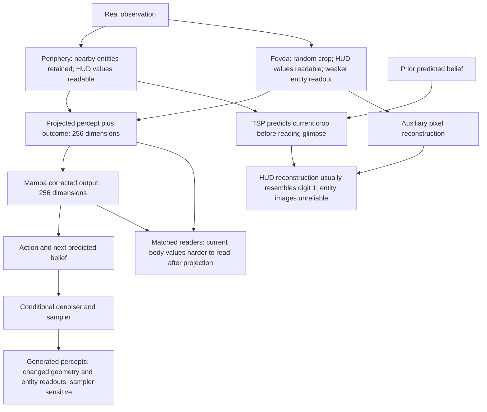
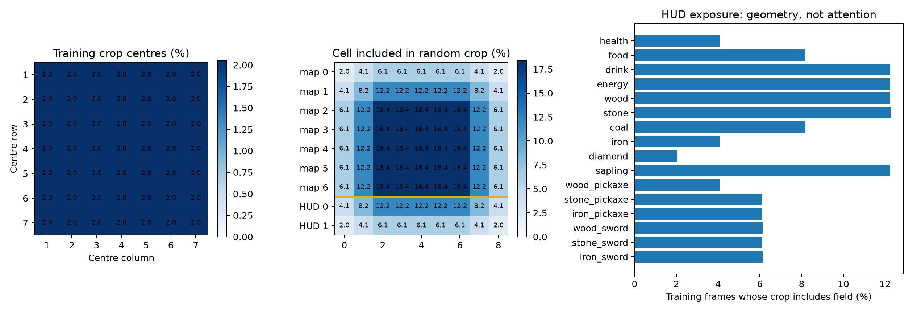
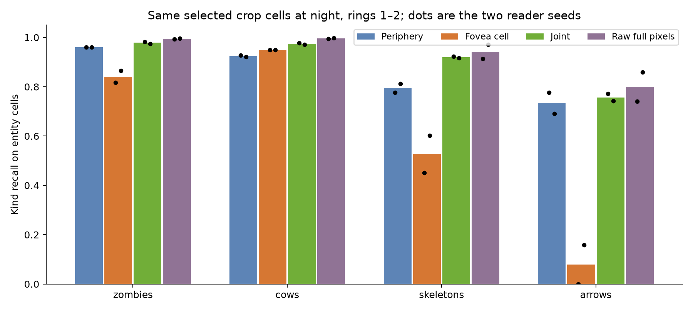
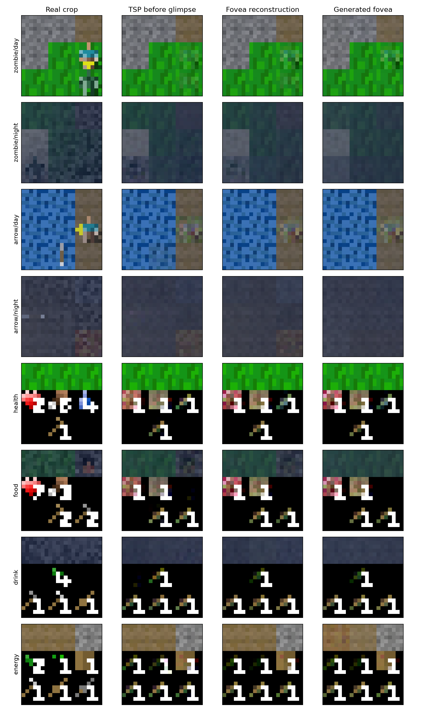
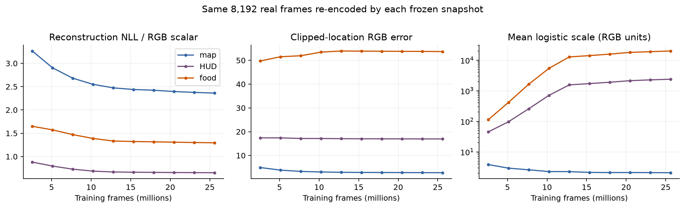
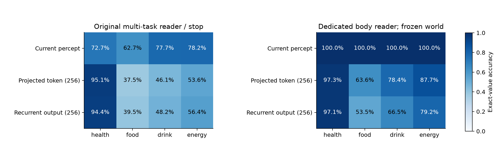
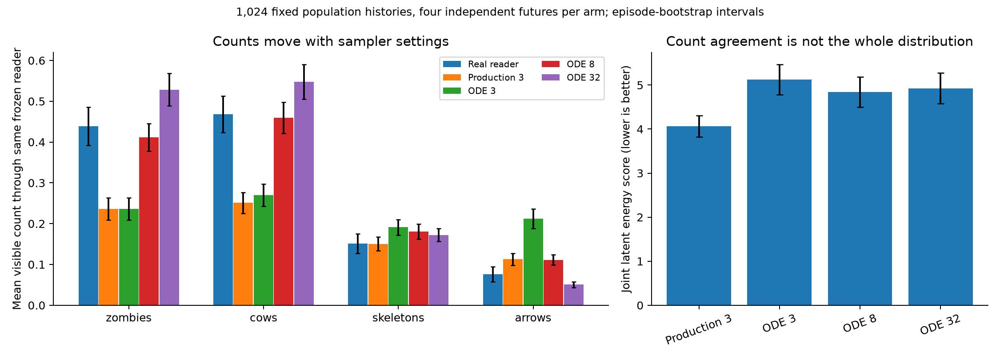

# Frozen P1/S1 dissection — 28 October 2026

The findings separate perception, readout, auxiliary image decoding and latent generation. They do not support a
single diagnosis of “the encoder erased entities” or “Mamba cannot remember.” Several original numbers understated
accessible information because of the probe. Other weaknesses remain after controlling the reader.

**Scope:** frozen world seed 1, final P1 checkpoint. No model/source fixes, P2, actor, new world seed, checkpoint
selection or final-split access. Diagnostic readers were trained; the world model was not.

## 1. Evidence and controls

- Checkpoint: `artifacts/saccade_m0/p1_world1/ckpt_10.pt`, SHA256
  `74eccc433bf5a785edd6d565edc1a970f8b468510abf2c0b07e24d28b547ebe5`.
- Reconstructed **all 25.6 million training fixation presentations**. RNG, queue, episode streams and saved histories
  matched **all ten checkpoints exactly**. These are repeated presentations, not 25.6 million distinct observations.
- Cached the real path for **400 probe-training episodes** and **1,009 dev episodes / 305,907 states**. Current
  percepts, the actual projected input token, and the actual corrected Mamba output were retained separately.
- Fresh readers used two seeds, natural frequencies, physical-episode train/validation partitions, common hidden
  widths, and the declared 30-epoch cap. Dev was used for exploratory diagnosis. There is only **one world seed**.
- Recomputed the original S1 joint-probe stopping rule: full-current-percept HUD accuracies reproduced exactly;
  recurrent HUD accuracies differed by at most **0.0252 percentage points**.
- Reused the original 30,000 S1 tuple selection. Real reader counts matched; generated mean counts reproduced within
  **0.0009 entities/frame**. The custom sampler matched unchanged S1 on a prescribed batch with identical randomness:
  **maximum difference 0 for p, g and v**. CPU reader decisions matched the GPU baseline on **129,024/129,024 cells**.
- Every sampled arm used the same histories, actions, fixations and initial/context random draws. Four independent
  futures were drawn per history. Population results use 1,024 fixed histories; separate past-entity cohorts bring the
  complete panel to 1,989 histories. Cohorts were selected from the preceding frame, not a future outcome.

The [protocol](PROTOCOL.md) contains the initial questions and dated-in-sequence amendments. Additional tests were
declared before their results. Failed controls are retained and restrict the conclusions below. Episode-bootstrap
SEs use 200 resamples. Reader-seed variation is reported separately from world-model replication.

## 2. Where the fovea actually looked

P1 contains **no learned fixation policy**. `saccade.data.fixation_prior` samples the 49 valid crop centres uniformly.
The training replay confirms the actual locations follow that prior.

Uniform crop centres do not give uniform cell exposure. Interior cells are included in **18.37%** of crops, corner
cells in **2.04%**. A crop touches the HUD with probability **28.57%**; HUD cells receive **14.29%** of crop-pixel
exposure although they occupy 22.22% of the screen.

| HUD field | Actual training frames including field | Actual S1 inclusion |
|---|---:|---:|
| Health | 4.0817% | 4.0911% |
| Food | 8.1578% | 8.1499% |
| Drink | 12.2401% | 12.2086% |
| Energy | 12.2455% | 12.2125% |
| Diamond | 2.0419% | 2.0464% |

In S1, health was included on **269/6,130 = 4.39%** of frames immediately after a health drop, close to its random
geometric exposure. It was included on 4.11% of frames with health <=3. There is no evidence here of a learned glance
after damage. Among states after at least one health glimpse, time since that glimpse had median **15**, p90 **51**,
p99 **102** frames; 7.58% of states had not had a health glimpse yet in that episode.

The crops contained about **13.57% of visible zombie instances, 12.09% of cows, 11.77% of skeletons and 15.19% of
arrows** in S1. Their locations differ, so the geometric expectations differ too; each observed exposure was close
to its conditional uniform-prior expectation. These are instance/cell exposures, not a policy success rate.

Evidence: [training replay](training_fixations.json), [dev coverage](dev_fixations.json),
[glimpse gaps and conditional coverage](fixation_history.json).

## 3. What the fovea represented

The original S1 all-map-trained periphery reader improved near-player night recall from untrained to trained:
zombie **94.18% -> 98.21%**, cow **93.54% -> 97.57%**, skeleton **87.29% -> 94.60%**, arrow **63.20% -> 81.65%**.
This actual M0 result supports retained entity information in the periphery. It does not resemble wholesale
periphery entity erasure. The exploratory crop-only reader results below use a smaller matched fitting set.

### HUD information is present in both percept pathways

Readers were fitted on the **same selected cells**, with common architecture, data splits and budgets. Feature
groups omitted from an arm were absent during both fitting and reading; no world input was zeroed at inference.

| Representation of a selected cell | Health | Food | Drink | Energy |
|---|---:|---:|---:|---:|
| Periphery token + lighting | 100.00% | 100.00% | 100.00% | 100.00% |
| Fovea token + lighting | 98.70% | 98.49% | 98.97% | 99.59% |
| Joint tokens + lighting | 100.00% | 100.00% | 100.00% | 100.00% |
| Reduced-resolution pixels + lighting | 100.00% | 100.00% | 100.00% | 100.00% |
| Full-resolution pixels + lighting | 100.00% | 100.00% | 100.00% | 100.00% |

These are mean exact-value accuracies of two reader seeds. The proposed HUD acuity gap is **not demonstrated in
these learned tokens**: even the 16-dimensional periphery token makes these values readable.

### Entity readout is weaker from individual fovea tokens

Night kind recall on the same selected cells within rings 1–2:

| Reader input | Zombie | Cow | Skeleton | Arrow |
|---|---:|---:|---:|---:|
| Periphery | 96.03% | 92.44% | 79.48% | 73.38% |
| Fovea cell token | 84.09% | 94.93% | 52.72% | 7.93% |
| Joint | 97.85% | 97.43% | 91.98% | 75.67% |
| Raw full cell | 99.44% | 99.54% | 94.18% | 79.97% |

The joint reader is numerically stronger for some kinds. This is evidence about available readout information,
not evidence that the existing belief update uses it or that it improves decisions. The fovea pathway has more
channels and within-crop context; this comparison does not isolate acuity as its sole difference.

These exploratory readers see fewer training cells than the original all-map S1 reader. Their raw-pixel controls
are achieved readouts, not perceptual ceilings, and these numbers do not replace the declared S3 blocker.

**Distributed information remains unresolved for rare entities.** Whole-crop readers were attempted because the
fovea convolutions mix neighbouring cells. Their raw-pixel positive controls also failed to localise rare arrows,
so their negative fovea results cannot establish information loss. A shared-query follow-up also did not recover
strong arrow readout from crop context; its raw control varied from 72.0% to 83.4% night-arrow recall, with one seed
below the declared 75% power threshold. Consequently, there is no justified claim that all arrow information is
absent from the full fovea representation. Several fits reached the epoch cap while still improving.

Evidence: [cell readers](fovea_readers.json), [whole-crop readers](crop_readers.json),
[shared-query follow-up](query_readers.json). The latter two failed/weak controls are part of the result.

## 4. The auxiliary pixel decoder emits poor digits despite readable tokens

Examples were the first eligible tuples in the fixed S1 sequence, selected by real labels and lighting, not by
prediction error. The fourth column is a sampled future, which need not equal that particular recorded outcome.

The real fovea tokens make HUD values readable, but the existing reconstruction adapter and shared pixel decoder
usually emit a digit-1-like pattern. A deterministic glyph instrument confirms the visual impression: train-split
white-pixel templates on the renderer's number area read the real dev digits perfectly, then read the decoded
real crops as follows:

| Field | Raw-template accuracy | Reconstructed crop classified as “1” | Correct reconstructed value |
|---|---:|---:|---:|
| Health | 100% | 99.83% | 1.51% |
| Food | 100% | 98.56% | 3.65% |
| Drink | 100% | 91.60% | 16.26% |
| Energy | 100% | 99.22% | 1.78% |

Results are identical at white thresholds 210, 240 and 250. An independent neural pixel reader gives essentially
the same value accuracies. This establishes a **token-to-decoder mismatch**; it does not establish why that decoder
learned this template. The glyph check concerns the clipped location image, not a claim about a coherent joint
glyph sampled from independent pixel marginals.

### Likelihood improvement did not track digit reconstruction

Each snapshot was evaluated on exactly the same 8,192 real frames/fixations, re-encoded with **its own** perception
and decoder. No old tokens were fed into a newer reader.

| Food-field reconstruction | Checkpoint 1, 2.56M frames | Checkpoint 10, 25.6M |
|---|---:|---:|
| NLL per RGB scalar | 1.650 | 1.296 |
| Clipped-location RGB MAE, 0–255 scale | 49.74 | 53.70 |
| Mean logistic scale in RGB units | 112.38 | 19,941.17 |

Thus the likelihood improved while this image-error measure worsened. Map reconstruction improved on both
measures over the same period. This is a measured divergence, not a conclusion that likelihood scoring is
intrinsically improper or that scale alone caused the learning outcome.

At the final checkpoint on the fixed 30k tuples, **37.5% of food-field RGB coordinates** have logistic scale >255;
the median is 33.8, p90 14,737. Across all HUD coordinates, 10.05% exceed 255. The large mean is partly a heavy-tail
effect, not a claim that every HUD pixel has a huge scale. About 87.3% of HUD target RGB scalars are exactly 0 or 255.
Unbounded logistic locations are permitted by the absorbing endpoint-bin likelihood; they are not invalid densities.

The likelihood still uses substantial image structure: replacing its locations by zero **at the same learned
scales** raises mean HUD NLL from 0.653 to 25.989. Copying the previous frame's locations at those scales gives
1.129. Therefore “all the gain is just variance” is also unsupported.

### TSP score and reconstructed entity images

The original S1 aggregate TSP score, 2.177 versus copy-previous 3.680 and position-mean 4.767, remains measured.
The implementation averages **RGB scalars**; “nats per pixel” in the original labels does not mean an RGB triplet.

Both TSP and fovea reconstruction use **exactly the same scale** on each real crop. Their mean-location errors can
therefore be compared without assuming a scale advantage. On all real dev crops, daytime background is reconstructed
well, but daytime zombie cells have about 23.8 RGB units of error and roughly 19 nats/RGB scalar through either route.

An independent raw-pixel entity reader reads **zero zombies and skeletons from the real fovea reconstructions**,
while the fovea-token reader reads many of those same real entities. It also misses real reconstructed arrows.
That positive-control failure disqualifies it as an oracle for counting entities in generated decoded images.
Missing creatures in a decoded image cannot simply be assigned to the latent generator.

This reconstruction problem occurs with the **real current crop**, so uncertain future movement and recursive
self-feeding cannot be its sole explanation. The auxiliary pixel decoder is a training component; the actor would
read the belief, not these rendered diagnostic images.

Evidence: [paired decoder scores](decoder_summary.json), [density parameters and shared-scale controls](pixel_density.json),
[checkpoint time course](decoder_timecourse.json), [glyphs](glyphs.json), [independent reader controls](independent_readers.json).

## 5. What the belief numbers actually establish

The original probe fitted achievements, 16 HUD quantities, recent-sighting bands and last-seen sides jointly, with
stopping based on their aggregate validation loss. A dedicated body reader changes only the measuring instrument.

| Frozen representation | Health | Food | Drink | Energy |
|---|---:|---:|---:|---:|
| Full current percept, original joint reader | 72.67% | 62.69% | 77.75% | 78.25% |
| Full current percept, dedicated body reader | 100.00% | 99.99% | 99.99% | 99.98% |
| Actual 256-D projected percept+outcome token, dedicated | 97.26% | 63.61% | 78.42% | 87.74% |
| Actual 256-D corrected Mamba output, dedicated | 97.10% | 53.51% | 66.48% | 79.21% |

There are two separable reader effects. Keeping the **joint** training objective but selecting its later best-body
checkpoint raises full-percept food accuracy to 91.19%. Fitting the dedicated objective raises it to 99.99%.
The original aggregate stopping/readout procedure substantially understated currently accessible body information.

Residual difficulty remains. The projected-token and recurrent-output comparisons have identical input dimension,
reader architecture, labels, splits and update cap. Food and drink are less readable at the corrected output.
Food MAE there is **1.162**, and only **71.35%** are within one; these errors are not all one-unit rounding errors.
The full-percept reference has a wider input and a different parameter count; it establishes available information,
not a matched proof that projection irreversibly destroys it. Failed finite readers are not information bounds.

The original health comparison also cannot by itself establish a memory benefit: a better reader gets essentially
perfect health from the current percept. Reward carries health-change information too. The exact source relation
`reward = newly unlocked achievement count + 0.1 * health change` matches the corpus to <=3.58e-8. This does not prove
that the network used that relation.

Inventory readout also improves with dedicated readers but remains weaker at the compressed states. For example,
wood/stone exact accuracies are 97.3%/98.0% from the full percept, 82.9%/64.7% from the projected token, and
72.3%/58.0% from the corrected output. High rare-item accuracy needs its base rate: diamond is absent in 98.04% of
dev states. Diamond achievement equals `diamond inventory >0` in 100% of these states. High achievement AP therefore
does not by itself demonstrate remembered unlock history.

Recent-sighting targets concern **observable kind history**, not hidden surviving tracks or identity. A dedicated
reader gets zombie 17–64-step AP 0.247 from the recurrent output versus 0.217 from the projected current input and
0.205 from the full current percept. This is limited readout evidence for past context; it does not demonstrate
calibrated hidden-entity beliefs, tracking, or decision value. The original past-sighting numbers are not identity
or object-permanence success rates.

Evidence: [reader objectives and metrics](belief_readers.json), [original-probe reproduction](belief_reproduction.json),
[base rates and reward identity](label_references.json).

## 6. Generated percepts: distribution mismatch, reader limits and sampler effects

### A strong mismatch exists before recursive imagination

The original one-step test conditions on **real history and real belief state**. Its problems already occur before
the model consumes a generated history. Recursive exposure bias cannot be the whole explanation.

On the original 30k tuples, the frozen entity reader reports roughly 0.235 zombies versus 0.422 on real tokens and
0.246 cows versus 0.467. Other independent token readers also give lower zombie/cow counts on the sampled crops.
However, these are **reader outputs on generated representations**, not simulator ground truth.

A geometry-only classifier, using token means/RMS/range summaries and no entity labels, distinguishes real and
generated frames at **99.53%** accuracy on held-out physical episodes; its paired-real null gives **50%**. Both
domains were rounded to float16 before measurement. This classifier is different from the original S1 MLP, so
99.53% versus 76.13% is not an additive explanation of the original C2ST score.

There is an analytic support difference. Inverting the encoder's tanh recovers a layer-normalised vector: its channel
mean is near zero. Median absolute inverse-channel means for real/generated periphery tokens are **0.000041 / 0.001540**.
The inverse variance is also affected by LayerNorm epsilon and raw feature scale; it is not exactly one. The sampler
clips its clean estimate to the allowed range but does not impose the encoder's full normalisation constraint.
This supports a distribution mismatch, not a recommendation to renormalise samples or proof that geometry caused
the entity-count deficits. A highly discriminative classifier can detect small systematic geometric differences.

Independent readers disagree more on generated content, especially for arrows/skeletons. The pixel-decoding reader
failed on real reconstructions and the fovea's own real-arrow reader is weak. Those failures prevent using either
as a semantic oracle for the sampled world.

### Sampler settings materially change the outputs, without a universal win

Mean counts through the **same frozen reader**, 1,024 fixed population histories and four futures/history:

| Source / sampler | Zombie | Cow | Skeleton | Arrow | Joint latent energy score |
|---|---:|---:|---:|---:|---:|
| Real tokens, reader | 0.4385 | 0.4678 | 0.1514 | 0.0762 | — |
| Production, 3 steps, churn 1 | 0.2363 | 0.2510 | 0.1506 | 0.1125 | **4.065** |
| ODE, 3 steps, churn 0 | 0.2361 | 0.2698 | 0.1912 | 0.2119 | 5.122 |
| ODE, 8 steps, churn 0 | 0.4116 | 0.4597 | 0.1809 | 0.1113 | 4.842 |
| ODE, 32 steps, churn 0 | 0.5283 | 0.5479 | 0.1724 | 0.0505 | 4.927 |

First compare churn at fixed three steps; then compare deterministic integration grids at fixed zero churn.
Eight deterministic steps bring zombie/cow counts closer, but overshoot some other counts and worsen the joint
latent score. Thirty-two overshoot zombie/cow counts and undershoot arrows. Relative to production, joint energy-score
increases are **0.777 ± 0.120 SE** for ODE-8 and **0.862 ± 0.126 SE** for ODE-32. The production score remains better
on this particular full-latent criterion. That criterion does not establish semantic or trajectory coherence.

The difference also appears where entities were already visible. In the past-zombie/day cohort, recorded/reader
mean next count is 1.227; production gives 0.717, ODE-8 1.023. Thus these count symptoms are not confined to new
arrivals. This does not remove the generated-domain calibration limitation.

The energy score uses the unbiased off-diagonal pair term from the four independent samples. Distances to the
single recorded successor and sample-pair diversity are reported separately. Averaging across histories permits
distributional evaluation; there is no claim to know the correct sampled branch for each individual history.

### Low aggregate denoising loss does not settle the entity question

Known-target denoising diagnostics were separated from forecasting. At sigma=1 on the population panel, the raw G1
loss is about 0.00955. Entity locations contribute **16.1%** of that loss, map background about **67.7%**, HUD about
14.7%. Entities have substantial residual error; the result does not justify saying their loss is negligible or
that its share caused the failure. These are loss decompositions, not separating objective-training experiments.
High-noise denoised conditional estimates are not themselves complete sampled worlds and need not preserve counts.

Evidence: [baseline samples summary](generation_baseline.json), [geometry C2ST](geometry_c2st.json),
[inverse geometry](inverse_encoder_geometry.json), [paired conditional counts and SEs](sampler_conditional_counts.json),
[joint scores](sampler_energy_scores.json), [loss decomposition](observed_target_loss_decomposition.json),
[exact sampler parity](sampler_parity.json).

## 7. The crop-use intervention remains inconclusive

The planned test branched real histories at 64-frame boundaries. Both branches used genuine crops from valid
training-prior fixations, with identical past, periphery, lighting, reward, action and subsequent real observations.
One fixation covered a target HUD field; the other covered the same HUD area in another column. A third branch
retained the original fixation.

There were **4,030 cases**. The unchanged branch's discrepancy against the unbranched chunk was RMSE **0.002190**,
maximum **0.06055**; against the original full-episode cache, RMSE **0.008055**, maximum **0.07617**. The fresh HUD
readers nevertheless agreed on **99.962%** of decisions with the unbranched chunk.

The declared feature-parity condition was not met. **No beneficial or harmful causal crop-use claim is made from
this test.** Batching/chunking discrepancies are observed; their kernel/precision mechanism was not isolated. The
raw branch results remain in [the failed-control record](fixation_branches.json). High decision agreement does not
retroactively waive the declared condition. The exact degree to which the current update exploits a useful glimpse
therefore remains unresolved here.

## 8. What is established and what remains open

**Established:** nearby entity content survives in the periphery; the fovea samples random locations; HUD values are
readable from both pathways; the original multitask probe understated body readout; matched 256-D state readouts
remain weaker for several current values; the auxiliary pixel decoder usually emits digit 1 despite readable values;
its likelihood can improve while RGB error does not; generated percepts differ geometrically and semantically under
available readers; sampler settings change counts without a joint-score win.

**Open:** whether hard-to-read state information is irreversibly lost; where all rare-entity information is stored
in the fovea; whether useful glimpse evidence improves the current update; how much generated count error reflects
actual missing entities versus reader domain shift; why the pixel decoder settled on its template; whether any of
these symptoms harms the eventual actor. No study here isolates an architectural or objective change as their cause.

The clean-percept reward/continuation calibration remains what S1 measured. It does not demonstrate consistency
of sampled HUD, rewards and death in recursive imagination. No S2 or actor result has been created, and no
post-training gate has been reinterpreted as passed or failed from these one-step diagnostics.

## 9. Reproduction, source boundaries and preservation

Run modules from the repository root with `.venv/bin/python -m
artifacts.experiments.20261028_saccade_p1_dissection.<module>`; CPU/GPU use is described by the script and protocol.
`foundation` precedes `crops`, `generation` and the readers; `inspect_pixels` needs the fitted cell readers;
`fixation_branches` needs the fitted belief readers. `generation_summary` and `figures` summarise saved outputs.
`timecourse`, `crop_readers`, `query_readers` and `glyphs` implement the stated follow-ups.

Canonical contracts were checked against `saccade/design/PERCEPTION.md`, `STEP_SPEC.md`, `CURRICULUM.md`, the original
S1 evaluator and source implementations of `Perception.forward`, `Belief.percept_embed/tokens`, `PixelDecoder`,
`pixel_nll`, `denoise_loss` and `one_step`. The Craftax renderer fixes the glyph area; its game logic fixes the reward
identity. Simulator labels are confined to measurement/readers, not world-model training.

The primary [JEDI paper, section 3.2](https://arxiv.org/html/2605.13013v1#S3.SS2) confirms that clamping and switching
are particular recipe components; this study does not test adding switching. The [EDM paper](https://arxiv.org/abs/2206.00364)
separates model and numerical sampling choices. These precedents inform interpretation, not claims that they prove
our model's behavior. Our sampler conclusions come from the frozen matched experiment above.

The initial sklearn-wrapper geometry call failed because scikit-learn is absent; it was rerun through LightGBM's
native API without an install. The first pixel audit hit PyTorch's large-quantile limit; the exact NumPy quantile
replaced that analysis-only call. Both failure logs are retained. These were diagnostic-tool issues, not model fixes.

[Opening hashes](frozen_identity.json) and [closing hashes](closing_identity.json) are identical for the checkpoint,
frozen S1 reader and recorded canonical sources. Model parameter hashes were also checked around forward experiments.
All new work is confined to this investigation directory; canonical Saccade code/design and the pre-existing dirty
notebook were left untouched. No training service, recurring automation or next phase was launched.
