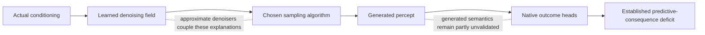

# Review of the generation-diagnosis plan

2026-10-29. Reviewed PLAN.md at commit `558ba9ba`. The plan was left unchanged. No proposed sampler,
head, token, training or architecture intervention was executed. The only new numerical test was a CPU-only
check of mathematical assertions against saved tokens and statistics; see `review_checks.py` and `review_checks.json`.

**Judgment:** the questions are right, and the independent reproduction strengthens the target. The decisive
interpretations in T0–T2 are not justified as written. Keep the questions; narrow what the results would establish.
T3–T5 are useful observational directions with the qualifications below. T6 is separate training, not diagnosis of
the frozen world.

## 1. Scope: a frozen model does not make every test observational

PLAN lines 32–68 propose explicitly changing several parts of the prediction path:

- T0 projects generated tokens and feeds them to the heads.
- T1 replaces the sampling algorithm, start noise, step count and stochasticity.
- T2 constructs a synthetic health-token successor.
- T6 launches a new P1 training seed.

These can be legitimate experiments, but they go beyond the user's current instruction to avoid interventions.
They should not silently be authorized as frozen-world reads. The present review ran none of them. Evaluating a
formula on saved tokens to disprove its claimed identity property is not feeding a changed observation through the
world model.

Native outcome heads are also part of the model under review, whereas external entity/HUD readers are measurement
instruments. If native heads misread generated representations, that is a predictive model failure, not merely a
bad external instrument to repair before recording the result. Preserve the original deployed-pipeline score.

## 2. T0 is not a validated geometry-only control

The proposed map is

`P(y) = 3 tanh(LN(3 atanh(y/3)) / 3)`.

It does not preserve all actual encoder outputs. In `saccade/model.py:24`, LayerNorm uses its default epsilon. For a
raw feature vector with variance v, its normalized variance is `v / (v + epsilon)`, not exactly one. The inverse
tanh therefore retains information about that raw variance; normalizing it a second time changes it.

On the first 1,024 saved real tuples, with no head/model forward pass:

| Token block | Coordinate RMSE after proposed map | Maximum coordinate change | Median inverse-tanh variance |
|---|---:|---:|---:|
| Periphery | 0.010342 | 0.039835 | 0.982404 |
| Glimpse | 0.005408 | 0.014919 | 0.987639 |
| Lighting | 0.001996 | 0.003839 | 0.995171 |

The map is approximately idempotent after that first transformation (repeat maximum error below 8e-7 on this
sample). That does not make it the identity on real encoder outputs. This is the distinction that matters for
the proposed control. No generated coordinates in the saved sample were at the inverse's boundary, but mathematically
`atanh(y/3)` is undefined/infinite at the sampler's allowed endpoints +/-3; an all-input claim also needs handling that.

More importantly, satisfying the token normalization constraints is not sufficient to put a collection of tokens
on the encoder's **joint observation support**. Periphery/glimpse agreement, shared lighting conditioning, object
content and spatial relationships are not certified by this map. A change in head output after projection would
show sensitivity to this transformation, not prove “geometry, not content” caused the original error.

The denoised-real control has a separate limitation: `D(x_real + sigma*noise)` is another model output, not guaranteed
to preserve its input's semantics. An erased terminal health cue could be a denoising error. A successful control is
useful evidence of local robustness near real tokens, but cannot validate all fully generated observations.

Nearest real-glyph clusters are useful references, but they are still latent readouts. Calibrating their support on
real plus denoised-real tokens does not certify fully generated tokens. Retain abstentions and support coverage;
do not require every generated token to receive a physical health label.

**Revision:** split T0 into external-reader qualification and native-head robustness. Neither becomes a universal
gate declaring generated semantics correct. Do not add the proposed normalization as a measurement repair.

## 3. T1 measures sampler sensitivity, not a unique learned-model probability

Varying numerical resolution at a fixed model, initialization, noise interval and ODE can measure discretization
sensitivity. Changing sigma_max additionally changes the initial-distribution approximation and path length.
Adding churn changes stochastic dynamics. These are related but distinct tests, not a single axis.

With an exact score and appropriate starting distribution, the ideal ODE/SDE constructions have the intended
marginals. A finite learned denoiser need not satisfy all these conditions. The EDM paper itself discusses drift
from practical, possibly non-conservative denoising fields in section 4. Thus an apparent plateau is an
**algorithm-specific numerical limit**, not an independently identified probability distribution shared by all
samplers. See [EDM](https://papers.nips.cc/paper/2022/file/a98846e9d9cc01cfb87eb694d946ce6b-Paper-Conference.pdf).

Consequently:

- More accurate event predictions under a slower sampler would demonstrate that inference settings matter for
  this frozen checkpoint. It would not establish that the learned distribution was correct all along.
- Failure of all tested solvers would narrow the alternatives, not prove that the training objective caused the error.
- Intermediate recovery does not yield an additive percentage split between solver and learning errors.
- Matching one marginal death rate is insufficient; conditional risks and joint consequences may remain wrong.

The ladder should specify one common population panel plus predefined risk strata, sampling counts, context-noise
handling, episode-cluster uncertainty, all solver equations and actual network evaluations. Keep the production
baseline immutable. A negative outcome remains an informative bounded sensitivity result.

There are two concrete numerical corrections:

1. `1880 / 5^2 = 75.2` is not total signal energy divided by total noise energy. For unit coordinate variance the
   latter is `1880 / (1880*25) = 0.04`. Using the previously measured latent RMS 0.915853 gives **0.033551**. A coherent
   nonzero mean can nevertheless remain detectable: its norm is about 30, or six noise SDs along that direction at
   sigma 5. Do not conflate these two facts. The existing trace also already showed the first clean mean projection
   at **29.820** and final at **30.002**, versus a real target mean of **30.010**. The initial discrepancy is not proof
   that this mean remains missing, or that it causes rare-event loss.
2. Current churn evaluates at `sigma_hat = sigma * (1 + min(1/N, sqrt(2)-1))`. With nominal sigma_max=20, this is
   **20.625 at N=32** and **20.3125 at N=64**, above the configured training clamp of 20. The proposed “no extrapolation”
   statement is false for those settings (`saccade/model.py:458`). Even below 20, training density varies: the configured
   lognormal puts about 4.70% of draws at/above 5, 1.22% at/above 10 and 0.233% in the clamped tail at 20.

The “under one GPU hour” estimate is not established. A conventional 64-step Heun sampler uses **127** network
evaluations per future, versus three in production; the full ladder also needs repeated futures and panels. Declare
the sample sizes and measure throughput before promising a duration. This is a budget observation, not a reason to
avoid a justified experiment.

## 4. T2 cannot provide calibrated event odds as written

There are three independent problems, any one of which prevents the decisive conclusion in PLAN lines 57–68.

**A lower-bound difference is not automatically a log-likelihood ratio.** Write

`ELBO(x|h) = log p(x|h) - gap(x,h)`.

The gap generally depends on the candidate x. Comparing two bounds does not cancel it. Nor is the project's
EDM-weighted raw-output MSE automatically an exact clean-data log likelihood. Kingma and Gao distinguish the weighted
diffusion objectives and the ELBO/noise-augmentation connection; their table explicitly distinguishes the EDM weighting
from plain ELBO weighting. Any proposed numerical ELBO needs its weighting, boundaries and terminal observation
distribution derived, rather than renaming the training loss.
See [Kingma and Gao, sections 3–4 and appendix D.1](https://arxiv.org/html/2303.00848).

**The classifier precedent is different.** Li et al. compare different class conditions c for the **same observed x**,
then use approximate class-conditional likelihoods for classification. They do not establish calibrated probabilities
of a future event by changing part of x under a fixed history. Their inference objective also includes explicit
approximations. See [Diffusion Classifier, sections 3.1–3.3](https://arxiv.org/html/2303.16203).

**A whole-observation density ratio is not an event probability.** Death probability integrates over all possible
successors consistent with death. The density ratio of one recorded successor and one edited successor need not
represent those two event masses, even if both exact densities were available. Averaging log density ratios across
different histories is not equivalent to the log-odds of their pooled event rate either.

The splice introduces another confound. A previous health token was produced under the previous lighting latent's
FiLM conditioning (`Perception.forward`), and may not agree with the current frame's other tokens. Removing direct
HUD glimpses avoids one duplicate-evidence problem; it does not prove joint plausibility or a fully defined “no damage”
successor. A deterministic drinking control concerns a different HUD quantity unless its edited field is defined too.

**Revision:** remove T2 as a decisive probability test. On unchanged real successors, outcome-stratified denoising
errors across native training noise levels can be a useful compatibility diagnostic. They must remain denoising
errors, not inferred event odds or a clean separation of solver versus objective. If a counterfactual ranking test is
later authorized, label it as such and validate its joint plausibility; it still does not supply calibrated death odds.

## 5. T3 is a good priority, with asymmetric conclusions and an exact conditioning contract

This test can run on real data without relying on T0's generated-token semantics. Strong held-out event prediction
would establish that useful predictive information is accessible to that reader. Failed probes would not establish
absence: the previous binary-health/full-percept control already demonstrated this distinction.

The full-input probe must match what the denoiser can actually access: current predicted belief, the historical
predicted beliefs/memory used by cached context frames, percept blocks, actions, fixation coordinates and validity.
Only current belief plus eight percepts omits some conditioning. `saccade/eval/s1.py:400` already has a more complete
conditioning-feature construction that can be audited and reused. Equalize reader capacity or report it explicitly.
Use physical-episode splits, held-out calibration and proper event scores beside ranking metrics.

The simulator positive control also needs an exact target and causal timing. Zombie attack tests adjacency **after**
player interaction and movement. The player can move away or kill the zombie before `update_mobs`; sleep changes
damage from 2 to 7. Reward also combines achievements and net health change, including intrinsic health recovery/loss.
Pre-action adjacency, cooldown and health alone do not deterministically predict all damage or death. Inspect
`craftax_step` at game_logic.py:1655 and `update_mobs` at :755. An oracle using full causal inputs is a useful reference;
it must not leak the realized future random draw into a purported state-only predictor.

Even a successful probe would leave several candidates: denoiser capacity, optimization, noise-level coverage,
weighting and sampling. “Information present -> objective/rarity” is too specific.

## 6. T4/T5 are descriptive diagnostics, not causal separators

**T4:** retain the event catalogue. Specify event definitions, opportunities/denominators, causal timing, positive
controls and sample sizes. Rarity, observability, pixel/token footprint, loss share and predictability vary together
across different events. Missing rare deterministic events would support a broader consequence-learning deficit;
it would not isolate rarity as its cause. Missing only hidden/stochastic events would not uniquely identify the
solver or information either. The cited long-tail literature motivates a hypothesis, not its proof in this model.

**T5:** keep real-reference distances, classwise support, context-conditioned two-sample tests and distributional
event diagnostics. Normalizing selected token statistics does not mean all geometry has been removed or semantics
isolated. Neither projected k-NN precision/recall nor a classifier score becomes a percentage of physically correct
worlds. Keep real-versus-real controls and disclose the metric's distance/feature dependence.

Rank histograms are useful, but health/counts/reward are discrete and require specified random tie-breaking or an
appropriate discrete PIT. With K=16, empirical probability resolution per history is 1/16; a 0.3% event produces only
0.048 expected hits per history. Many histories can still estimate aggregate rates; do not confuse that with precise
per-history calibration. Preceding-context stratification and clustered uncertainty are needed. Hamill's warning
about interpreting histogram shape is appropriate:
[original paper](https://doi.org/10.1175/1520-0493%282001%29129%3C0550%3AIORHFV%3E2.0.CO%3B2).

Two opening assertions also need narrowing:

- Matching mean death rates on real successors is a strong recognition control, not complete conditional calibration.
- A negative reward in a real-low-health/adjacent-zombie context does not identify a zombie hit in a generated future.
  A nonlethal intrinsic health decrement is possible, and the generator's belief may be uncertain about starting health.
  The discrepancy is a strong association to diagnose, not yet a demonstrated violation of a particular completion rule.

## 7. A scope-consistent order

For the current **no-intervention** request:

1. Preserve the original production consequence deficit and its independent reproduction; use stable `sigmoid(-logit)`
   for very small death probabilities (the reproduction currently uses `1 - sigmoid(logit)`). This numerical accounting
   distinction does not explain the large observed deficit.
2. Define consequence events and their simulator controls at the correct point in the step; qualify external readers
   on held-out real data and retain generated unsupported regions.
3. Run the full-conditioning event probes on real histories, with one-sided information claims.
4. Examine native denoising errors on real successors by event, noise level and saved checkpoint. This is a training-path
   diagnostic, not a reconstructed likelihood or causal proof of rare-event neglect.
5. Complete the event catalogue and conditional bulk/tail summaries on unchanged production samples, with instrument
   limitations attached to every semantic reading.

Solver substitutions are a separate, potentially valuable intervention once that scope is intended. Token projections
and synthetic counterfactuals should not be promoted to clean controls without their missing contracts. Seed 2 is
replication of training and belongs outside this frozen-world diagnosis; two seeds help assess repeatability but
are neither necessary to report a defect in this checkpoint nor sufficient to establish an architecture-wide cause.

The plan is close to a useful diagnostic program, but its outcome-to-cause arrows must be weakened before results
are interpreted. Otherwise the proposed “decisive pair” could produce another half-truth: informative numbers with
conclusions the experiment cannot identify.
