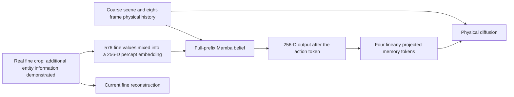

# F1.5: useful fine evidence, weak uptake, and cheaper fixation

2026-11-02. Complete bounded campaign. No world training, corpus change, production
architecture change or overnight launch. Frozen F1.5 checkpoint 10:
`95fa2cc82cb9dc3cae11cbf9f44f880aff17e250de639911f39d159564978128`.



The direct coarse route is broad and spatially explicit. The ONLY route from past fine
crops to a future physical query is through the belief/memory interface. The current
query's fine crop is correctly excluded; the factorization also provides no direct
past-fine context path. This is the design contract, not a newly discovered code bug.

**Finding:** fine evidence is not generally redundant, and its encoder is working. The
native system shows little practical prediction benefit from genuine alternative crops.
Stronger conditional readers find a large raw-fine advantage but no robust comparable
advantage along the existing mixed/emitted interface. This is an ACCESSIBILITY gap,
not proof of information erasure, and not an identification of one training cause.
The carry test below did not settle whether hidden fine information can be recovered.

## 1. What ran, with controls

Protocol: [PLAN.md](PLAN.md). Contracts/code checks: [AUDIT.md](AUDIT.md).

1. **Conditional readouts:** six supplements, two reader families, two seeds = 24 fits.
   Every fit has 2,400 AdamW updates, batch 1,280, same initialization and minibatches
   within family/seed. Fit on first 360 train episodes, report 40 disjoint train episodes
   and 250 dev episodes. Dev has 78,338 source frames. Final evaluation split untouched.
   The reader sees current FULL coarse scene, previous eight full physical percepts,
   prior emitted beliefs, actions, arrived outcomes, fixation/query identity and the
   current local coarse token. Supplements: zeros, raw queried fine token, whole-crop
   value contribution to percept embedding, corrected emission, post-action emission,
   projected memory. All supplements padded to the same dimension. Kind labels train
   disposable instruments only. Half of each class-balanced minibatch is queried inside
   the actual crop, half outside; raw fine is zero outside. This avoids unsupported
   outside-crop queries in later controls.
2. **Native paired crops:** 595 fixed dev scenes, all 49 genuine crops, same previous
   real history, action and outcomes. Conditional readers re-read 955 current entity
   queries. Entity-free controls match the informative crop's screen row. No future
   outcome selects source queries. Reuse existing fixed-noise native predictions/losses.
3. **Carry query:** 6,000 training + 1,000 validation queries (balanced kinds and crop
   availability), 6,725 unique frames. Full native prefixes regenerated from raw frames,
   not guessed states. Maximum post-action replay discrepancy versus S1: .00791 RMS.
   Frozen native Mamba takes a learned queried-cell token; classification head receives
   its emission and the same coarse baseline. Identical-pool baseline, fine and ordinary
   post-action controls; two seeds, 2,400 updates each. Both short-convolution and SSM
   carry included. This is not a proposed production update or memory architecture.

Initial smoke stopped before fitting because of a misspelled symlog helper; preserved
log, corrected, repeated. Completed full readout campaign took 812.7 s, peak 2.36 GiB;
paired re-reading 13.5 s; carry collection/fitting 274.8 s. CPU smoke/checking time is
additional. Native contract tests: **18 passed**, including GPU checks (49.5 s).

Primary protocol fixed before fits; the outside-crop support correction was written
before the first fit. Carry mechanics were specified before carry collection/fitting,
after seeing preliminary primary-reader results. No scientific-null budget was extended.

## 2. Does fine evidence add anything beyond the coarse scene AND history?

Yes, in the declared reader families. Night-time macro recall (mean recall across empty,
zombie, cow, skeleton, arrow), averaged over the two instrument seeds:

| Inputs / supplement | Concatenated reader | Query-gated reader |
|---|---:|---:|
| Full coarse baseline | 79.80% | 83.02% |
| + queried fine token | **84.95%** | **90.91%** |
| + mixed whole-crop input contribution | 79.19% | 79.11% |
| + corrected belief | 83.01% | 79.51% |
| + post-action belief | 81.66% | 79.49% |
| + projected memory | 85.27% | 77.66% |

Raw fine improves night macro recall in ALL four reader fits: +3.31, +6.98, +8.90,
+6.87 percentage points. Respective episode-bootstrap 95% intervals:
[+2.20,+4.47], [+5.78,+8.14], [+7.45,+10.13], [+5.72,+8.06].
Fine improves mean night macro cross-entropy across seeds too (flat .6044 -> .4892;
gated .5297 -> .4220), but CE is NOT uniformly better in every seed. The raw logits
are class-balanced diagnostic scores, not calibrated environmental event probabilities.

**Crucial negative control on our interpretation:** the two reader families DISAGREE
about the downstream representations. The flat memory reader can outperform the raw-fine
reader in aggregate; the gated memory reader regresses. A compressed representation can
make otherwise coarse information easier to classify. These aggregate readouts cannot
be used as a curve of information destroyed at each stage.

Fine benefits are also not universal by kind: flat-reader night arrow recall drops
from .671 to .648, while gated-reader arrow recall rises .698 -> .728. Skeleton benefits
are much larger (.699 -> .839 flat; .774 -> .932 gated). Confusions and CE retain these
regressions. Do not collapse all kinds to a success statement.

## 3. Does looking actually transfer the extra evidence into the belief?

Eight strict source queries, in eight scenes/episodes, have a crop where ALL four coarse
baseline readers miss the entity and ALL four fine-augmented readers identify it.
They comprise three zombies, one cow, four skeletons. No selection by future loss.
This deliberately strict subset is NOT an estimate of how often a real agent needs to look.

For each independently trained stage reader, measure the true-kind log-score change
between informative and row-matched empty crops, subtracting that same gaze-only change
in its baseline reader. Range across the four fits:

| Supplement | Conditional log-score gain, nats |
|---|---:|
| Raw fine | +1.45 to +2.36 |
| Mixed whole-crop input | +.013 to +.222 |
| Corrected emission | +.007 to +.149 |
| Post-action emission | −.042 to +.189 |
| Projected memory | −.002 to +.275 |

There is SOME uptake: several emitted-memory estimates have positive intervals. It is
wrong to say the fovea has zero influence. But the advantage is much smaller, less
consistent and harder to access than in the raw fine token. These are separately trained
readers with different calibration and representational difficulty, so the ratios are
NOT percentages of retained information. Selecting on fine-reader success also favors
the raw-fine row; its absolute gain is not a population effect estimate.

The broader fine-readable cohort has 833 source queries, 459 scenes, 191 episodes.
Raw-fine conditional gains range .095–.248 nats, post-action gains −.0077–+.0165,
and projected-memory gains .0036–.0131. Full intervals and query IDs are saved.
Again: connected and sometimes useful, not a dead channel.

### Native forecast readout

For the eight stricter cases, whole-map native denoising changes by **+.0492%**
(95% interval −.0224% to +.1576%); highest two noise levels: +.0349%
[−.0772%,+.1896%]. No demonstrated benefit. Eight cases and whole-map dilution limit
this statement. Newly qualified entities do not match the old source-local masks, so
those saved local scores are intentionally NOT reported as local tests of this subset.

The previous, larger 58-scene source-local test remains recorded in
`../20261102_p1f15_readiness/UPTAKE_RESULTS.md`: mean +.00003%, interval
[−.00480%,+.00533%], and native next-frame TSP −.0236%
[−.0662%,+.0152%]. Those scenes had the earlier fine-readability control, not this
stronger full-coarse conditional qualification. Do not combine them as identical cohorts.

Current entity classification is not the same target as forecasting the next coarse
percept. These tests do NOT prove how much a Bayes-optimal future physical forecast
would improve from the fine token. Thus 'the objective cannot benefit from fine evidence'
and 'the decoder alone is responsible' are BOTH unproven.

## 4. Is the information hiding in Mamba's full carry?

The extra query instrument did not recover it. Inside-crop held-out queries (500 total,
100 per kind), macro recall for seed 0 / 1:

| Same-pool inputs | Seed 0 | Seed 1 |
|---|---:|---:|
| Baseline | 68.0% | 67.6% |
| + raw fine | **83.2%** | **82.0%** |
| + ordinary post-action emission | 68.8% | 61.8% |
| + learned query through frozen carry | 66.0% | 65.0% |

Fine gains: +15.2 points [9.4,19.3] and +14.4 [9.9,20.1], episode bootstrap.
The query weights DID train (RMS change .0999 / .0833); the network fits training labels
almost perfectly (CE .000244 / .000073), but generalizes poorly. This rules out 'the
query was never optimized', not information hiding in an encoding this instrument cannot
learn. The smaller 6,000-query pool also makes it a weaker instrument than the full-data
readers. **Negative carry result is inconclusive about irreversible forgetting.**
A positive result would have demonstrated recoverability; absence of one does not prove
absence of information. No unplanned probe/budget ladder followed this null.

## 5. What this establishes, and what it does not

Established:

* Fine observations contain additional current entity information even after controlling
  for full physical context, prior emitted belief and action.
* Native genuine crops change input/belief/memory, but existing future physical/TSP
  readouts show very small average benefit. This exists on REAL histories, before
  P2 self-feeding or extra sampler steps become relevant.
* Fine information is much more readily usable before whole-crop mixing than through
  our bounded downstream readouts. The first observed accessibility gap is already at
  the input interface; blaming only the diffusion sampler is untenable.
* No robust carry readout proved that the standard emission alone is the bottleneck.

Not established:

* Irreversible information erasure, a specific Mamba defect, or insufficient state width.
* Whether all of the practical loss comes from mixing, training pressure, spatial
  binding, or downstream use. These can coexist.
* A causal claim about uniform fixation versus factorization versus earlier decoder
  changes: this campaign holds one F1.5 checkpoint fixed.
* That semantic fine information would yield a large improvement on P1's particular
  future-latent objective, or that any proposed repair improves the learned world.

Mechanistic concern to DISCUSS: the coarse stream supplies spatial history directly,
whereas fine evidence must be mixed, retained and exported through a small unconditioned
interface. Reconstruction trains fine fidelity; TSP can use current coarse evidence;
G1 can exploit coarse history. There is no guarantee that any will learn the needed
fine-to-future route. This is a compatible explanation, not a proven unique cause.

## 6. Cheap chooser options

See [CHOOSER_RESEARCH.md](CHOOSER_RESEARCH.md), primary-source limitations and native
computational contracts included. The promising first comparison is:

* **Online sparse self-distillation:** small coarse-history priority head predicts native
  C/S maps/policy; occasional detached DO/NOOP teacher replays. No pretrained reference.
* **Direct coarse-history, action-conditioned expectation head:** fit detached next coarse
  targets and construct action sensitivity/surprise without native teacher forecasts.

Compute-only small-head benchmark: 46,978 parameters, 1.37 ms per 1,024 frames;
15.44 ms including an extra native perception pass. Untrained; teacher/training/full
pipeline costs excluded, so this is not a P1 ETA.

Also documented: predicting existing native G1 errors, learned acquisition policies,
inverse-dynamics contingency and small-ensemble disagreement. These are distinct target
families, not different names for the same progress signal. H3 verifies that predicting
a bad score very accurately does not rescue selection.

Neither candidate should depend on the main fine-history Mamba for P1 collection if we
want to remove sequential overhead. Forecast calls account for only ~7.2 of the ~22.5
extra benchmark-extrapolated GPU hours; the remainder belongs to the prototype's
sequential perception/belief collection. A coarse-only selector is an explicit reduction
in its information set. Sparse teachers still need proper NOOP belief-prefix replays
and context forecasts; actual full-path runtime must be measured.

No chooser is selected here, and no chooser-only P1-F2 run is qualified as a repair for
the evidence-uptake finding. Next discussion should choose a minimal separating test of
the fine-to-belief interface versus predictive learning pressure, alongside a bounded
cheap-head comparison. No new corpus work or overnight job was started.

## Reproduction and artifacts

```
.venv/bin/python -m artifacts.experiments.20261102_foveal_information.conditional --smoke
.venv/bin/python -m artifacts.experiments.20261102_foveal_information.conditional
.venv/bin/python -m artifacts.experiments.20261102_foveal_information.paired
.venv/bin/python -m artifacts.experiments.20261102_foveal_information.analyze
.venv/bin/python -m artifacts.experiments.20261102_foveal_information.carry_readout
.venv/bin/python -m artifacts.experiments.20261102_foveal_information.carry_analyze
```

GPU programs need host CUDA access. Cached source data and native checkpoint identities
must match. Readout scripts resume by skipping already completed fits; identities bind
code, protocol and checkpoint. `conditional/dev_metrics.json`,
`conditional_comparisons.json`, `paired_summary.json`, `carry_summary.json` contain full
errors and intervals; raw logits and exact query indices are retained. `*_identity.json`
and the campaign manifest bind their actual code/artifact versions. Existing world and
training-source hashes were checked unchanged after the campaign.

Batching qualification: a block-start native belief plus coarse-only within-block history
is another explicit candidate; it delays fine feedback rather than dropping all fine
history. Block length and own-history behavior need validation. See CHOOSER_RESEARCH.md
for the computational contract; it is not equivalent to the per-frame full-belief chooser.

Important training-versus-frozen distinction: better fixation could still TEACH this path
during joint P1, because the parameters and supervision distribution would change. The
frozen findings do not prove that chooser training cannot improve uptake. They show that
uptake must be measured explicitly and cannot be assumed from accurate priorities or
better current-crop reconstruction. Teaching through TSP/loss placement also remains a
separate possible benefit from acquiring new information for the belief.
