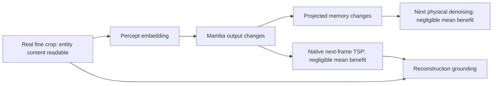

# Bounded foveal-uptake / decision-2 campaign

2026-11-02. Frozen native F1.5 checkpoint 10, SHA256
`95fa2cc82cb9dc3cae11cbf9f44f880aff17e250de639911f39d159564978128`.
Protocol: [UPTAKE_PROTOCOL.md](UPTAKE_PROTOCOL.md). No new world-training recipe or overnight run launched.
The four-update collector exercise below is a disposable mechanical check; it is not a scientific training arm.
It starts a fresh optimizer on a checkpoint solely to exercise the gradient paths; it does not reproduce P1's
initialization, optimizer history or frame-based schedule, and its losses are not a stability/improvement result.

The measured weak-use result occurs with REAL histories and crops, before self-feeding or generated evidence.
It is therefore a distinct question from P2's robustness to its own outputs. The diagram does not claim that
Mamba erased the fine information: output sensitivity, information retention and useful prediction are different.

## 1. The fine encoder is not a dead channel

Two fixed-budget readers were trained on the first 360 training episodes, with 40 disjoint episodes for reporting.
Both use balanced kind sampling; these are diagnostic instruments, never world/chooser supervision.

| True class | Reader 0 recall | Reader 1 recall |
|---|---:|---:|
| empty | .9648 | .9667 |
| zombie | .9722 | .9791 |
| cow | .9948 | .9974 |
| skeleton | .9815 | .9815 |
| arrow | .9500 | .9429 |

False positives and the full confusion matrices are retained in `uptake_local/readers.json`. These are aggregate
held-out recalls, not night-only ceilings. Readability does not establish that the deployed world uses the content.

## 2. The properly paired native uptake test is nearly null, including locally

595 fixed dev scenes, from the previous uptake reading's sample: all 339 night-set frames and 256 random frames.
58 scenes (48 episodes), all at night, have a true entity missed by the native periphery reader but correctly read
by BOTH fine readers in at least one legal crop. All 58 have entity-free control crops at the SAME fixation row.
Same physical frame, complete earlier history, action, reward, future query and noise; only the genuine crop differs.
49 crops, eight native monitor noise levels, two shared-noise sets. Source-defined radius-two neighborhoods avoid
selecting a region using the realized future. Intervals use 2,000 episode-bootstrap replicates.

| Readout: informative crop minus matched control | Mean fractional loss change | 95% interval |
|---|---:|---:|
| Local physical denoising, all levels | +.00003% | −.00480% to +.00533% |
| Local physical denoising, highest two levels | −.00598% | −.02136% to +.00791% |
| Whole-map denoising, all levels | −.00030% | −.00408% to +.00377% |
| Local denoising, refit periphery reader ALSO misses (25 scenes) | −.00606% | −.01353% to +.00077% |
| Native next-frame TSP pixel MSE | −.02364% | −.06615% to +.01523% |

The TSP control was explicitly added after the physical null and is documented in the protocol. Its future query
is centered on the first useful SOURCE cell, not on a future outcome. It sees the next real periphery and the varied
post-action belief, with no direct past-glimpse context path. It tests a native fine-detail consumer, not a full
forecast without next-frame coarse evidence. Its null cannot prove that memory erased information.

These readouts do not support a substantial average benefit in this frozen model under these objectives. They do
not prove that the entire sampled forecast distribution or actor value is gaze-insensitive. In particular a
single denoising estimate is a conditional mean; it is not a full generative distribution (DIAMOND §5.2).

### Where crop differences go

Mean RMS contrast between informative and row-matched control crops:

| Stage | RMS difference |
|---|---:|
| percept embedding | .0970 |
| algebraic crop-value contribution to embedding | .0913 |
| algebraic fixation-mask contribution | .0220 |
| corrected Mamba output, after percept token | .0690 |
| emitted predicted belief, after action token | .0226 |
| projected memory | .0133 |
| local first-call physical prediction | .00237 |

Different modules have different scales; this is not a conservation-of-information curve. The two Mamba emissions
share their final normalization, but the after-percept output includes a direct percept residual whereas the
after-action output has an action residual. A reduced emitted difference is not proof of forgetting in the carry.
The crop-value contribution exceeds the mask contribution: the input is not merely forwarding a location bit.
First-call forecast variation across noise draws is .165 RMS on these scenes; that is sampler variability, not an
epistemic-uncertainty estimate. Relative to it the crop contrast is small. Full native raw arrays are preserved.

### Instrument limits that matter to the conclusion

* The new periphery-only reader recovers the qualified source entities in roughly half the scenes. The stricter
  25-scene subset remains nearly null. An old probe error is not proof that the periphery lacks the information.
* Auxiliary readers of embedding/belief/memory show no reliable true-kind probability gain from looking. They
  also see the local periphery, so they can learn to ignore the extra representation. Their null does not establish
  information loss. Do not use them to pinpoint an irreversible compression bottleneck.
* Post-result descriptive analysis: 18 qualified scenes have exogenous next actions. Their local loss change is
  −.0071% (interval −.0127% to −.0011%). This is a small benefit, not literally zero influence. Seven scenes have
  a qualified kind unseen in the last eight frames; none has a kind never seen in the episode. Kind visibility is
  not object identity or proof that the prior knew the target. These are descriptive strata, not new primary tests.
* Thus the missing discriminant is **useful new information conditional on the whole existing belief and periphery**,
  not whether a fine token is readable by itself. A matched conditional reader (prior + full periphery + action,
  versus those inputs plus fine evidence, versus those inputs plus the updated belief) would address that next.
  It has NOT been run. It should be discussed before another diagnostic or architectural repair.

What is established: connected but weak practical use in these native prediction readouts; not a dead fine
encoder and not solely whole-map averaging. What is unresolved: conditional redundancy versus insufficient
learning pressure versus poor memory export/readout. No loss or memory repair is selected by this campaign.

## 3. Reliability and sequential behavior of the working chooser

Signals are label-free: actual/NOOP first-call physical predictions from the SAME pre-action carry; surprise
against the current periphery. Diagnostic policy: equal mean-normalized C/S, softmax temperature 1, uniform floor
.2; comparison adds a screen-space overlap trace with half-life four frames. These are test settings, not canonized.

48 fixed scenes at checkpoints 1, 5, 10; four episodes / 16 scenes held out. At checkpoint 10, across forecast-noise
draws on held-out scenes: C rank correlation .909; S .925; mixture-probability total variation .149. Rank stability
is good but the probabilities are not identical. No learning-progress or epistemic-uncertainty guarantee follows.

Exact simulator replay and render matched stored pixels bit-for-bit in eight minimum-light scenes (light zero).
Four static re-renders per scene, same physical state: mixture TV .0457, surprise rank correlation .752. C is
exactly invariant to CURRENT-frame static by construction, because it does not read that frame. Do not present
this as learned denoiser robustness. Onset-only static renders were preserved separately; their noise was tiny.

Sequential replay: 12 episodes, up to 256 frames each, each policy with its OWN selected-glimpse and belief history.
Held-out four-episode results (909 frames per policy):

| Policy | Mob in crop | HUD overlap | Exact window repeat | Mean largest streak per episode |
|---|---:|---:|---:|---:|
| uniform | 12.2% | 27.3% | 2.43% | 2.25 |
| C/S mixture | 29.4% | 27.8% | 2.43% | 2.25 |
| mixture + recency | 26.8% | 29.2% | 1.88% | 2.00 |

All policies covered about 98–99% of the 49 windows over these episode prefixes. No pathological fixation trap
appeared under these settings. The trace has no demonstrated necessity or training benefit. Small exploratory
attempt cohorts also show increased counter/resource coverage; e.g. drink counter 6/9 versus 1/9, wood counter 8/35
versus 4/35. Report these denominators; they are not precise generalization estimates or proof of improved learning.

## 4. Full-path mechanical check: useful findings, not launch qualification

`collector_preflight.py`: full native `p1_losses`, all terms, all modules; two streams, two consecutive updates at
64 and 256 steps. Physical records and episode order unchanged, actual chosen fixations retained in reused
prefixes, collector uses independent random generators, native loss replays the PRE-collection carry. Caches are
rebuilt from raw prefix under current parameters. Resets are exercised inside chunks. All named modules have
finite nonzero gradients. Sequential/native final belief discrepancies are .0060–.0075 RMS (BF16 computation).

The initial prototype failed an important test: cached native actual belief and separately carried reference NOOP
belief differed numerically at an update boundary, giving nonzero C even for actual NOOP. The failure log is kept.
The corrected prototype saves the pre-action carry and recomputes BOTH scoring branches together under current
parameters. Its scoring belief differs from P1's stored prior output by .009–.014 RMS at the boundary; current-
parameter scoring versus stale training caches remains explicit. This needs a declared production contract.

The generated chooser callback receives exactly the CLEAN p/v returned by the cascade. The diagnostic real chooser
also reads clean encoded p/v. The glimpse head receives conditioning-augmented p/v: this separate selection versus
conditional-input issue remains documented; a callback identity check does not magically resolve it.

### Runtime is a substantive decision

The per-stream correctness prototype is slow and is not a proposed launcher. A separate reset-free B=16, T=64
batched collection benchmark measured 3.245 s per 1,024 frames (uniform collection 2.210 s; trace variant 3.231 s).
At the same 25.6M-frame budget that is **22.5 additional GPU-hours of collection**, if throughput carries over,
before P1 training's roughly 11 hours. This is an extrapolation, not a measured full-run ETA. Asynchronous resets,
carry consistency, startup and checkpoint overhead still need the actual implementation benchmark.

Consequently the working direct chooser is NOT demonstrated to fit one ordinary overnight run. Changing the
frame budget, batching/refresh approximation or controller estimator would be a scientific/design decision,
not a hidden engineering substitution. No production controller or launch has been qualified by this prototype.

## 5. Data: prepared correction, separate coverage limit

See [P2_DATA.md](P2_DATA.md), `terminal_inclusive_audit.json`, and the terminal-inclusive index bank.
P1 used the full corpus; the window exclusion applies only to proposed P2 prior-sampled trajectory scoring.
All 705,646 random actions and 2,432,119 training-step flags were checked. H=16 admission grows from 244,096 to
272,809 windows; deaths can occur at every position (1,914–1,915 per position) rather than only at position 16.
Independent enumeration of the saved bank gives 30,628 terminal-containing windows (11.23%). This does not add
advanced outcomes: H=16 still covers coal/iron/zombie unlock counts 1/0/0. No new P1 data were collected or installed.

## Literature and interpretation

* [Mnih et al., recurrent visual attention](https://proceedings.neurips.cc/paper_files/paper/2014/file/3e456b31302cf8210edd4029292a40ad-Paper.pdf):
  glimpses enter recurrent state and both sensing and task actions are trained for task return. A readable glimpse
  alone is not their success criterion; their tasks differ from our low-precision future-latent objective.
* [Saccader](https://proceedings.neurips.cc/paper/2019/file/8dd48d6a2e2cad213179a3992c0be53c-Paper.pdf):
  explicit suppression of visited locations has precedent for static classification. This does not establish that
  our short recency trace is necessary in dynamic world learning; our replay did not find a trap without it.
* [DIAMOND §5.2](https://arxiv.org/html/2405.12399): a one-step denoising estimate is a conditional mean; iterative
  sampling resolves modes. Do not turn this campaign's denoising-loss null into a theorem about sampled worlds.
* [JEDI §3.2](https://arxiv.org/html/2605.13013v1): denoised-output switching is a robustness procedure; our P1
  omitted it. Self-feeding failures are a P2 starting point, not by themselves an architectural veto.
* [Ortega et al.](https://arxiv.org/html/2110.10819v1): conditioning on expert actions can import hidden information;
  exogenous trajectories are used for P2 scoring for a causal reason, despite their poor advanced-state coverage.

End of bounded campaign. Next is discussion: conditional fine-information test and/or F2's teaching question,
controller cost/refresh contract, and P2 outcome credit. No automatic additional experiments or launch.
