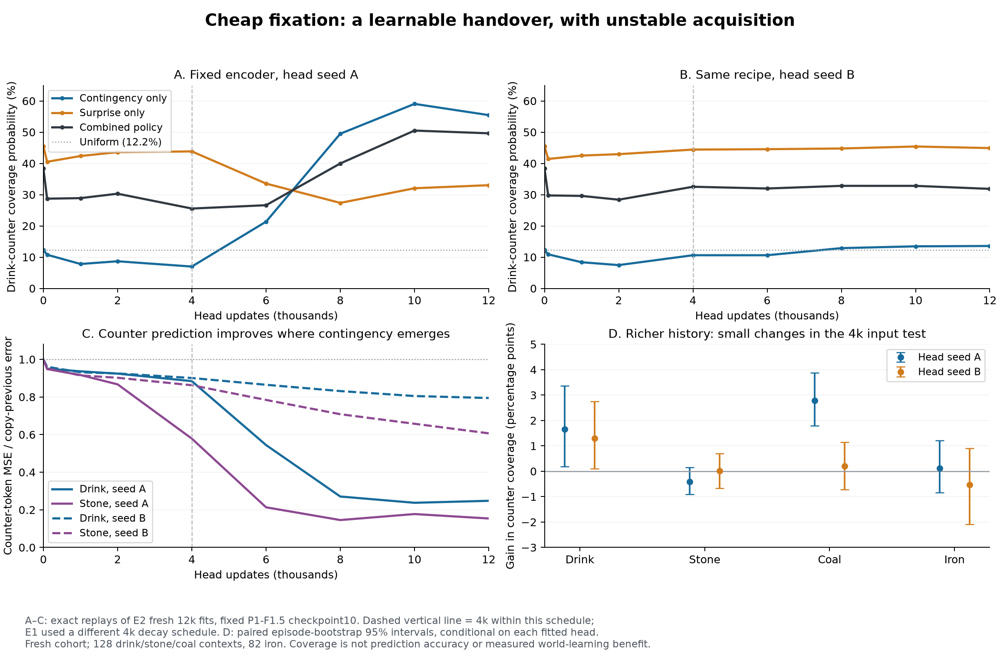

# Learned fixation: what E1–E3 establish

2026-11-03. F1.6's world evaluation was not inspected. All three original experiments
finished; no world-training recipe changed. This dissection adds one exact replay of
completed fits and analysis of existing forecasts, scoped in DISSECTION_PLAN.md.

## Finding

The proposed surprise-to-contingency handover is learnable by the original coarse-only
head with MSE. It appears strongly for drink and stone in some fits, including a fit
whose encoder never changes. It is not reliable across the two head seeds (which
change BOTH initialization and minibatch order) and training histories. Coal/iron remain predominantly surprise-led. The tested native
belief input gives small gains, not a rescue. This supports continuing the cheap-head
family; it does not qualify a production online recipe or prove a world-learning gain.

A=611601, B=611602 are HEAD seeds of one F1.5 WORLD seed. Fresh reporting cohort has
128 contexts each for drink/stone/coal and82 for iron. Earlier cohort readings are
also archived and show the same qualitative endpoint pattern. No fitted-head choice
or policy was installed using these results. All probabilities include20% uniform.

## E1: the original4k result is real, but narrower than a design verdict

Both final weight tensors reproduce the archived original fits with max difference0.
Instrumentation did not change fitting. Checkpoint10 representation is fixed.

* Counter-token MSE at4k remains92% of copying for drink,79–90% for stone,96–97% for
  coal and97% for iron. Global random-frame MSE had fallen about70% versus copying.
* Remote contingency-only probability falls below uniform: drink7.8–8.3% vs12.2%,
  stone3.9–7.0% vs12.2%, coal2.3–2.8% vs8.2%, iron1.6–2.3% vs4.1%.
* Surprise still finds these counters. For coal its probability rises from31.1% to
  48.1–49.1%, although the counter itself is barely predicted. Predicting background
  better can make the unlearned counter relatively more salient.
* Mixed drink-counter coverage falls38.3% ->29.2–29.4%; episode-bootstrap differences
  -9.1pp[-12.2,-6.3] /-9.0pp[-12.3,-6.0]. This is a remote/contact allocation change,
  not proof that total teaching quality got worse: contact receives more attention.

Initialization is not blank: zero output weights make the head COPY the last frame.
Initial surprise is therefore a change detector. Initial C is exactly zero. Once
nonzero C develops, per-frame mean normalization gives it its full relative mixture
weight irrespective of absolute scale or remote-effect accuracy. This explains how
gaze can leave the remote counter before its action association is acquired; it does
not establish that all local C is noise or that a particular gating fix is needed.

## E2: delayed acquisition and recipe/seed dependence

The carried head AND its optimizer moments/steps persist across worlds1->5->10;
saved Adam steps are exactly4000/8000/12000. All non-token episode/action/reward/
termination/reset/monitor metadata match across encoder caches. Fresh comparisons
receive the same cumulative update budget, not just the final4000 updates.

Checkpoint10 endpoints, probabilities of covering the remote counter:

| Head/history | Drink C-only | Drink mixed | Stone C-only | Stone mixed |
|---|---:|---:|---:|---:|
| A carried |12.4%|27.6%|29.2%|34.2%|
| A fresh |55.5%|49.6%|46.8%|34.2%|
| B carried |57.1%|48.5%|48.1%|35.2%|
| B fresh |13.6%|31.8%|5.8%|26.2%|

Carrying is not uniformly better: mixed drink carry-minus-fresh is-22.0pp
[-26.1,-17.7] for A, +16.6pp[12.2,21.3] for B. These intervals condition on the fitted
heads; two seeds do not estimate a population success rate. Averaging would hide
the important disagreement. The coarse-only information contract is unchanged.

### Exact fixed-encoder replay: acquisition is not just token drift

Fresh E2 fits originally stored only endpoints. Both were repeated with identical
12000-update recipes and intermediate readouts. All endpoint C/S/forecast/error arrays
match exactly, max difference0 on both cohorts;335.8s, no changed hyperparameter.

Head A, drink:

| Update | C-only coverage | S-only coverage | Mixed coverage | Counter MSE / copy |
|---|---:|---:|---:|---:|
|4000|7.0%|43.8%|25.6%|.884|
|6000|21.4%|33.6%|26.6%|.544|
|8000|49.5%|27.4%|40.0%|.271|
|12000|55.5%|33.0%|49.6%|.248|

The counter forecast improves, its direct action sensitivity increases, and the
mixed policy retains remote looks as surprise decreases. Stone similarly reaches
counter error.154 of copy. In B the same12k recipe ends at drink.794/stone.607 of
copy and largely fails to develop remote contingency. Longer fitting is not a
demonstrated reliable fix. E2 uses a12000-step cosine schedule, different from E1's
4000-step decay; the difference cannot be attributed to update count alone.

There is some tracking capability: B's learned drink C coverage at world5's end is
56.1%, becomes50.2% on switching to world10's representation, and recovers58.5% after
100 adaptation updates. This is snapshot tracking, not a continuously co-trained world.

### Not just first units or neighboring patches

Among the two clear drink/stone fits (A fresh, B carried), counter errors for NONZERO
increments fall63–65% for drink (109 cases),76–84% for stone (99), relative to copying.
First units are also improved (19 drink,29 stone cases). Improvement exists at night
as well as day. These are token-prediction errors, not digit-classification accuracies.

The additional prelogged wood class follows the same acquisition pattern. In the
two strong fits its counter error is5.9/8.4% of copying, including6.7/9.0% for
nonzero increments (97 cases). The weaker12k fits remain at56/70% of copying.
Learning is therefore not confined to one counter or only0->1 changes. Better
prediction does not guarantee more remote gaze: A fresh's mixed wood coverage is
24.7%, against27.0% at E1's endpoint, while its error falls from88.1% to5.9% of copy.

98.6–99.3% of C energy within counter-covering windows belongs to the actual drink/
stone counter cell. The positive is not merely overlapping3x3 windows. Forecast
changes align with the recorded counter changes; NOOP forecasts remain close to the
prior counter along that direction. NOOP has no paired observed future here, so this
is evidence of an action-conditional association, not counterfactual identification.

Failed-stone/no-tool controls retain small residual counter effects, but own-counter
C energy is only1.7–3.4% of that on successful stone attempts in the strong fits.
Do not quote the huge error/copy ratios on these quiet controls: copy error is nearly
zero, making the ratio misleading. Absolute error is reported in the raw files.

## What has NOT moved into contingency

Coal and iron's counter errors remain93–99% of copying even in the12k fits. In this
qualified fresh cohort, all128 coal and82 iron attempts actually incremented; this
is not a benchmark averaging an equal mixture of successes and failures. That does
not prove identical outcomes are inferable from every coarse history.

In the two strong drink/stone fits, the target coal/iron cell explains less than1%
of C energy inside its counter-covering windows. Some apparent remote C is driven
by neighboring HUD cells (notably stone). Do not call this learned coal/iron dynamics.
Nevertheless surprise-only remote coverage is about50–53% in those fits: the actual
crop can be useful without perfect contingency, as the user argued. Count coverage
as coverage; do not turn it into evidence that the corresponding effect was learned.

Training400 contains1716 drink /4040 stone /462 coal /269 iron attempts (old coverage
audit). Frequency is a plausible contributor, not an isolated causal explanation.
These fits do not separate gradient competition, effective exposure, optimization
path or harder conditional recognition. No rebalancing or longer-run fix is selected.

Saplings need a different interpretation. Only6/128 fresh and13/300 earlier attempts
actually yield a sapling, so near-copy prediction error cannot by itself establish
the same failure as on the qualified coal/iron transitions. In the strong fits,
surprise-only looks cover the sapling counter in62–63% of those six fresh drops,
versus9.4% of the122 non-drops. Earlier-cohort drop coverage is about58% (13 cases).
This is a useful descriptive example of reacting to a rare unexpected outcome from
the ARRIVED coarse frame before selecting its fine crop. Small success counts limit
the conclusion; no rare-event forecasting calibration or anticipation claim follows.

## E3: native belief is not a demonstrated remedy

Both heads have118032 parameters; same seeds,4000 updates, minibatches and objective.
Auxiliary inputs are training-standardized; no channel reaches the std floor. Control
gets a deterministic coarse sketch; treatment gets native pre-action full-history
belief. Native coarse collection matches the old cache exactly; actual-prefix causality
and optimizer continuation checks pass. No current outcome/crop enters the forecast.

Rich-minus-coarse mixed remote probability (pp; paired95% episode-bootstrap):

| Head | Drink | Stone | Coal | Iron |
|---|---:|---:|---:|---:|
|A|+1.66[+.19,+3.36]|-.41[-.91,+.15]|+2.78[+1.80,+3.88]|+.12[-.84,+1.21]|
|B|+1.30[+.10,+2.75]|+.02[-.67,+.70]|+.20[-.71,+1.15]|-.53[-2.09,+.90]|

Small benefits exist; they do not produce remote contingency. This is a negative
for that input route/4k reader, not proof the belief contains nothing. Independently,
E2's successful coarse-only fits show native full-history belief is not necessary
for these demonstrated common counter associations. Do not generalize to occlusion,
night entities, achievement history or later VoI tasks.

## Interaction of prediction, policy and teaching

No single P0 policy is best throughout acquisition. Surprise-only wins remote
coverage while the counter is unpredicted; when A learns drink, C-only gives55.5%,
S-only33.0%, mixed49.6%. Selecting S-only from the short-fit result would lose this
later benefit. The fixed normalization/weights remain design choices, not calibrated
information gain. Relative S allocation can rise even as absolute counter error falls.

More remote gaze can replace contact gaze. For A, stone remote/contact/union changes
21.6/37.0/58.6% (E1) ->34.2/24.6/58.8% (fresh E2). Total either-location coverage is
almost unchanged; the allocation between two useful sites changes. A's iron remote
coverage rises26.5 ->41.9% despite unlearned own-counter C. This is useful potential
curriculum behavior, not proof of learning the iron effect or a better world model.

The supported chain is: inexpensive forecasts can acquire some action associations
and combine C/S into useful-location coverage. The untested chain is: chosen crops
improve the jointly trained world's perception/memory/prediction. The head learns
its own coarse forecasting task, not the world's denoising loss. C also remains high
after mastery: the handover preserves action-directed looks; it does not implement
automatic habituation away from all mastered regions.

## Decision scope

Continue the coarse-only MSE head as a viable candidate; do not select a lucky head
or add full native belief as the presumed fix. The immediate unresolved issue is
reliable acquisition at the real world's update/data-exposure clock and useful
combined allocation, followed by matched world-learning benefit. The evidence does
not choose an online cadence, new loss, priority weight, further budget or P1-F2
launcher. This bounded campaign stops for discussion.

Evidence: original PLAN/RESULTS; e1/e2/e3 identities and snapshots; exact-replay identity;
metadata_optimizer_audit.json; paired_dissection.json; grounded_dissection.json;
plot_dissection.py/png/pdf; DISSECTION_PLAN.md. Original source/input pins still verify.
