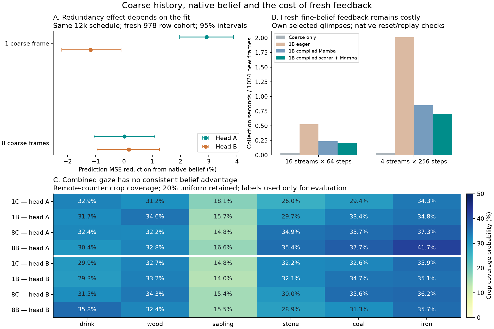

# History / belief ablation and fresh-feedback cost

2026-11-03. Approved campaign complete: four arms, two head seeds,12000 updates
each. Original4k fits preserved; they cannot be extended exactly because optimizer
state was not saved and their LR clock differs. All new arms start with identical
weights and per-example minibatch streams within seed. No world/encoder/belief
training, adaptive weights, production controller change or overnight launch.

**The user's redundancy hypothesis is supported by one fit, not reliably by both.**
Belief adds2.93%[1.97,3.87] factual whole-grid MSE improvement at one frame in headA,
versus0.01%[-1.06,1.09] at eight frames. In headB it worsens one-frame MSE by1.18%
[0.10,2.20], while eight-frame belief improvement is0.17%[-0.95,1.26]. The paired
absolute interaction is+0.001003[0.000483,0.001498] forA and
-0.000452[-0.000916,0.000030] forB. Earlier reporting cohort gives the same sign
pattern. Intervals condition on fitted heads, not population head/world-seed effects.

**One frame is surprisingly competitive even without belief.** Fresh random-frame
MSE1C/1B/8C/8B is0.02922/0.02903/0.02871/0.02859 forA and
0.02923/0.02950/0.02934/0.02844 forB. On the event-balanced full cohort1B's global
error is effectively level with8C inA and0.59% worse inB. A near tie does not
establish equivalence or show belief is why one frame works.

**Combined gaze, not perfect component C, remains the practical yardstick.** The
fresh remote-counter table and all paired differences are in RESULTS.md and
COMPARISONS.json.1B-minus8C combined coverage in probability points:

| Consequence | Head A | Head B |
|---|---:|---:|
| Drink |-0.73[-4.96,2.75]|-2.17[-4.87,0.76]|
| Wood |+2.41[0.26,4.62]|-1.08[-3.16,0.88]|
| Stone |-5.26[-8.42,-2.20]|+2.10[-0.38,4.47]|
| Coal |-2.26[-5.16,0.18]|-0.91[-2.74,0.78]|
| Iron |-2.55[-5.52,0.33]|-1.16[-3.69,1.50]|

Broad entity coverage stays~48% for1B versus~47% for8C in the fresh natural-frame
sample (86 entity-present frames). No consistent scene-wide or consequence-wide
gaze advantage appears. Prediction and gaze must remain separate: woodA's actual
counter error is~2.9x8C's, yet its crop coverage is2.4pp higher because surprise
can keep drawing attention to a poorly predicted effect. A worse forecast alone
is not proof of a worse teaching policy. The stoneA coverage loss is a concrete
selection regression hidden by near-equal aggregate MSE.

**Baseline lineage matters.** All four arms use E3's118032-parameter auxiliary
input head for capacity matching;8C is NOT the original smaller101584-parameter
coarse-only head. The matched sketch branch can itself alter acquisition. Keep
the original operational references visible (full saved/fresh, both seeds and
histories in ORIGINAL_HEAD_REFERENCE.json). For example, fresh original8-frame
head drink coverage A/B=49.6/31.8%, versus31.7/29.3% in1B. Carried original
A/B=27.6/48.5%. These are operational comparisons with changed input routes and
parameters, not clean causal estimates of removing history. The new8C control
does not replace the original head's evidence or erase its successful fits.

**What the test does and does not locate.** The direct eight-frame path is not
demonstrated as the sole reason for small native-belief gains. Removing it can
make this reader benefit in one fit but does not yield reliable acquisition or
policy improvements.1B reads a256D corrected output projected to64D and broadcast
to the grid; it does not read the full internal Mamba carry. The main model can
also query that carry through its subsequent action token. These are different
interfaces. The results constrain this reader/recipe; they do not establish that
Mamba's internal memory contains no useful information. Frozen uniform-prefix
belief utility is not own-gaze closed-loop learning benefit. Neither a larger
reader nor a new belief representation was tested or selected.

**Runtime: measured on the actual fresh-belief dependency.** Both collectors cache
coarse perception in a batch.1C then chooses its crops in a batch.1B does actual/
NOOP head queries, samples a crop, encodes ONLY the selected fine evidence and
advances native six-layer Mamba by percept+action before selecting the next crop.
No denoiser-scoring calls, NOOP Mamba forks, stale beliefs or periodic refresh.
Three consecutive chunks per shape; first warms kernels, last two timed; episode
resets included. Native replay final corrected-belief errors<0.9% relative, SSM
errors<0.6%; all world weights/buffers unchanged. Latency medians/ranges are short
benchmark readings, not full-run confidence intervals or hardware lower bounds.

| Collection seconds per1024 new frames |16x64|4x256|
|---|---:|---:|
|1C, batched scorer |0.041|0.040|
|1B, eager reference Mamba |0.524|2.012|
|1B, compiled Mamba |0.235|0.850|
|1B, compiled scorer+Mamba |0.205|0.702|

Compiled scorer+Mamba collector plus ordinary P1 forward/backward/clipping takes
1.750s vs1.586s baseline at16x64 (+10.3%) and2.142s vs1.484s at4x256 (+44.4%).
Optimizer steps, data gathering, monitoring and checkpoint writes are excluded
from both; head fitting is separately measured. The shorter stream batch makes
sequential feedback relatively expensive. This is an actual own-history collector,
not the cost of a head fed cached native beliefs.

At25.6M frames, split equally between the two phases, EXTRA collection extrapolates
to8.45GPU-hours eager,3.42h compiling Mamba, and2.87h compiling scorer too. This is
NOT an unavoidable lower bound or a complete overnight ETA. Compilations/warmups
are recorded separately; the final full benchmark including both shapes took51.4s.
The old22.5h expensive-chooser estimate is inapplicable. Remaining fine/scoring/
sampling/launch overhead may admit more optimization; we stopped the bounded
profiling effort because this belief interface shows no consistent utility gain.

**Numerical checks / preserved failures.** The first zero-column folding check
failed a strict TF32 coordinate threshold; IEEE arithmetic then verified the smoke
identity. The trained-head check still exceeded3e-6 in raw coordinates. These
failures are preserved, not called architecture failures. Revised checks establish
float64 folding equality (observed0) and real broad-dev policy maximum TV1.47e-5.
Compiling the scorer changes its checked probability vectors by<=3.1e-6 TV. Native
reset/replay checks, zero NOOP contingency, no target/future inputs, mask coverage,
identical sampling hashes, detached world inputs and unchanged weights all pass.
RUNTIME_NOTES.md and raw cost logs preserve the mechanical corrections. No
threshold was retroactively advertised as the original passing check.

**Decision supported now.** Keep the coarse-only family as the practical candidate;
this1B implementation does not show a reliable benefit worth its added fresh-belief
cost. It is neither a rejection of belief-conditioned attention generally nor a
proof that fresh feedback is unoptimizable. Discuss with the user before changing
the head, training curriculum, collection contract or launching P1-F2. No further
scientific experiment or runtime optimization follows automatically.

Evidence: IDENTITY.json, COMPARISONS.json, TRAJECTORIES.json,
ORIGINAL_HEAD_REFERENCE.json, COST_V2.json, cost_full_compile.json, SOURCE_PINS.json,
POSTPROCESS_PINS.json and all per-step weights/optimizer/RNG/forecast archives.
