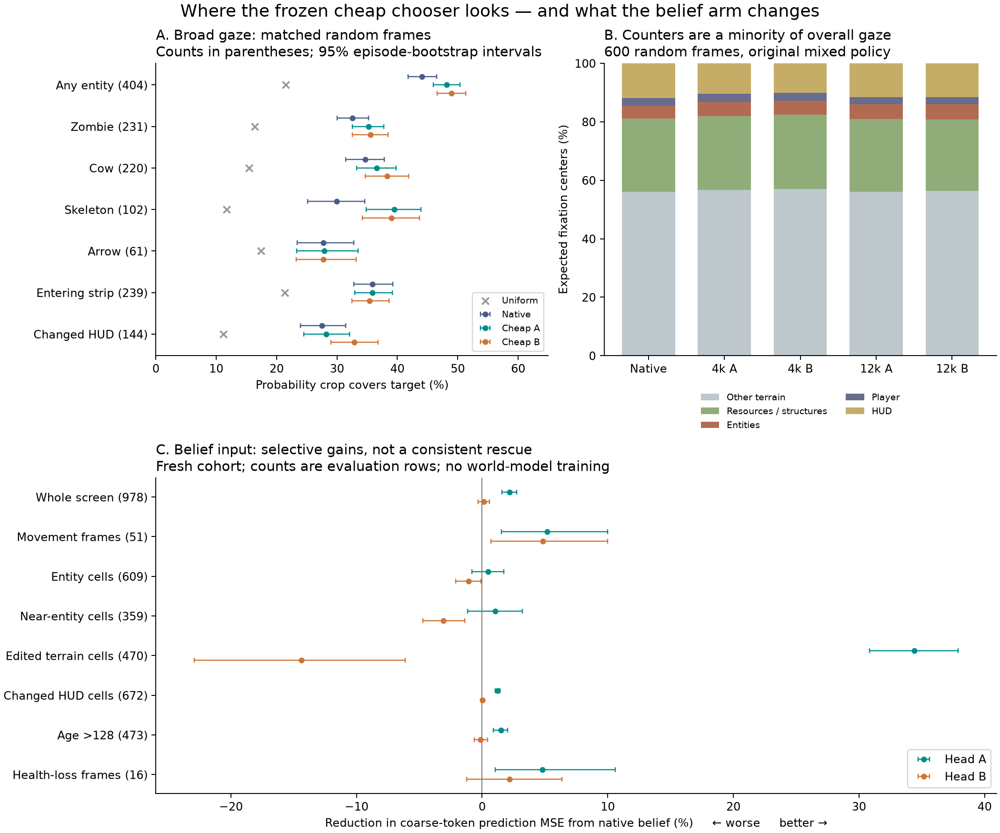

# Whole-screen gaze and the belief arm

2026-11-03. Both requested dissections are complete. No optimization, world-model
changes or policy adoption. P1-F1.6 results were not inspected. Full measurements:
[gaze.json](gaze.json), [belief.json](belief.json),
[belief_counters.json](belief_counters.json), [noise.json](noise.json).

**The cheap head is not primarily looking at counters.** On broad random frames
its prospective gaze covers entities more often than uniform or the archived native
expensive chooser. Much of that targeting is surprise-led. The belief arm has
selective gains, particularly movement, but no reproducible large rescue of rare
counter events or hidden-entity prediction. Fresh night rendering noise makes up
a substantial component of surprise for BOTH chooser families.

**What was actually measured.** These are offline probabilities from frozen heads,
not executed closed-loop gaze or demonstrated world-learning gains. All mixed
policies use the already fixed mean-normalized equal C/S score blend, softmax and
20% uniform exploration. The expensive reference is the archived native high-noise
denoiser scorer, not a perfect contingency oracle. Its two-draw scoring estimator
differs from the cheap conditional-mean head's estimator.

A/B = head seeds611601/611602 of ONE F1.5 world seed. They change initialization
and training batch order. The long cheap heads have12k cumulative updates; short
ones have4k. Carried12k and fresh12k are both reported, including the weak remote-
counter fits. No successful head was selected for this report.

Natural-frame cohorts:600 saved frames /245 episodes and128 confirmation frames
/85 disjoint episodes, uniformly sampled within each cohort's eligible transitions
(t>=8). They contain404/86 frames with entities. These are the appropriate cohorts
for ordinary gaze allocation. The full counter benchmark deliberately balances
events and must not be used as an estimate of ordinary behavior frequency.

All intervals are paired episode-cluster bootstrap95% intervals, conditional on
these fitted heads and native forecast draws. They do not include world-seed or
head-training-population uncertainty. Secondary slices are exploratory, with no
multiple-testing correction.

**1. What the cheap head would look at.**

On the600-frame natural cohort, long carried heads place centers on:

| Center's content | Cheap A | Cheap B | Expensive native |
|---|---:|---:|---:|
| Common/other terrain |56.1%|56.5%|56.0%|
| Resources and structures |24.9%|24.4%|25.0%|
| Entities |5.0%|5.1%|4.5%|
| Player |2.5%|2.4%|2.5%|
| HUD |11.6%|11.6%|12.0%|

These are disjoint center categories summing to100%. A center need not land
directly on an entity to include it in the3x3 crop. Terrain within a selected crop
is not automatically wasted evidence. Expected crop-cell allocation is also
archived: entities4.3–4.4% versus1.8% uniform; HUD12.6% versus14.3% uniform.

Probability a crop covers the specified target, conditional on its presence:

| Target (exposed frames) | Uniform | Expensive | Cheap A carried | Cheap B carried |
|---|---:|---:|---:|---:|
| Any entity (404) |21.5%|44.1%|48.2%|49.0%|
| Zombie (231) |16.4%|32.6%|35.2%|35.5%|
| Cow (220) |15.4%|34.6%|36.5%|38.3%|
| Skeleton (102) |11.7%|29.9%|39.5%|39.0%|
| Arrow (61) |17.4%|27.8%|27.9%|27.7%|
| Nearby entity, ring<=2 (257) |21.4%|39.0%|40.5%|40.7%|
| Newly entering map strip (239) |21.3%|35.8%|35.9%|35.4%|
| Changed HUD field (144) |11.2%|27.5%|28.2%|32.8%|

Rows overlap and are not percentages that should sum to100%. Opportunity differs
by target location; the uniform column accounts for the valid-window geometry.

Any-entity paired cheap-minus-expensive advantage is+4.13pp[2.61,5.58] for carriedA
and+4.91pp[3.31,6.60] for carriedB. Original4k heads already reach48.5/48.0%; fresh
12k heads48.7/48.5%. Thus the broad result is not an artifact of cherry-picking a
long-fit winner. The128-frame confirmation cohort gives49.3/49.7% carried versus
45.2% expensive and20.1% uniform; paired advantages+4.12pp[0.74,7.49] and
+4.51pp[1.16,8.15]. Arrow confirmation has only9 exposed frames: do not promote
that point estimate to a strong new result.

**Most of the cheap advantage is by day.** Entity coverage day:55.1/56.1% cheap
versus48.8% native (245 exposed frames). Night:37.5/38.0% versus36.8% (159 frames).
Both still exceed uniform at night, but stronger overall cheap coverage does not
mean it solves difficult night observations.

**C and S do different jobs.** With long carried heads, any-entity coverage is
33.3/34.1% for C-only,55.7/56.1% for S-only,48.2/49.0% for the existing blend,
and44.5/45.1% for arithmetic probability mixing. Native:27.6% C-only,54.3% S-only,
44.1% existing blend. A mixture that protects remote counters can therefore trade
away some entity concentration. These are selection properties, not teaching
utility measurements or a reason to adopt S-only.

**2. Visual noise: measured by holding physics fixed.**

Eight selected night states, four renderer RNGs each. Their original replays match
stored frames exactly. Only the CURRENT rendered evidence changes; history,
model weights, head forecasts and native forecast randomness remain fixed.
Contingency is exactly identical across each scene's four rerenders.

For each window, mean squared surprise over those four renders decomposes exactly
into squared residual of the mean percept plus the finite-repeat percept variance.
Uniform-window averaging gives:

| Chooser | Finite-repeat variance / total surprise energy | Mixed-policy TV between rerenders | S-only TV |
|---|---:|---:|---:|
| Original4k A/B |43.3/44.1%|3.7/3.8%|8.1/8.4%|
| Carried12k A/B |46.9/45.6%|3.9/3.8%|8.7/8.7%|
| Expensive native |51.1%|4.0%|9.3%|

TV is probability mass redistributed, not the percentage of looks wasted. The
largest-scoring window changes on27–31% of cheap carried repeat pairs versus48%
native, but many such swaps are near ties: the full mixed distribution moves much
less. HUD-touch probability changes by only~0.8pp on average.

The variance fraction is an EXACT FINITE-BANK decomposition, using denominator4;
it is not the true population aleatoric fraction or a claim about all daytime or
trajectory surprise. Four renders do not estimate every noise realization. This
test isolates fresh current-frame noise, not noise entering through prior history.
It also cannot say which noise-driven looks eventually help learning. It does show
that the expensive chooser is not a noise-free teacher and raw surprise does not
identify reducible error.

**3. Belief arm: gains beyond the small aggregate.**

The E3 comparison holds parameter count118032, fit length4k, initial weights and
batch order matched. The coarse auxiliary input is a fixed256D sketch of the last
coarse grid; the rich auxiliary input is the native corrected Mamba belief BEFORE
the queried action. Both are train-standardized, projected to64D and broadcast to
all locations. Main8-frame coarse history is unchanged. It tests this auxiliary
route and fit, not every way of using memory or a pure extra-history intervention.

Fresh978-row confirmation benchmark, positive = lower token prediction MSE:

| Slice / target | Rows with target | Head A | Head B |
|---|---:|---:|---:|
| Whole benchmark |978|2.17%[1.58,2.76]|0.12%[-0.33,0.60]|
| Natural random-frame subset |128|3.31%[1.12,6.15]|2.21%[-0.00,4.58]|
| Movement-action frames, whole grid |51|5.19%[1.55,9.99]|4.85%[0.69,10.01]|
| Entity cells |609|0.46%[-0.81,1.73]|-1.09%[-2.12,-0.09]|
| Near-entity cells |359|1.03%[-1.17,3.21]|-3.10%[-4.71,-1.40]|
| Edited terrain cells |470|34.41%[30.84,37.91]|-14.37%[-22.93,-6.10]|
| Changed HUD cells |672|1.24%[1.04,1.44]|0.04%[-0.10,0.17]|
| Episode age>128, whole grid |473|1.49%[0.90,2.03]|-0.12%[-0.64,0.45]|
| Health-loss frames, whole grid |16|4.80%[1.04,10.59]|2.17%[-1.22,6.35]|

Evaluation rows can repeat a physical frame under different event labels:
978 rows=975 unique frames;609 entity rows=607 frames;359 near-entity rows=357
frames. Natural samples, movement frames and the16 health-loss cases are unique.
JSON includes unique-frame counts for every group. Sparse health/return cases
are not decisive evidence of a hidden-memory capability.

The movement benefit replicates on the earlier cohort:4.44%[1.44,7.78] and
3.35%[1.15,5.55],288 movement frames. Player-cell error also improves in both
heads overall (10.6/16.3% fresh;13.6/30.8% saved), but that cell contributes only
~0.16–0.17% of baseline fresh benchmark error, so large relative player gains
cannot explain much global improvement.
Movement only looks rare in the event-balanced benchmark: those51 frames are
40% of the128 natural-frame confirmation sample (earlier288/600=48%). It is a
common-play benefit, not evidence of a rare hidden-state capability.

The edited-terrain sign reversal is real and reproduces on the earlier cohort:
A31.85% better, B10.81% worse. This is heterogeneity hidden by averaging, not a
robust rare-event rescue. On health-loss frames the HEALTH-CELL improvement is
only1.20/0.53% fresh (0.57/0.57% saved): the whole-grid gain is not a large gain in
predicting the damage digit. An entity appearing after8 entity-free frames has
only6 fresh cases; no consistent cross-cohort/seed gain is established.

Actual increment COUNTER-CELL prediction error reductions, fresh cohort:

| Counter | Increment rows | Head A | Head B |
|---|---:|---:|---:|
| Drink |128|1.11%|0.25%|
| Wood |128|3.14%|-0.12%|
| Stone |128|2.33%|-0.23%|
| Coal |128|-0.18%|0.27%|
| Iron |82|0.20%|0.18%|
| Sapling |6|0.30%|-0.83%|

First versus later increments and no-increment outcomes are retained separately
in belief_counters.json. No hidden large coal/iron gain emerges in this route.

**Where the global gain comes from.** All disjoint category contributions sum to
the full measured improvement. For fresh headA's2.169 percentage-point global
relative improvement, common terrain contributes1.513pp, resource terrain0.259pp,
inventory0.178pp, all entities together0.131pp, player0.018pp, with the remaining
categories closing the total. For B's0.116pp, resource terrain adds0.484pp but
common terrain subtracts0.140pp and entities subtract0.325pp. A small net result
can therefore conceal opposing improvements and regressions. This does not
establish their internal cause or that the belief itself lacks useful information.

**What this supports for the architecture discussion.** Preserve the whole-screen
perspective: the cheap family already finds entities and entering content, even
when its remote counter contingency is unreliable. Reliability is not only better
counter localization; it includes night noise, action/scene competence and stable
rare-event acquisition. E3 supports selective usefulness of native belief under
this route, not a general solution to long-term or fine-evidence access. Neither
more entity coverage nor lower detached token MSE proves faster world learning.

**Verification and bounds.** GPU work was frozen inference only (~8s per pass; a
second pass retained the already computed static percepts for the variance
accounting). Original67 source/input pins still match. Full-precision E3 mean MSE
matches its original archives to<=5.96e-8; C/S window differences<=3.06e-5 due
floating-point reduction order. Label-cache episode keys/offsets match, category
allocation sums to1, all policies are normalized and keep exploration, no-op C=0,
and the error decomposition closes. Spatially cycling all49 policy shifts removes
entity-targeting advantage exactly back to uniform opportunity. Paired identical
predictions return exactly zero difference. Evidence in CHECKS.json,
inference_identity.json, decomposition_audit.json and original_pins_audit.json.

No further experiments or repairs were launched after this dissection. Ready to
discuss the improved cheap-head design with the user.
