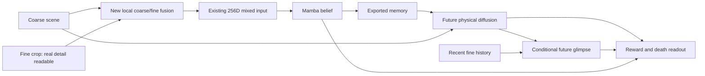

# P1-F1.6: useful consequence gains, no demonstrated fine-memory repair

2026-11-03. Completed review of the original design, code, source pins and full
matched evaluation. The user explicitly reopened F1.6 after the chooser studies.
No production code, world weights, curriculum, loss, corpus or gaze policy changed.
No P1-F2/P2/actor run was launched. Protocol: [PLAN.md](PLAN.md).
Machine-readable detail: [ANALYSIS.json](ANALYSIS.json).

The new module is real and trained. It did not remove the old global projection,
make spatial tokens persistent, change Mamba's export, or remove the direct coarse
history route. Mandatory fusion is not mandatory reliance on fine information:
the module itself can use its coarse inputs, and downstream consumers retain
other predictive routes. These are code facts and possible explanations, not a
measurement of which shortcut caused the result.

## 1. What was actually compared

F1.5 and F1.6 are from scratch, world seed1, 25.6M frames, uniform gaze, identical
saved recipe except `belief.spatial_fusion={kind:joint_fine,hidden:128,init_seed:611901}`.
Actual checkpoint configs were compared, not inferred from current YAML.
The sole new parameter block has 19,648 parameters: shared 88→128→64 GELU,
then existing token normalization. Its joint fine token replaces the raw fine
canvas entering the old 256D projection. No raw fine bypass.

Training took 11h01m; evaluation finished at 2026-11-03 02:08 UTC. All ten
checkpoints exist; checkpoint10 was selected by the existing monitor rule, with
no three successive increases. Actual checkpoint SHA256 is
`34bda77fe5ec5226c4f003301c972d918e2d4a4a554a5a6f279fcabbe922b045`.
All 48 pinned source files still match. Re-running F1.5 beside F1.6 reproduced
EVERY numerical field of its previous random-gaze interface evaluation exactly
(maximum difference 0). New readers are checkpoint-specific. The cascade-copy
check passes in all 32 consistency batches. See `recipe_check.json`,
`ANALYSIS.json.audit`, and the original run's CHECKS/STATUS/evaluation log.

This isolates the fusion PACKAGE in this paired seed, not locality separately
from added nonlinear capacity or the across-seed expected effect.

## 2. Primary mechanism: a useful past look still has negligible native benefit

The original queued test covers 1,339 frames in 250 dev episodes and all 49 genuine
looks per frame. F1.6's map-loss spread over looks is 0.0376% of mean loss on the
random cohort and 0.0420% on the night cohort (F1.5 approximately 0.06% each).
Random is a sampled cohort, NOT a day-only stratum. For windows containing a
missed mob versus empty windows, F1.6's map loss difference is
`+0.000000785 ±0.000002624 SE` (32 random-cohort frames) and
`−0.000003261 ±0.000004714 SE` (75 night-cohort frames). No detected benefit.
This alone is limited by whole-map averaging and reader-defined misses.

### New, bounded local check

Both worlds were replayed on the SAME 58 previously qualified night scenes
(48 episodes), keeping the original informative/control crop weights and
source-defined local regions. Real full prefixes, all 49 genuine same-frame
crops, eight native noise levels, two shared draws, no world updates.
The next action, target and noise are paired across looks. No arbitrary zeroed
glimpse or incompatible memory/cache substitution. Negative values below mean
the informative crop improves the native consumer's loss.

| Native loss change from informative look | F1.5 | F1.6 | F1.6 95% episode-bootstrap interval |
|---|---:|---:|---:|
| Local future physical, all levels | +0.00061% | −0.00217% | [−0.00770%, +0.00381%] |
| Local future physical, highest two levels | +0.00018% | +0.00736% | [−0.01278%, +0.03089%] |
| Next-frame TSP pixel MSE | −0.02364% | +0.01712% | [−0.01551%, +0.04669%] |

Not all old fine-readability controls transfer to the new encoder. Both new fine
readers recognize every old source cell/crop in 40 scenes (35 episodes). This
declared common-readable subset ALSO has no local physical benefit:
F1.6 −0.00119% [−0.00815%, +0.00586%]; highest levels +0.01222%
[−0.01496%, +0.04745%]. TSP worsens slightly on this subset:
+0.03498% [+0.00391%, +0.06731%]. Report this as a small descriptive regression,
not a broad theorem about fine prediction. The primary all-58 cohort is retained.
Readable source observations are a positive control, not proof of information
new to the full coarse/history baseline; this control does not establish the
Bayes-optimal gain for these forecast targets.

A final SOURCE-only instrument audit was declared after this null: among the
40 fine-readable scenes, the new native coarse reader still misses all original
source cells in36 scenes(32 episodes). Re-reading the EXISTING saved losses on
this subset gives local effect−0.000276%[−0.00760%,+0.00737%]. Thus merely making
the old difficult entities coarse-readable does not explain the null. This
post-result descriptive subset does not replace the original cohort, or prove
absence of conditional information from every other coarse token/history.
No new future forecasts or fits were run for it; see `source_checks.json`.

Legitimate crop contrasts reach every stage. RMS values:

| Stage | F1.5 | F1.6 |
|---|---:|---:|
| mixed embedding | .09700 | .08161 |
| corrected emission | .06898 | .05877 |
| post-action emission | .02263 | .01885 |
| projected memory | .01328 | .01110 |

These are different representations/scales, and contrasts include location as
well as content. They are NOT information-retention percentages. They show a
connected route; they do not show useful semantic uptake. Native prefix replay
RMS stays below .00844. The original F1.5 next-TSP effect reproduces the historical
value; denoising uses new common noise for both worlds. Collection/fine-reader
fitting took 105.7 seconds. All raw losses, reader weights, cohorts and identities
are saved in this directory. No diagnostic-budget extension followed the null.

**Conclusion:** this specific local integration did not demonstrate the intended
fine-to-future repair. This is stronger than the whole-map null alone. It still
does not prove irreversible erasure, that 256D is universally insufficient, that
Mamba cannot store fine content, or that all spatial-fusion designs fail.

## 3. The world nevertheless learned some consequences better

Actor-interface readout, random gaze. These are probabilities emitted by the
world's outcome heads on generated successors, NOT achieved agent scores.
Achievement rows select recorded successful transitions and are descriptive
for stochastic events. Risky rows are defined BEFORE the outcome (health≤2 and
an adjacent zombie), so recorded damage/death frequencies are calibration targets.

| Readout | Histories | Recorded | F1.5 generated | F1.6 generated | Paired change, percentage points (95% interval) |
|---|---:|---:|---:|---:|---:|
| first wood | 300 | 100% | 84.22% | 88.45% | +4.23 [1.82,6.63] |
| collect stone | 300 | 100% | 82.17% | 90.47% | +8.30 [5.56,11.04] |
| zombie defeat, observed-success subset | 300 | 100% | 19.97% | 29.53% | +9.56 [7.48,11.64] |
| skeleton defeat, observed-success subset | 300 | 100% | 46.70% | 52.41% | +5.71 [3.20,8.22] |
| collect coal | 300 | 100% | 10.31% | 17.49% | +7.18 [4.90,9.46] |
| collect iron | 287 | 100% | 2.85% | 5.46% | +2.61 [1.36,3.85] |
| eat cow, observed-success subset | 300 | 100% | 20.96% | 17.22% | −3.73 [−5.95,−1.51] |
| make stone pickaxe | 300 | 100% | 82.79% | 79.96% | −2.83 [−4.92,−0.74] |
| place furnace | 300 | 100% | 86.81% | 81.88% | −4.93 [−7.41,−2.46] |
| damage, risky context | 3,805 | 12.75% | 5.35% | 2.93% | −2.43 [−2.91,−1.95] |
| death, risky context | 3,805 | 12.77% | 1.75% | 1.09% | −0.66 [−0.92,−0.40] |

Every other achievement is retained in ANALYSIS.json. Drink stays 87.4→87.6%,
table91.2→92.5%, wake-up48.9→49.5% (recorded88%); none is a detectable change
on these paired intervals. Diamond6.2→1.5% has only12 histories and a wide
interval; do not pronounce a reliable diamond regression. Iron sword90.9→92.8%
improves modestly. The multiple event readings remain exploratory paired-seed
results, not adjusted across-seed significance claims.

The major gains/regressions also appear under guided evaluation gaze. Random
versus guided generation is close; the old current-query gate has not returned.
This is not evidence of improved past-glimpse use: the whole jointly learned
model and its current-percept outcome interface changed.

### Risk and reward: the broad mean conceals a serious problem

Heads on REAL risky successors give damage12.89% and death12.77%, beside recorded
12.75%/12.77%. On generated successors they give2.93%/1.09%. Thus the failure is
in the generated-percept/outcome-consumer path, not simply a missing real-data
death label. This does NOT uniquely separate wrong generated content from poor
head generalization to generated latent representations.

Across6,000 random histories, expected reward is .03879 versus .03137 recorded:
about24% optimistic, essentially unchanged from F1.5. Positive reward contributes
.03985 versus .03552 real; negative reward contributes−.00106 versus−.00415 real.
Random death probability .00029 versus .004 real (~14x underprediction).
Random unlock probability .03972 versus .03367 real. Do NOT use the
outcome-selected "no unlock happened" subset to call these false rewards;
independent stochastic samples need not match the recorded draw.

## 4. Counter detail: a real mixture of learning and readability changes

Verified correct / unknown, F1.5→F1.6. Each world's readers were refitted and
qualified on real tokens. Unknown generated tokens are not counted as successes;
they are also not established wrong digits.

| Target | Generated fine crop, correct | Periphery, correct | Periphery, unknown |
|---|---:|---:|---:|
| drink0→1 | 77.0→78.4% | 52.7→73.6% | 29.1→11.0% |
| drink increments | 17.8→24.1% | 7.6→9.8% | 40.2→43.3% |
| wood0→1 | 67.1→75.9% | 40.6→55.1% | 32.6→25.1% |
| wood increments | 63.5→68.2% | 33.6→29.0% | 45.8→55.2% |
| table placement | 39.4→45.0% | 36.8→43.0% | 0.8→0.6% |

The drink appearance gain is largely better readability: unknown decreases18.1pp
while verified success rises20.9pp; the among-readable paired gain is5pp with an
interval spanning zero. Wood appearance has an among-readable gain too.
For wood increments verified periphery success falls4.53pp [−6.84,−2.22], BUT
unknown rises9.44pp and success among reads readable in BOTH arms rises2.90pp.
The correct conclusion is worse usable periphery output, not demonstrated worse
underlying arithmetic in all those unknown samples.

Individual transitions expose persistent failures. Fine drink1→2 improves
44.1→54.9% (288 samples/144 histories);2→3 stays9.9→9.1% (372/186);
5→6 stays0.5→0.9% (214/107). Fine wood1→2 improves69.4→78.7% (516/258),
2→3 stays62.7→61.6% (526/263),5→6 stays0% (30/15). Periphery drink5→6 is0%
in both; wood3→4 falls15.5→9.5% while unknown rises72.6→82.8%.
These are descriptive transition strata, not independently estimated population
event probabilities. See `ANALYSIS.json.counter_transitions` for every starting
value, including small unsupported tails. This is not a solved counter model.

Failed table attempts generate a fine false placement0.41→0.83% (a small paired
regression); periphery false placements0.55→0.77% are not detectably changed.
The fixed NOOP drink/wood panel has zero verified false increases in both worlds.

## 5. Perception improved; emitted belief scarcely did

Real-token periphery day entity recall is essentially perfect. Near-player night
presence recall averaged over two probe seeds96.53→96.70%; by kind:
zombie97.93→98.23%, cow98.65→98.21%, skeleton96.24→96.71%, arrow85.34→86.19%.
The perception blocker passes. Wider night rings remain harder (presence87.54→86.84%).

Both reconstruction and TSP correctly render all tested real HUD digits/icons.
Reconstruction MAE on0–255 pixels improves: day map1.35→1.02, night4.07→3.87,
zombie5.46→4.11, cow4.43→3.34, skeleton12.10→9.49, table3.46→2.85,
iron4.17→3.01. Arrows14.93→14.08 and diamond16.64→15.68 remain much harder.
These are REAL-input reconstruction readings, not generated-future accuracies.

Belief HUD exact accuracy, two probes:78.68→78.75%. Current-percept controls
92.37→92.56%; last-eight-step controls87.76→88.55%. Health is98.49%, but
food44.80%, drink47.21%, energy53.26% in the new belief. The mean hides them.
Achievement AP91.95→92.14%; departed-kind probes are largely unchanged.
These show accessible readout under the declared instrument, not a bound on
everything encoded in Mamba's much larger internal carry.

## 6. Generated percepts remain different from real ones

S1 C2ST accuracy94.64→91.96% (50% indistinguishable): lower, still readily
separable. Counts on30,000 one-step samples from real histories:

| Kind | Real through F1.6 reader | F1.5 generated | F1.6 generated |
|---|---:|---:|---:|
| zombie | .420 | .243 | .274 |
| cow | .470 | .304 | .243 |
| skeleton | .158 | .052 | .045 |
| arrow | .092 | .122 | .129 |

Real-reference reader error changes slightly between worlds; it is not simulator
count ground truth. The same qualitative zombie gain/cow loss appears on the
smaller paired sampler panel. More evaluations recover many missing entities:
F1.6 cow counts .242 at3/churn1→.492 at8/churn0→.553 at32/churn1, real .480.
Skeleton .064→.160→.160, real .145. Arrows remain excessive. Matching counts
does not establish identity, collision validity, event coupling or safe rewards.
Primary3/churn1 is not replaced after results; sampler tuning remains parked.

### Token distance and visible fidelity tell different stories

On the exact256-context conditioning panel, random-cohort fine-token MSE given
real next coarse tokens worsens .00127→.00278, but decoded pixel MSE IMPROVES
.00194→.00127 (~35%). Given generated coarse, token MSE .00402→.02437,
while pixel MSE .01397→.01460 is broadly similar. Post-DO pixel error also
improves with real coarse (.00216→.00132) while staying much larger with
generated coarse (.00986→.01042). The target latent spaces differ; token-MSE
ratios alone cannot identify a semantic regression. Generated conditioning is
scored against the one recorded realization, so some departure can be valid
stochastic variation, not a conditional-stage error.

F1.6 retains more fine appearance variation: night rerender variance .000552→.002487,
while coarse variance .05546→.05086. This is an observed representation change,
not proof that keeping noise caused the regressions. It helps explain why token
coordinates cannot be treated as fixed semantic units across trained worlds.
The monitor ends .02706→.02982 (+10.2%), and its broad fine contribution is
.01619→.02982 on the class-loss panel, despite improved real-pixel fidelity.

The generated glimpse and TSP render are more mutually consistent than before:
random-HUD mismatch .00152→.00102, but the generated world can be consistently
wrong. Reward-query consistency remains imperfect: for rewarding contexts the
median range over49 fixations is .0655 and maximum .1967 reward units. The
active contexts are not identical between worlds, so those selected medians are
not a paired improvement estimate. No terminal contexts occur in that panel;
its continuation≈1 cannot validate mortality. These parked issues are retained,
not new reasons to redesign P1 immediately.

## 7. Cheap-history side decision

The user shelved belief-conditioned fixation. Exact last1/2/4/8 input projection
folding was checked in FP64 and policy distortions in FP32 (max TV<1e-4).
Timing actual/NOOP forecasts plus mixed-policy probabilities, no training:

| Frames batched |1|2|4|8 coarse histories |
|---|---:|---:|---:|---:|
|1024|35.26ms|35.49ms|36.74ms|35.62ms|
|4096|141.45ms|142.35ms|146.47ms|145.44ms|

The small/nonmonotone differences are negligible beside native world updates.
Measured8-minus1 extrapolates to~17s over25.6M frames, excluding common work;
this is a shape microbenchmark, not a measured whole-run ETA. No2C/4C fits:
they do not buy a material processing-speed tradeoff. This does not establish
equal selection quality. The original smaller operational head and these
capacity-matched auxiliary controls remain distinct.

One initial FP32 raw-coordinate tolerance failed (2.55e-5; policy TV3.30e-6),
preserved in `history_cost_initial_check_failure.log`. Changing GEMM shapes alters
accumulation order; FP64 established algebraic folding instead. No scientific
quality threshold was relaxed and no world/head was retrained for the timing.

## 8. Interpretation for the next discussion

1. Reject the narrow claim that this simple early-fusion package, with otherwise
   unchanged P1 training, has repaired useful fine-to-future uptake.
2. Preserve its consequence/reconstruction gains AND its damage/death/cow/wood
   regressions. It is not a clean global upgrade or a solved imagination world.
3. Native uptake is weak on real prefixes, before self-feeding. That issue cannot
   be delegated entirely to P2 robustness. Conversely P1 was not trained on
   self-feeding, and this review did not run or pass the full P2/S2 contract.
4. Learned gaze can still teach by allocating prediction/grounding gradients;
   that differs from acquiring new evidence which the deployed belief then uses.
   Chooser scores and current-crop rendering do not establish the latter. A
   learned-gaze experiment must keep this distinction visible.
5. Do not silently adopt F1.6 as a demonstrated repair or roll in another
   architectural change before discussing tonight's baseline/comparison.

Rechecked primary papers: AFF learns local+global feature weights; CF-ViT reuses
aligned coarse features via an MLP/residual; neither validates our recurrent
memory learning. Our local joint MLP is an adaptation, not a replication.
DIAMOND §5.2 explains why a denoising estimate and iterative sampled distribution
are different objects; that limits the uptake null's scope.

- https://arxiv.org/html/2009.14082 (method3.2,4.1)
- https://arxiv.org/html/2203.03821 (feature reuse Eq11–14)
- https://arxiv.org/html/2405.12399 (5.2)

End of bounded review. Return to discussion; no automatic repair or world launch.
