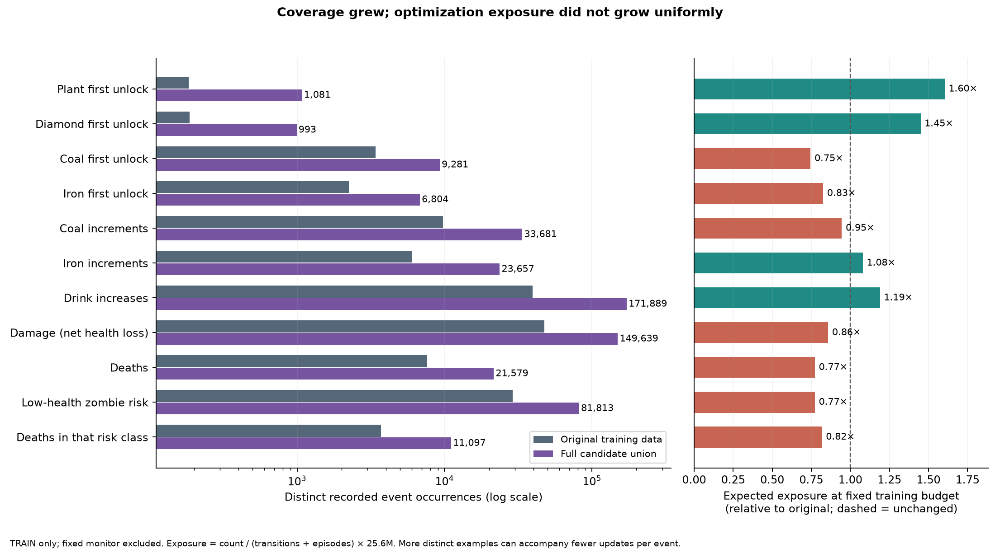
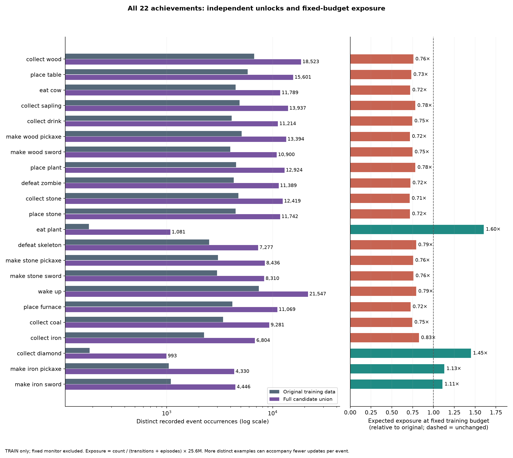
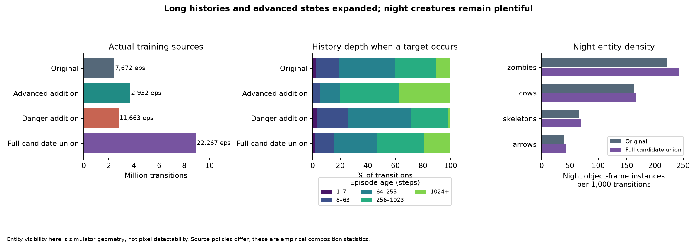

# Full training-dataset census — 2026-11-04

Final, complete census of the original store plus both authorized collections. No model fit, training run, sampler or architecture change. All counts below exclude the stable 5% monitor; original dev/final remain untouched. The full union is an accounting candidate, not an adopted training mixture.

The entire three-store archive has 25,440 episodes and 9,973,386 transitions. The eligible training pool has 22,267 episodes/8,914,902 transitions; held-out monitor episodes are excluded. Original dev (1,009 episodes) and final (1,002) remain separate, unchanged and unused in this audit.

**Main finding:** independent coverage is much broader, especially long histories, plant/diamond skills and diverse danger. At the fixed 25.6M-frame budget, raw concatenation reduces repetition from 10.49 to 2.86 passes. Several first unlocks and danger events become less frequent per emitted frame, even after the separate danger collection.

## Source composition

|Source|Train episodes|Transitions|Deaths|Truncated at cap|Median / p90 / max length|Frames after step 1023|
|---|---|---|---|---|---|---|
|Original|7,672|2,432,119|7,621|51|213.00 / 624.90 / 2,500.00|250,266 (10.3%)|
|Advanced addition|2,932|3,711,420|2,311|621|1,085.50 / 2,500.00 / 2,500.00|1,391,638 (37.5%)|
|Danger addition|11,663|2,771,363|11,647|16|180.00 / 522.00 / 1,457.00|52,804 (1.9%)|
|Full candidate union|22,267|8,914,902|21,579|688|211.00 / 1,064.00 / 2,500.00|1,694,708 (19.0%)|

Long episodes are complete natural histories, not cutouts or repeated prefixes. In the advanced addition, 1,602 episodes reach step 1,024 and 621 survive to the 2,500-step cap. A cap is truncation, not death.

Original/new reset keys were checked disjoint across all source splits. New sources use the same frozen symbolic expert and environment, with fixed exploration schedules, no success/death acceptance filtering, and full actual behavior probabilities/random-action flags. These diagnostic state labels never become world-model inputs.

Advanced policies: competent epsilon 0/.02/.05/.10, interleaved with fixed 16-action uniform bursts after 512/1,024-step competent prefixes. Danger policies: reset exploration at epsilon .25/.5/1, interleaved with a fixed 512/1,024-step competent prefix then uniform actions until termination/cap. No state was hand edited.

Whether scheduled late exploration was actually reached (survival is not assumed from the assigned policy name):

|Assigned policy|Train episodes|Reached exploration switch|Actual transitions after prefix|Deaths after switch|
|---|---|---|---|---|
|advanced_bursts_0.02_512|727|619|262,313|605|
|advanced_bursts_0.02_1024|729|526|255,120|501|
|danger_late_failure_0.02_512|637|550|38,110|550|
|danger_late_failure_0.02_1024|641|466|52,322|466|

For burst policies, post-prefix transitions include both bursts and base-policy intervals; for late-failure policies every post-prefix action is uniform. The danger addition includes 1,016 genuinely reached late-failure trajectories (90,432 post-prefix random actions), rather than merely 1,278 assigned trajectories.

New held-out monitor support (excluded throughout this training census):

|Held-out source|Episodes|Transitions|Deaths|Risk deaths|Plant|Diamond|Coal|Iron|
|---|---|---|---|---|---|---|---|---|
|Advanced addition|140|168,701|112|39|29|35|130|130|
|Danger addition|625|142,840|625|360|5|5|145|92|

Keep original evaluation/monitor results separately visible. New held-out data can check generalization on the acquired distribution, but its rare-class support remains small and silently changing an aggregate monitor would change checkpoint selection. This audit does not make that selection change.

## All 22 first unlocks

Each unlock occurs at most once per episode, so these counts are also independent episode support. First unlocks are distinct from repeated counter increases. Rates use emitted frames (T+1 per episode), matching the P1 budget.

|Unlock|Original|Advanced|Danger|Union|Unique growth|Fixed-budget exposure ratio|
|---|---|---|---|---|---|---|
|collect wood|6,671|2,931|8,921|18,523|2.78×|0.76×|
|place table|5,804|2,930|6,867|15,601|2.69×|0.73×|
|eat cow|4,466|2,888|4,435|11,789|2.64×|0.72×|
|collect sapling|4,868|2,824|6,245|13,937|2.86×|0.78×|
|collect drink|4,105|2,847|4,262|11,214|2.73×|0.75×|
|make wood pickaxe|5,102|2,926|5,366|13,394|2.63×|0.72×|
|make wood sword|3,976|2,823|4,101|10,900|2.74×|0.75×|
|place plant|4,507|2,811|5,606|12,924|2.87×|0.78×|
|defeat zombie|4,300|2,872|4,217|11,389|2.65×|0.72×|
|collect stone|4,750|2,919|4,750|12,419|2.61×|0.71×|
|place stone|4,466|2,911|4,365|11,742|2.63×|0.72×|
|eat plant|184|778|119|1,081|5.88×|1.60×|
|defeat skeleton|2,509|2,683|2,085|7,277|2.90×|0.79×|
|make stone pickaxe|3,047|2,826|2,563|8,436|2.77×|0.76×|
|make stone sword|2,986|2,813|2,511|8,310|2.78×|0.76×|
|wake up|7,416|2,911|11,220|21,547|2.91×|0.79×|
|place furnace|4,169|2,899|4,001|11,069|2.66×|0.72×|
|collect coal|3,398|2,802|3,081|9,281|2.73×|0.75×|
|collect iron|2,249|2,696|1,859|6,804|3.03×|0.83×|
|collect diamond|187|626|180|993|5.31×|1.45×|
|make iron pickaxe|1,045|2,221|1,064|4,330|4.14×|1.13×|
|make iron sword|1,096|2,268|1,082|4,446|4.06×|1.11×|

First unlocks by episode age (union):

|Unlock|1–7|8–63|64–255|256–1023|1024+|
|---|---|---|---|---|---|
|eat plant|0|0|0|646|435|
|collect diamond|0|0|188|628|177|
|collect coal|0|2,606|6,252|417|6|
|collect iron|0|25|6,102|656|21|
|make iron pickaxe|0|0|2,337|1,894|99|
|make iron sword|0|0|2,672|1,694|80|

This separates late-life coverage from merely collecting more early events: 435 of 1,081 plant unlocks occur at age≥1,024; only 6 of 9,281 coal and 21 of 6,804 iron first unlocks do. Longer episodes are especially relevant to plant maturation, later survival, repeated mining and inventory states; missing long histories alone is not an explanation for first coal/iron failure.

## Repeated consequences and numeric value coverage

|Consequence|Original events / episodes|Union events / episodes|Expected old / union per 25.6M frames|Exposure ratio|
|---|---|---|---|---|
|Wood|64,952 / 6,671|195,367 / 18,523|681,522 / 559,617|0.82×|
|Stone|88,495 / 4,750|325,457 / 12,419|928,552 / 932,253|1.00×|
|Coal|9,727 / 3,398|33,681 / 9,281|102,063 / 96,477|0.95×|
|Iron|5,981 / 2,249|23,657 / 6,804|62,757 / 67,764|1.08×|
|Diamond|212 / 187|1,126 / 993|2,224 / 3,225|1.45×|
|Sapling|6,110 / 4,868|17,986 / 13,937|64,110 / 51,520|0.80×|
|Drink|39,435 / 4,073|171,889 / 11,118|413,780 / 492,366|1.19×|
|Health recovery|41,037 / 6,154|130,098 / 17,393|430,589 / 372,658|0.87×|

Prior numeric value for an increment (0 means 0→1; decreases/consumption can allow repeated 0→1 without another unlock):

|Counter|Source|0→1|1→2|2→3|3→4|4→5|5→6|6→7|7→8|8→9|
|---|---|---|---|---|---|---|---|---|---|---|
|wood|Original|16,173|17,405|15,084|11,273|3,494|956|354|154|59|
|wood|Full candidate union|44,989|49,181|44,465|35,040|13,036|4,752|2,269|1,156|479|
|stone|Original|15,565|9,429|8,496|7,661|7,590|7,821|8,777|9,980|13,176|
|stone|Full candidate union|44,934|28,194|26,099|25,418|27,110|30,708|36,170|43,521|63,303|
|coal|Original|3,861|2,555|1,541|878|447|235|116|64|30|
|coal|Full candidate union|11,788|8,471|5,633|3,517|2,010|1,120|628|333|181|
|iron|Original|2,993|1,718|757|308|128|53|20|4|0|
|iron|Full candidate union|10,940|6,746|3,233|1,510|695|301|144|68|20|
|diamond|Original|187|21|4|0|0|0|0|0|0|
|diamond|Full candidate union|993|123|10|0|0|0|0|0|0|
|sapling|Original|5,764|330|15|1|0|0|0|0|0|
|sapling|Full candidate union|17,033|906|45|2|0|0|0|0|0|

**Remaining holes:** diamond increments above 2→3 are absent; high-valued iron and sapling changes still have tens or single examples. Even wood 8→9 has only 479 examples. More source frames cannot repair a state/action combination that never occurred. The main rare-event gains are not uniformly spread across all values.

## Damage, death and survival controls

Damage below means net health loss in a transition, not a simulator-attributed attack count. Risk means health≤2 and an active zombie at Manhattan distance 1; it includes awake and sleeping states. Contexts overlap; empty hunger/thirst or a visible arrow is not proof of the cause of death.

|Event|Original|Advanced|Danger|Union|Old / union per million frames|Exposure ratio|
|---|---|---|---|---|---|---|
|damage|47,618|40,211|61,810|149,639|19517.2 / 16743.4|0.86×|
|death|7,621|2,311|11,647|21,579|3123.6 / 2414.5|0.77×|
|risk|28,891|12,194|40,728|81,813|11841.6 / 9154.2|0.77×|
|risk death|3,701|759|6,637|11,097|1516.9 / 1241.7|0.82×|
|risk survival|25,190|11,435|34,091|70,716|10324.7 / 7912.6|0.77×|

|Prior context|Old transitions|Union transitions|Old deaths|Union deaths|Empirical death probability old / union|
|---|---|---|---|---|---|
|day|1,624,283|5,832,390|3,778|10,928|0.233% / 0.187%|
|night|807,836|3,082,512|3,843|10,651|0.476% / 0.346%|
|health1|33,337|87,963|1,778|5,260|5.333% / 5.980%|
|health2|68,361|184,874|2,553|7,730|3.735% / 4.181%|
|sleeping|448,823|1,780,369|3,992|10,864|0.889% / 0.610%|
|awake|1,983,296|7,134,533|3,629|10,715|0.183% / 0.150%|
|food empty|42,770|214,907|267|1,184|0.624% / 0.551%|
|drink empty|191,780|774,978|1,746|5,003|0.910% / 0.646%|
|arrow visible|211,011|842,592|800|2,275|0.379% / 0.270%|
|skeleton visible|367,299|1,396,520|1,197|3,481|0.326% / 0.249%|
|iron equipment|776,747|4,409,853|1,395|4,592|0.180% / 0.104%|
|risk day|13,916|41,385|1,783|5,465|12.813% / 13.205%|
|risk night|14,975|40,428|1,918|5,632|12.808% / 13.931%|
|risk ready|9,399|25,495|3,580|10,719|38.089% / 42.044%|
|risk unready|19,492|56,318|121|378|0.621% / 0.671%|
|risk sleeping|2,089|6,560|790|2,410|37.817% / 36.738%|
|risk awake|26,802|75,253|2,911|8,687|10.861% / 11.544%|

These probabilities are unadjusted behavior-policy mixtures. They do not estimate a causal effect of equipment, sleeping, action or night. Readiness is the prior-state cooldown of an already-adjacent zombie; attack/update order and movement can still alter the outcome.

|Death state|Original|Union|
|---|---|---|
|lava|122|279|
|health_zero|7,621|21,579|
|lava_and_health_zero|122|279|
|nonlava_health_zero|7,499|21,300|
|other|0|0|

The simulator sets health to zero in lava; lava and health-zero counts overlap. Nonlava health-zero is not automatically a zombie death. No attack/starvation causal labels are inferred from overlapping contexts.

Deaths by episode age:

|Age band|Original deaths|Union deaths|Original risk deaths|Union risk deaths|
|---|---|---|---|---|
|1_7|0|0|0|0|
|8_63|558|1,774|274|895|
|64_255|4,453|12,440|2,437|7,225|
|256_1023|2,258|5,566|883|2,319|
|1024_plus|352|1,799|107|658|

## Action support at usable resources

Opportunity = awake, faced matching block, counter<9 and the exact required pickaxe held (wood for stone/coal, stone for iron, iron for diamond). NOOP/DO are drawn from different visited states, so these counts alone are not a matched causal comparison. Actual uniform-action-branch successes add stronger local action support.

|Resource|Source|Qualified DO|DO increments|Qualified NOOP|NOOP increments|DO without tool|Random-branch DO increments|
|---|---|---|---|---|---|---|---|
|drink|Original|39,435|39,435|4,081|0|0|1,507|
|drink|Full candidate union|171,889|171,889|22,619|0|0|4,710|
|wood|Original|64,952|64,952|3,007|0|0|2,803|
|wood|Full candidate union|195,367|195,367|9,789|0|0|8,564|
|sapling|Original|101,550|6,110|23,753|0|0|1,839|
|sapling|Full candidate union|300,460|17,986|83,648|0|0|5,666|
|stone|Original|88,495|88,495|3,507|0|5,107|1,772|
|stone|Full candidate union|325,457|325,457|15,045|0|12,987|5,417|
|coal|Original|9,727|9,727|183|0|810|156|
|coal|Full candidate union|33,681|33,681|561|0|2,007|374|
|iron|Original|5,981|5,981|71|0|2,981|69|
|iron|Full candidate union|23,657|23,657|202|0|6,788|141|
|diamond|Original|212|212|1|0|2,218|0|
|diamond|Full candidate union|1,126|1,126|6|0|8,025|2|

In the saved support, qualified DO always increments drink/wood/stone/coal/iron/diamond; sapling collection is stochastic (17,986 increases from 300,460 qualified DOs). Negative controls exist (NOOP/no tool), but diamond still has only 6 qualified NOOP opportunities and 2 randomized successful DO transitions. Rare skills are still expert-action dominated.

## Scene and action composition

Creature counts below are nominal simulator-visible instances (active and inside the camera rectangle), not distinct tracked identities and not a guarantee the night pixels reveal them. Background terrain counts include cells occluded by objects.

|Entity|Source|Object-frame instances|Night instances|Frames with entity within two cells|Night instances / 1k transitions|
|---|---|---|---|---|---|
|zombies|Original|1,087,643|539,115|515,369|221.7|
|zombies|Full candidate union|4,548,326|2,170,764|2,078,915|243.5|
|cows|Original|1,190,187|396,660|418,466|163.1|
|cows|Full candidate union|4,270,615|1,491,907|1,470,535|167.3|
|skeletons|Original|410,180|162,416|123,750|66.8|
|skeletons|Full candidate union|1,551,822|620,257|444,612|69.6|
|arrows|Original|231,943|95,668|155,574|39.3|
|arrows|Full candidate union|930,969|383,618|622,667|43.0|

|Background cell|Original view-cell count|Union view-cell count|Density ratio|
|---|---|---|---|
|invalid|0|0|new|
|out of bounds|1,104,513|5,711,557|1.41×|
|grass|72,305,532|237,625,911|0.90×|
|water|16,554,690|78,837,412|1.30×|
|stone|24,028,238|87,452,465|0.99×|
|tree|5,402,932|17,951,277|0.91×|
|wood|0|0|new|
|path|14,762,895|59,198,117|1.09×|
|coal|777,709|2,668,978|0.94×|
|iron|618,625|1,939,783|0.86×|
|diamond|82,832|266,518|0.88×|
|crafting table|713,709|2,320,534|0.89×|
|furnace|633,484|2,238,008|0.96×|
|sand|14,748,656|60,194,053|1.11×|
|lava|1,178,296|4,227,125|0.98×|
|plant|308,955|992,859|0.88×|
|ripe plant|2,431|14,229|1.60×|

Camera-aligned terrain edits (same world location; entering borders excluded):

|Edit|Original cells / episodes|Union cells / episodes|
|---|---|---|
|stone to path|110,352 / 4,750|427,819 / 12,419|
|tree to grass|64,994 / 6,671|195,775 / 18,523|
|path to stone|22,740 / 4,178|99,787 / 11,050|
|water to stone|11,832 / 1,372|61,137 / 5,060|
|grass to crafting table|14,934 / 5,774|44,726 / 15,494|
|coal to path|9,750 / 3,398|33,803 / 9,281|
|grass to furnace|7,510 / 3,109|24,899 / 8,896|
|iron to path|5,981 / 2,249|23,662 / 6,804|
|grass to stone|5,911 / 2,636|18,497 / 7,377|
|path to furnace|5,706 / 3,350|16,906 / 9,231|
|grass to plant|5,296 / 4,507|15,710 / 12,924|
|sand to stone|2,162 / 1,125|9,144 / 3,866|
|path to crafting table|1,533 / 1,184|5,246 / 3,800|
|furnace to path|1,529 / 995|4,993 / 3,110|
|sand to furnace|1,192 / 846|4,062 / 2,777|
|crafting table to path|1,155 / 953|3,968 / 3,070|
|sand to crafting table|615 / 551|2,116 / 1,850|
|ripe plant to plant|217 / 184|1,349 / 1,081|
|diamond to path|212 / 187|1,126 / 993|
|lava to stone|71 / 66|301 / 265|
|plant to ripe plant|30 / 27|147 / 135|
|grass to path|35 / 35|117 / 116|
|sand to path|7 / 7|30 / 30|
|lava to furnace|10 / 10|30 / 30|
|lava to crafting table|2 / 2|11 / 11|
|lava to path|0 / 0|1 / 1|

All 17 action frequencies:

|Action|Original|Union|Original / union % of transitions|
|---|---|---|---|
|NOOP|76,198|301,517|3.13% / 3.38%|
|LEFT|271,285|961,244|11.15% / 10.78%|
|RIGHT|265,052|942,189|10.90% / 10.57%|
|UP|278,338|991,754|11.44% / 11.12%|
|DOWN|283,465|1,008,446|11.66% / 11.31%|
|DO|411,541|1,444,014|16.92% / 16.20%|
|SLEEP|67,393|244,054|2.77% / 2.74%|
|PLACE_STONE|98,918|396,827|4.07% / 4.45%|
|PLACE_TABLE|71,587|264,595|2.94% / 2.97%|
|PLACE_FURNACE|67,946|255,966|2.79% / 2.87%|
|PLACE_PLANT|79,763|310,278|3.28% / 3.48%|
|MAKE_WOOD_PICKAXE|74,153|288,044|3.05% / 3.23%|
|MAKE_STONE_PICKAXE|75,935|296,035|3.12% / 3.32%|
|MAKE_IRON_PICKAXE|74,488|294,134|3.06% / 3.30%|
|MAKE_WOOD_SWORD|73,831|289,779|3.04% / 3.25%|
|MAKE_STONE_SWORD|74,829|293,637|3.08% / 3.29%|
|MAKE_IRON_SWORD|87,397|332,389|3.59% / 3.73%|

## P2: actual exogenous sequences, with terminal suffixes

A real window qualifies only when every observed action in it came from the actual uniform-random branch. After a true terminal, the remaining horizon may be absorbing. A surviving cap supplies no imaginary future. Windows overlap: event/episode support below is deduplicated. This audits support; it does not adopt a P2 objective or train on labels.

|Horizon|Original windows|Union windows|Union full real horizon|Union absorbing-tail windows|
|---|---|---|---|---|
|2|407,279|1,516,801|1,501,540|15,261|
|4|300,317|1,245,208|1,208,799|36,409|
|8|278,477|1,165,050|1,092,683|72,367|
|16|277,312|1,127,420|987,882|139,538|

|Event inside qualifying H16 support|Original events / episodes|Union events / episodes|
|---|---|---|
|damage|10,721 / 4,723|44,372 / 15,609|
|deaths|4,722 / 4,722|15,261 / 15,261|
|risk deaths|2,985 / 2,985|9,443 / 9,443|
|coal first unlock|1 / 1|2 / 2|
|iron first unlock|0 / 0|0 / 0|
|diamond first unlock|0 / 0|0 / 0|
|coal increments|1 / 1|23 / 22|
|iron increments|0 / 0|11 / 11|
|diamond increments|0 / 0|0 / 0|
|drink increases|440 / 238|2,551 / 1,344|

Many terminal events are covered by a short actual random suffix plus absorption, not 16 live steps before death. This avoids survival censoring but must not be sold as 16-step live trajectory diversity. Long advanced-skill P2 windows remain a separate coverage issue.

## Policy-component accounting

Policies were fixed before their outcomes. This table exposes which collection generates each support class; no new event-driven acceptance or training weight is chosen here.

|Policy|Episodes|Transitions|Plant unlock|Diamond unlock|Coal unlock|Iron unlock|Deaths|Risk deaths|
|---|---|---|---|---|---|---|---|---|
|old_eps_0.1|1,927|1,289,865|177|176|1,700|1,485|1,876|579|
|old_eps_0.25|1,915|524,328|7|11|1,210|707|1,915|824|
|old_eps_0.5|1,916|345,127|0|0|488|57|1,916|1,105|
|old_eps_1.0|1,914|272,799|0|0|0|0|1,914|1,193|
|advanced_competent_0.0|371|849,000|210|135|367|364|57|15|
|advanced_bursts_0.02_512|727|611,246|88|118|702|675|713|271|
|advanced_competent_0.02|367|666,244|149|105|360|347|171|33|
|advanced_bursts_0.02_1024|729|897,563|206|175|710|690|704|246|
|advanced_competent_0.05|367|440,036|88|64|339|325|306|91|
|advanced_competent_0.1|371|247,331|37|29|324|295|360|103|
|danger_reset_exploration_0.5|3,915|711,476|1|0|970|150|3,915|2,191|
|danger_reset_exploration_1.0|5,175|740,973|0|0|0|0|5,175|3,292|
|danger_reset_exploration_0.25|1,295|356,373|4|8|878|513|1,279|592|
|danger_late_failure_0.02_512|637|345,553|0|53|612|592|637|307|
|danger_late_failure_0.02_1024|641|616,988|114|119|621|604|641|255|

## What tonight can and cannot test

- Better-supported learning hypotheses: plant eating/diamond and advanced-tool events, late-state inventory changes, more distinct death/damage contexts, and later-state exploratory actions. Greater diversity can reduce memorization even where frequency falls.
- Raw-union caveat: at unchanged 25.6M frames, common first unlocks, coal first unlock, damage and deaths do not all receive more updates. An unchanged result on these would not isolate an architecture failure or refute a coverage hypothesis; unique diversity and exposure changed together.
- High-value iron/diamond counters, action support for very rare skills, and advanced-skill exogenous H16 windows remain thin or absent. Data collected so far does not close these holes.
- Extra night-entity examples create learning opportunity, not proof the fovea supplies incremental information over coarse vision/history or that its information reaches generation. Native fine uptake, sampler quality and P2 self-feeding are separate questions.
- Recommended scope for a later approved data run: same F2 architecture/learned chooser, 3×3 coarse input, losses and evaluations. A concurrent 2×2 change would alter sensing and obscure what the data changed. No run is launched by this audit.
- Final mixture and compute exposure must be declared together. Simply taking every source once is a defensible diversity experiment, but is not an experiment that increases optimization pressure on every rare failure. No event balancing or longer budget has been silently adopted.

Expected readings, to keep the run interpretable:

| Learning hypothesis | Evidence supporting it | Required reading | What a null would not prove |
|---|---|---|---|
| Better plant/diamond prediction | >5× independent unlock episodes; 1.60×/1.45× fixed-budget exposure | First unlocks and repeated increments, event recall AND false positives, on fixed old evaluation and separately the fresh monitor | Not proof that foveal integration works/fails |
| Better advanced counter behavior | Iron increments 5,981→23,657; high values filled unevenly | Per-prior-value increments in generated periphery AND generated glimpse; real-target heads as a separate control | Not proof that all high values are supported |
| Better danger generalization | 21,579 deaths and 11,097 risk deaths; true late-failure trajectories | Risk-conditional sampled damage/death, by health, day/night, sleep and cooldown; false death on surviving controls | At fixed frames, not a clean refutation of extra optimization pressure: death exposure is lower |
| Better late-history handling | 1.69M transitions at age≥1,024, versus 0.25M | Fixed evaluation stratified by prefix length; action-conditioned outcomes with deep real prefixes | Not proof of P2 self-feeding readiness or exact spatial/entity memory |
| Better coal/iron prediction | More source episodes and repeated increments, but first-unlock exposure falls | Keep first unlock distinct from later increments; compare same histories and gaze | A miss alone cannot identify data diversity versus optimization, memory or generator cause |

## Validation and provenance

All 22 original unlock counts reconcile to the previous train census; all new unlocks, transitions, damage, deaths and risk counts reconcile to the final committed manifests. New audit-sidecar hashes were checked against each manifest. All 22,267 actual-train ids are unique. Synthetic checks cover camera-aligned edits and terminal/truncation handling. Collection processes both exited successfully.

The collection QA includes native-GPU legacy parity and full native-GPU replay checks. The independent post-prefix CPU replay recovered all saved rewards/termination/random-action flags, but cross-backend pixels differed by at most one intensity value in 530 of 13,931,190 channels; that original exact-pixel failure remains recorded. Stored GPU observations and sidecars are authoritative. See `../20261104_rare_collection/RANDOM_TAIL_CHECK.json`; do not call cross-backend replay byte-identical.

Reproduction: `.venv/bin/python -m unittest artifacts.experiments.20261104_dataset_eda.test_census -v`; `.venv/bin/python -m artifacts.experiments.20261104_dataset_eda.census`; `.venv/bin/python -m artifacts.experiments.20261104_dataset_eda.analyze`.

All individual metrics, independent-episode support, densities and expected fixed-budget exposures are in `all_metrics.csv`; raw complete census in `CENSUS.json`, compact summary in `SUMMARY.json`, per-episode diagnostics in `episodes.json.gz`, and final manifest snapshots beside them. No probe was fitted and no simulator state is fed to the world model.
