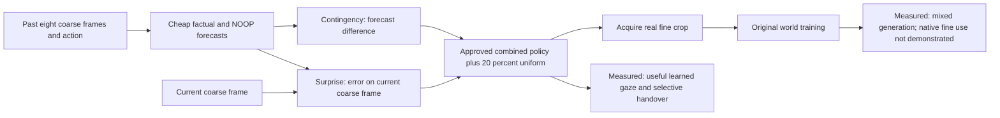
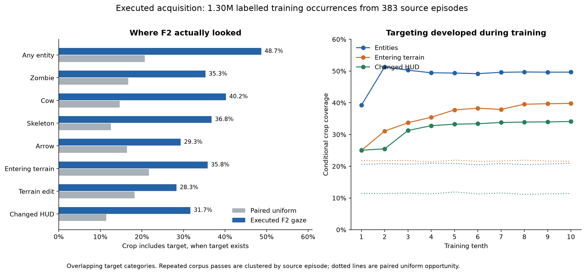
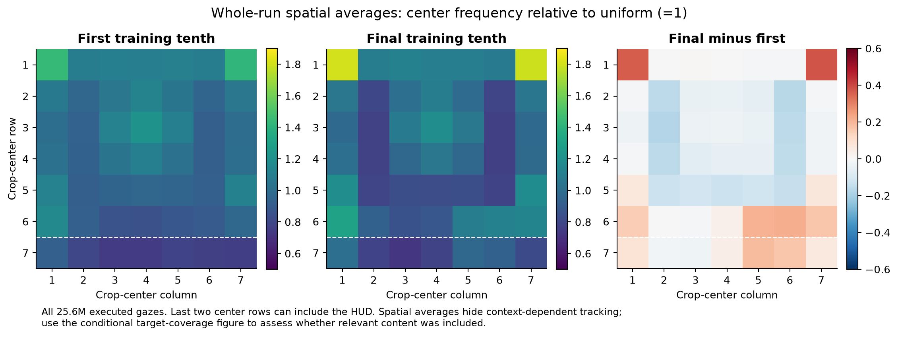
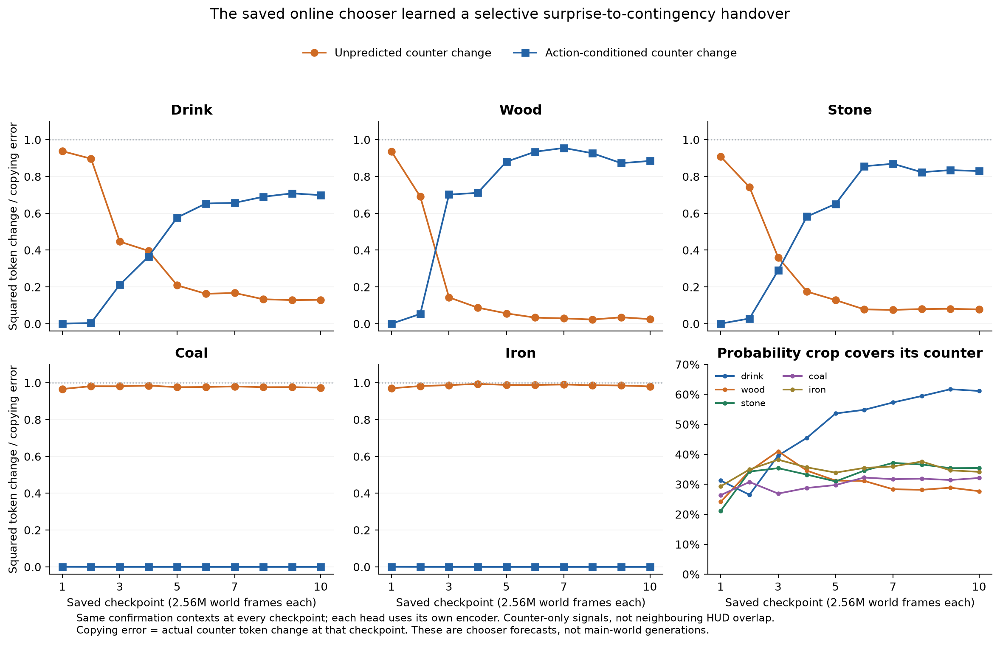
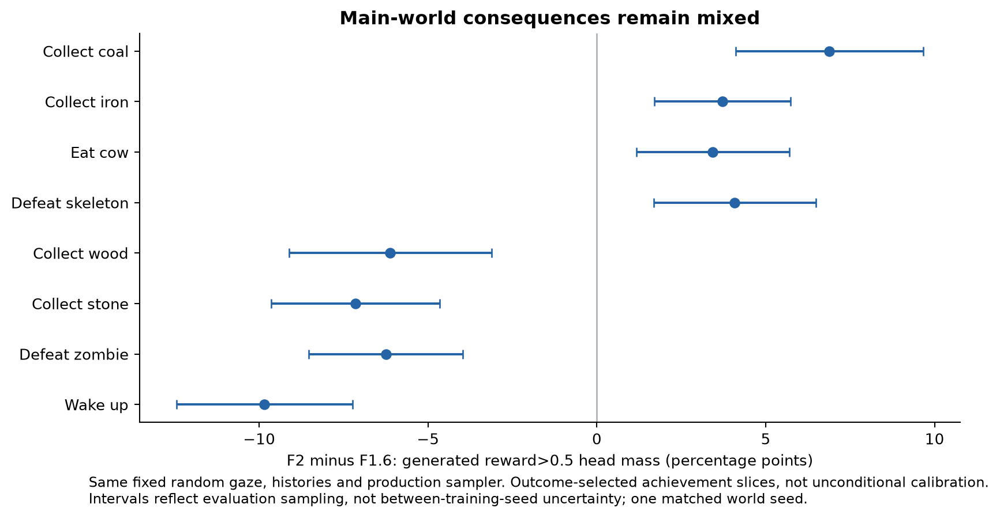

# P1-F2 review: acquisition succeeded; teaching remains mixed

2026-11-04. Completed frozen review requested by the user. No model/head refit,
training ablation, architecture change, P2/actor run or new launch. Prior fine-path
repair proposals are set aside. Original PLAN, controller, head, trainer, TEACHING
history and evaluation code were read before the new descriptive analysis.

**Main finding:** the actual online chooser learned meaningful gaze, including a
selective surprise-to-contingency handover for drink, wood and stone. Coal and
iron remain surprise-led. It also seeks entities, entering terrain and changed
HUD, rather than simply staring at counters. This is acquisition evidence in
one trained seed. The main world's consequences are mixed and its useful native
fine-to-future uptake is still unestablished. Those are separate claims.

## 1. What ran, and what was held fixed

F2 is F1.6 trained from scratch with the acquisition policy substituted. It is
not the earlier guided policy, a fine-tune, or a different world architecture.
Saved world configs and parameter shapes agree exactly; seed=1; 25.6M world
frames; 16 streams; 64 then256-step chunks with accumulation. Same corpus,
mandatory joint64 spatial fusion, cascade generator, faithful pixel objectives,
optimizer, clipping, monitor and budget. All 95 source/input pins still match.
F2 completed 25,000 detached head updates (6.4M sampled examples), and retained
all 25.6M actual gazes. Final ck10 was selected by the original monitor rule.

Training took 11h32m52s, versus 11h00m59s for F1.6: about 32min/4.8% extra wall
time, not a separately isolated microbenchmark. Evaluation completed normally.
The fixed-gaze F1.6 references reproduce every archived numerical class field
exactly under both random and guided gaze. Both controls are therefore real,
matched evaluations, not figures copied from a different reader or population.

The 101,584-parameter head reads eight prior coarse frames, prior lighting,
actions/rewards/termination/validity, with **no Mamba input**. Current fine pixels
and simulator labels never reach the policy. Forecasting precedes current coarse
evidence; surprise is then computed after seeing the current coarse frame, and
the fine crop is acquired last. Surprise can react to an already-visible coarse
consequence. This is the approved P1 teaching timeline, not anticipatory P3 VoI.

Policy exactly:
`0.8 softmax(0.5 C/mean(C) + 0.5 S/mean(S)) + 0.2/49`.
C and S are 16-channel squared differences summed over 3x3 windows; zero maps
stay zero. No reference model, labels, adaptive weights, noise-floor subtraction,
hand placement or new policy search was added.

Sources: [original PLAN](../20261103_p1f2/PLAN.md),
[controller](../20261103_p1f2/chooser.py),
[recipe](../20261103_p1f2/chooser.json), [PROVENANCE.json](PROVENANCE.json).

## 2. Where the eye actually went

The complete trace has 25.6M records. Semantic labels already exist for a training
subset: 1,296,145 executed occurrences,123,494 unique physical frames, 383 source
episodes after excluding monitor episodes. Repeated epochs are clustered under
the original physical episode for uncertainty estimates; they are not treated
as1.3M independent worlds. Uniform draws were preserved on the identical frames.

The right question is whether the **whole3x3 crop includes the target**, conditional
on the target existing. A center on grass may still acquire a neighboring mob.
The following categories overlap and are not shares that should sum to 100%.

| Target present | F2 crop coverage | Paired uniform | Gain pp [95% episode bootstrap] | Occurrences |
| --- | --- | --- | --- | --- |
| Any entity | 48.7% | 20.7% | +27.99 [27.46, 28.64] | 861682 |
| Entity within two cells | 42.4% | 21.3% | +21.13 [20.65, 21.70] | 535661 |
| Zombie | 35.3% | 16.7% | +18.58 [17.94, 19.21] | 456911 |
| Cow | 40.2% | 14.6% | +25.59 [24.74, 26.53] | 498215 |
| Skeleton | 36.8% | 12.5% | +24.27 [23.17, 25.41] | 191636 |
| Arrow | 29.3% | 16.4% | +12.91 [12.22, 13.64] | 116161 |
| Entering terrain | 35.8% | 21.7% | +14.12 [13.46, 14.84] | 463032 |
| Terrain edit | 28.3% | 18.2% | +10.08 [9.39, 10.78] | 146439 |
| Changed HUD | 31.7% | 11.4% | +20.27 [19.79, 20.80] | 328609 |

Held-out confirmation agrees: on 86 naturally sampled entity-containing frames
from 63 source episodes, expected combined-policy entity coverage is 48.9% versus
20.1% uniform; gain+28.88pp [24.18,33.91]. The larger saved natural sample gives
48.2% versus21.5% (404 exposed frames). These are **natural random-frame cohorts**;
the event-balanced benchmark is never used as a population distribution.

The final expensive native scorer covers entities 43.8% on the same saved natural
cohort versus cheap combined 48.2%, C-only 32.4%, S-only 56.4%, uniform 21.5%. These
are descriptive component comparisons, not a new policy adoption or proof of
decision superiority. Surprise carries much of the entity attraction, while
contingency also gives above-uniform coverage.

**Not HUD fixation collapse.** On natural saved frames the final policy touches
some HUD with probability 26.5%, versus 28.6% uniform. In the executed semantic
trace, common-terrain centers account for 54.3% versus 53.6% uniform; resource
centers 24.7% versus 26.5%; all mob centers 4.64% versus 1.75%. Crop-cell shares give
the same broad picture. Terrain dominates the available screen; a terrain center
is not evidence of a useless look. Health has no valid exact crop center at its
edge column, but is included by neighboring crops; zero health-center count must
not be called zero health acquisition.

**Acquisition develops.** Entity coverage rises 39.2→49.7% from the first to last
training tenth; entering terrain 25.0→39.8%; changed HUD 25.1→34.1%. These are
descriptive online exposures, not held-out improvement caused by gaze.

**Night is weaker.** Entity coverage is 55.0% versus 19.7% uniform by day,38.3%
versus22.3% at night. Skeletons 43.8/12.4% day,26.2/12.8% night; arrows33.2/16.4%
day,23.9/16.5% night. Entering terrain is42.5/21.4% day but24.5/22.1% night.
The chooser has not solved low-light allocation.

**No prolonged global stare.** Across the full trace, consecutive visits to the
same screen window are 4.33% versus 2.04% uniform; median and95th-percentile same-
window runs are both 1 frame. Longest run 15 versus 5 uniform. These are screen
coordinates, not world-place revisits or persistent object tracking.

Sources: [TRACE.json](TRACE.json), [BEHAVIOR.json](BEHAVIOR.json),
[original saved trace reading](../20261103_p1f2/readings/chooser_trace.json).

## 3. Did surprise actually become contingency?

**Yes, selectively, in the actual online run.** This review replays all TEN saved
online heads with their OWN saved encoders on IDENTICAL fixed physical contexts.
No head is refitted. The second confirmation cohort is source-episode-disjoint
from the saved cohort. Both final endpoints reproduce the queued readings
bit-for-bit, including predictions, NOOP predictions, C, S and probabilities.
This addresses online development, rather than inferring it from separately
trained heads on different checkpoints.

To avoid mistaking moving token coordinates or overlapping HUD windows for
learning, measurements use the actual counter cell, plus a same-checkpoint
copying reference. A ratio1 means as much squared counter error as copying the
previous counter;0 means none. C is divided by that same actual counter-change
energy. These are token-space prediction diagnostics, **not numeric accuracy or
fractions of information**. Exported predictions are the original half-precision
diagnostic arrays; C/S window maps remain full precision.

| Consequence | Increment cases | Error/copy ck1→10 | Counter C/change ck1→10 | Final C peak covers counter | Final S peak covers counter |
| --- | --- | --- | --- | --- | --- |
| drink | 128 | 0.938 → 0.130 | 0.001 → 0.699 | 93.0% | 43.8% |
| wood | 128 | 0.935 → 0.026 | 0.001 → 0.885 | 54.7% | 38.3% |
| stone | 128 | 0.908 → 0.078 | 0.001 → 0.829 | 72.7% | 21.1% |
| coal | 128 | 0.966 → 0.973 | 0.000 → 0.000 | 0.8% | 80.5% |
| iron | 82 | 0.970 → 0.980 | 0.001 → 0.000 | 0.0% | 85.4% |

Drink's C peak moves from covering the counter in 0% of cases at ck1, to 53.1%
at ck3,82.0% at ck5,93.0% at ck10. Its residual counter error falls while
action-conditioned prediction appears. Wood and stone show the same transition.
Coal and iron do not: their counter forecasts still largely copy, and their
remaining error keeps the remote counter salient through surprise.

This is more than an argmax finding:
- Actual counter-change energy grows rather than vanishing: drink11.03→14.36,
  wood17.68→21.55, stone11.69→16.30. Drink error falls10.34→1.87; wood16.53→0.55;
  stone10.61→1.27. The lower ratios are not explained by collapsing these changes.
- NOOP forecasts remain near the previous counter: final NOOP drift/change is
  about0.0011 drink,0.0002 wood,0.0004 stone. Large C is not simply a wildly
  unstable NOOP branch. This is a learned counterfactual forecast difference,
  not identification of the environment's true causal effect.
- Counter-only C accounts for84.8% of whole-map C energy on drink,49.7% on wood,
  59.0% on stone. A nearby HUD cell is not supplying all the apparent localization.
- Later increments also improve: final error/copy 0.191 drink (109 cases),0.035
  wood (97),0.085 stone (99). This is not only detecting a first icon appearing.
  Coal and iron later-increment ratios remain0.972 in both classes.

Episode-bootstrap endpoint intervals for error/copy:
drink0.130 [0.100,0.171], wood0.026 [0.017,0.035], stone0.078 [0.046,0.123].
Their corresponding C/change intervals are0.699 [0.652,0.738],0.885 [0.853,0.915],
0.829 [0.770,0.879]. The independently held-out episodes confirm this particular
trained mechanism; they do not replace a second training seed.

### The policy is context-sensitive, and handover is not habituation

| Context | Cases | Counter crop probability | Uniform | Faced-cell crop probability |
| --- | --- | --- | --- | --- |
| drink | 128 | 61.1% | 12.2% | 6.9% |
| wood | 128 | 27.7% | 12.2% | 29.8% |
| stone | 128 | 35.4% | 12.2% | 23.2% |
| coal | 128 | 32.1% | 8.2% | 39.1% |
| iron | 82 | 34.1% | 4.1% | 30.1% |
| sapling | 128 | 10.9% | 12.2% | 42.1% |
| stone_no_tool | 128 | 4.0% | 12.2% | 56.9% |

The no-tool stone control allocates only 4.0% to the stone counter versus12.2%
uniform, but56.9% to the contacted cell versus18.4% uniform. The learned policy
is not an unconditional mining→HUD hand rule.

The low average sapling counter coverage also conceals useful event sensitivity.
In the **executed training trace**, actual drops attract a counter look 62.6% of
the time versus12.6% paired uniform; attempts without a drop only 10.8% versus
12.1%. There are2,877 repeated drop exposures versus48,855 non-drop exposures,
not that many independent episodes. The held-out confirmation has only 6 actual
drops, so it is too small to give a separate robust drop-rate estimate. This
behavior reacts after the current coarse observation; it does not predict the
random drop before it occurs.

The controller does **not** learn a formal learning-progress objective or
automatically leave mastered effects. The C/S weights stay equal; each map is
mean-normalized, so falling absolute surprise does not automatically turn down
its share. Contingency remains high for well-learned actions. Wood's counter-look
probability peaks41.0% aroundck3, then ends27.7% while prediction keeps improving;
drink rises to61.1%. The measured handover is about forecast content and relative
spatial salience, not an automatic schedule or proof of optimal attention.

Sources: [DEVELOPMENT.json](DEVELOPMENT.json), [HANDOVER.json](HANDOVER.json),
[ENDPOINT_PARITY.json](ENDPOINT_PARITY.json). Curves include every saved checkpoint.

## 4. Is it chasing renderer noise?

There is some noise sensitivity. The already queued panel contains eight real
renders for each of16 bright and16 dark fixed physical states. Reusing those
renders with identical history, forecast and physics gives an exact finite-bank
decomposition of squared error into residual-of-mean plus percept variance.
Dark-state fresh-render variance averages58.0% of S energy, but the combined
policy changes by only 4.55% mean total variation across render pairs; HUD-touch
probability changes by1.11 percentage points. Bright renders are identical and
give0 for both. This is a small finite bank, not a population noise-floor fit.

**58% of surprise energy is not58% of looks wasted.** The combined probability
map responds less than the raw S energy, and real entity coverage remains above
uniform at night. It would also be wrong to say the chooser has learned to
subtract irreducible noise: no such objective or estimate exists here.

Source: [NOISE_REUSE.json](NOISE_REUSE.json); no new simulator bank was collected.

## 5. Did useful acquisition teach a better world?

**Some effects improve, others regress.** The primary comparison uses the SAME
fixed random evaluation gaze in both worlds so that F2 cannot win by receiving
easier test fixations. The guided-gaze comparison repeats the broad directions.
Main-world reward/death predictions are read from sampled generated percepts
using each world's heads; real-successor head performance is reported beside
them. This is not the cheap head's prediction quality.

Below is the complete achievement/context event table under the production
3-step/churn1 sampler. `Event mass` means reward-head probability of reward>0.5,
not an exact achievement label. Achievement rows are selected because the
recorded unlock happened: they measure recall on those outcomes, **not**
unconditional event calibration. Health penalties can also alter reward.
Small cohorts are retained and must not be over-interpreted. Intervals are
paired evaluation uncertainty, not between-training-seed uncertainty.

| Context | Histories | Recorded event | Real successor heads F1.6→F2 | Generated event mass F1.6→F2 | Difference pp [95%] |
| --- | --- | --- | --- | --- | --- |
| random | 6000 | 3.4% | 3.4% → 3.4% | 4.0% → 4.0% | +0.03 [-0.16, +0.22] |
| sapling_context | 2000 | 13.5% | 12.8% → 13.1% | 7.8% → 5.6% | -2.21 [-2.85, -1.56] |
| risky | 3805 | 1.8% | 1.8% → 1.6% | 1.8% → 1.6% | -0.24 [-0.52, +0.03] |
| adjacent | 3000 | 3.0% | 3.1% → 3.1% | 3.0% → 2.5% | -0.49 [-0.78, -0.21] |
| COLLECT_WOOD | 300 | 100.0% | 99.4% → 99.3% | 88.4% → 82.3% | -6.12 [-9.12, -3.12] |
| PLACE_TABLE | 300 | 100.0% | 98.4% → 99.4% | 92.5% → 92.8% | +0.31 [-1.31, +1.92] |
| EAT_COW | 300 | 100.0% | 78.0% → 80.9% | 17.2% → 20.7% | +3.43 [+1.16, +5.71] |
| COLLECT_SAPLING | 300 | 100.0% | 89.8% → 91.3% | 5.2% → 2.7% | -2.55 [-3.94, -1.16] |
| COLLECT_DRINK | 300 | 100.0% | 88.9% → 87.4% | 87.6% → 86.4% | -1.25 [-3.37, +0.87] |
| MAKE_WOOD_PICKAXE | 300 | 100.0% | 99.9% → 99.9% | 91.8% → 87.1% | -4.70 [-7.24, -2.17] |
| MAKE_WOOD_SWORD | 300 | 100.0% | 99.0% → 99.2% | 89.4% → 88.9% | -0.53 [-1.06, +0.00] |
| PLACE_PLANT | 300 | 100.0% | 92.9% → 93.8% | 85.8% → 86.8% | +1.03 [-0.74, +2.79] |
| DEFEAT_ZOMBIE | 300 | 100.0% | 76.4% → 77.6% | 29.5% → 23.3% | -6.25 [-8.53, -3.97] |
| COLLECT_STONE | 300 | 100.0% | 99.4% → 99.5% | 90.5% → 83.3% | -7.14 [-9.64, -4.65] |
| PLACE_STONE | 300 | 100.0% | 95.7% → 96.0% | 92.1% → 93.1% | +0.96 [-0.43, +2.35] |
| EAT_PLANT | 25 | 100.0% | 27.9% → 36.1% | 14.4% → 17.5% | +3.09 [-4.68, +10.85] |
| DEFEAT_SKELETON | 300 | 100.0% | 61.6% → 63.9% | 52.4% → 56.5% | +4.08 [+1.68, +6.48] |
| MAKE_STONE_PICKAXE | 300 | 100.0% | 99.6% → 99.3% | 80.0% → 77.3% | -2.62 [-5.04, -0.20] |
| MAKE_STONE_SWORD | 300 | 100.0% | 99.3% → 99.4% | 80.7% → 77.7% | -3.03 [-5.22, -0.83] |
| WAKE_UP | 300 | 88.0% | 84.1% → 85.9% | 49.5% → 39.7% | -9.84 [-12.44, -7.24] |
| PLACE_FURNACE | 300 | 100.0% | 92.0% → 91.7% | 81.9% → 79.2% | -2.66 [-4.74, -0.58] |
| COLLECT_COAL | 300 | 100.0% | 98.4% → 99.2% | 17.5% → 24.4% | +6.88 [+4.11, +9.66] |
| COLLECT_IRON | 287 | 100.0% | 98.1% → 97.9% | 5.5% → 9.2% | +3.72 [+1.70, +5.74] |
| COLLECT_DIAMOND | 12 | 100.0% | 98.5% → 94.3% | 1.5% → 7.7% | +6.16 [-6.45, +18.77] |
| MAKE_IRON_PICKAXE | 124 | 100.0% | 98.4% → 97.2% | 88.4% → 82.5% | -5.91 [-9.76, -2.07] |
| MAKE_IRON_SWORD | 123 | 100.0% | 98.7% → 99.3% | 92.8% → 89.4% | -3.36 [-5.07, -1.65] |

Coal, iron, cow and skeleton outcome slices improve; wood, stone, zombie and
wake-up regress. Tables and some other crafting reward slices remain strong,
but a high table-unlock reward probability does not imply a correct placed-table
image. The two instruments below expose that distinction.

For risky contexts (3,805 histories), generated death mass is 1.09→1.27%, against
12.77% from either head on the actual successor. Paired change includes zero.
There is no meaningful death repair. Real-successor heads remain much stronger
than generated inputs across numerous failures. This establishes a functional
generation/input gap; it does not uniquely assign cause to the sampler, the
denoising field, or behavior of the head on off-distribution generated tokens.

### Direct generated glimpse, periphery and failure cases

The M0.5 evaluator supplies newly fitted, qualified checkpoint-specific readers.
Generated out-of-support tokens stay UNKNOWN in the denominator. All real-token
readings in the rows below are correct when readable; unreadable real fractions
are retained in the original JSON. N counts sampled futures, not independent
physical episodes. The original evaluator clusters uncertainty by source episode.

| Readout | Context | N futures | Metric | F1.6→F2 | UNKNOWN F1.6→F2 | Difference pp [95%] |
| --- | --- | --- | --- | --- | --- | --- |
| Fine crop | drink appearance | 204 | success | 78.4% → 82.8% | 0.5% → 1.0% | +4.41 [-2.24, +11.07] |
| Fine crop | drink increment | 1796 | success | 24.1% → 25.4% | 5.3% → 3.3% | +1.39 [-0.82, +3.61] |
| Fine crop | wood appearance | 456 | success | 75.9% → 71.3% | 0.0% → 0.4% | -4.61 [-9.22, +0.01] |
| Fine crop | wood increment | 1544 | success | 68.2% → 72.3% | 3.8% → 2.4% | +4.15 [+1.97, +6.32] |
| Fine crop | table all | 1918 | success | 45.0% → 36.9% | 0.1% → 0.1% | -8.19 [-9.98, -6.39] |
| Fine crop | sapling all | 1920 | success | 0.2% → 0.3% | 0.3% → 0.3% | +0.10 [-0.19, +0.40] |
| Fine crop | adjacent all | 2220 | success | 1.7% → 0.3% | 2.0% → 1.8% | -1.40 [-2.07, -0.73] |
| Fine crop | risky all | 2224 | success | 1.1% → 1.5% | 4.6% → 7.7% | +0.40 [-0.20, +1.01] |
| Fine crop | drink_fail all | 564 | false_change | 5.5% → 22.5% | 5.3% → 5.3% | +17.02 [+11.66, +22.38] |
| Fine crop | table_fail all | 2424 | false_change | 0.8% → 0.3% | 0.5% → 0.2% | -0.54 [-1.05, -0.02] |
| Coarse outside crop | drink appearance | 182 | success | 73.6% → 67.0% | 11.0% → 20.3% | -6.59 [-13.50, +0.31] |
| Coarse outside crop | drink increment | 1574 | success | 9.8% → 7.8% | 43.3% → 52.2% | -2.03 [-3.49, -0.58] |
| Coarse outside crop | wood appearance | 414 | success | 55.1% → 56.5% | 25.1% → 19.3% | +1.45 [-3.85, +6.75] |
| Coarse outside crop | wood increment | 1346 | success | 29.0% → 30.7% | 55.2% → 53.9% | +1.63 [-0.74, +4.01] |
| Coarse outside crop | table all | 1586 | success | 43.0% → 35.1% | 0.6% → 0.3% | -7.94 [-9.83, -6.06] |
| Coarse outside crop | sapling all | 1748 | success | 0.0% → 0.0% | 2.2% → 2.6% | +0.00 [+0.00, +0.00] |
| Coarse outside crop | adjacent all | 3824 | success | 0.2% → 0.0% | 19.8% → 18.4% | -0.18 [-0.35, -0.01] |
| Coarse outside crop | risky all | 3852 | success | 0.3% → 0.1% | 32.1% → 38.4% | -0.16 [-0.37, +0.06] |
| Coarse outside crop | drink_fail all | 488 | false_change | 1.0% → 8.6% | 29.7% → 29.9% | +7.58 [+4.25, +10.91] |
| Coarse outside crop | table_fail all | 3248 | false_change | 0.8% → 0.4% | 1.2% → 0.4% | -0.34 [-0.77, +0.09] |

The failure tests matter. False drink changes rise5.5→22.5%, despite drink
being one of the chooser's strongest acquired effects. Table placement falls
45.0→36.9% in the fine crop, although the reader's UNKNOWN rate stays about0.1%.
That table regression cannot be dismissed as reader abstention. Adjacent damage
is generated correctly only1.67→0.27% on a population with22.2% recorded damage;
risky damage remains1.12→1.53% versus20.5% recorded. Those stochastic-context
rates are not "fraction of realized damage cases correctly recalled".

Wood's later fine increments improve68.2→72.3% (paired gain+4.15pp [1.97,6.32]),
but its first unit falls75.9→71.3%. Drink later fine increments24.1→25.4% do not
give a clear gain; coarse drink later increments decline9.8→7.8%, accompanied by
UNKNOWN43.3→52.2%. Coarse-token regression there cannot be cleanly partitioned
into semantic error versus mismatch to the real-token reader.

The detailed transition table below prevents averaging away the nonuniformity:
drink's fine2→3 prediction is still only11.3%, whereas wood3→4 reaches85.2%.
Wood5+ has very few qualified cases, so zeros there do not establish broad
high-count behavior. UNKNOWN is always retained.

| Readout | Counter | Transition | N futures | Verified F1.6→F2 | F2 copy | F2 other | F2 UNKNOWN | Paired pp [95%] |
| --- | --- | --- | --- | --- | --- | --- | --- | --- |
| guided | drink | 0→1 | 204 | 78.4% → 82.8% | 14.7% | 1.5% | 1.0% | +4.4 [-2.2, +11.1] |
| guided | drink | 1→2 | 288 | 54.9% → 58.3% | 37.5% | 2.1% | 2.1% | +3.5 [-2.6, +9.5] |
| guided | drink | 2→3 | 372 | 9.1% → 11.3% | 62.4% | 22.6% | 3.8% | +2.2 [-0.1, +4.4] |
| guided | drink | 3→4 | 358 | 26.0% → 29.9% | 38.0% | 27.7% | 4.5% | +3.9 [-1.1, +8.9] |
| guided | drink | 4→5 | 266 | 40.6% → 39.5% | 32.0% | 23.7% | 4.9% | -1.1 [-8.5, +6.3] |
| guided | drink | 5→6 | 214 | 0.9% → 2.8% | 86.4% | 7.9% | 2.8% | +1.9 [-0.3, +4.0] |
| guided | drink | 6→7 | 124 | 2.4% → 0.0% | 54.0% | 45.2% | 0.8% | -2.4 [-5.0, +0.2] |
| guided | drink | 7→8 | 98 | 18.4% → 26.5% | 30.6% | 41.8% | 1.0% | +8.2 [-1.2, +17.5] |
| guided | drink | 8→9 | 76 | 21.1% → 3.9% | 63.2% | 30.3% | 2.6% | -17.1 [-25.9, -8.3] |
| guided | wood | 0→1 | 456 | 75.9% → 71.3% | 28.3% | 0.0% | 0.4% | -4.6 [-9.2, +0.0] |
| guided | wood | 1→2 | 516 | 78.7% → 79.3% | 20.7% | 0.0% | 0.0% | +0.6 [-2.8, +4.0] |
| guided | wood | 2→3 | 526 | 61.6% → 67.9% | 26.8% | 1.0% | 4.4% | +6.3 [+2.8, +9.8] |
| guided | wood | 3→4 | 332 | 75.3% → 85.2% | 10.2% | 3.0% | 1.5% | +9.9 [+4.8, +15.1] |
| guided | wood | 4→5 | 128 | 57.0% → 53.1% | 36.7% | 3.9% | 6.2% | -3.9 [-12.6, +4.8] |
| guided | wood | 5→6 | 30 | 0.0% → 0.0% | 100.0% | 0.0% | 0.0% | +0.0 [+0.0, +0.0] |
| guided | wood | 6→7 | 6 | 0.0% → 0.0% | 83.3% | 0.0% | 16.7% | +0.0 [+0.0, +0.0] |
| guided | wood | 7→8 | 6 | 0.0% → 0.0% | 50.0% | 50.0% | 0.0% | +0.0 [+0.0, +0.0] |
| periphery | drink | 0→1 | 182 | 73.6% → 67.0% | 12.6% | 0.0% | 20.3% | -6.6 [-13.5, +0.3] |
| periphery | drink | 1→2 | 256 | 29.7% → 29.3% | 30.1% | 0.0% | 40.6% | -0.4 [-6.4, +5.6] |
| periphery | drink | 2→3 | 322 | 3.1% → 0.9% | 54.0% | 3.1% | 41.9% | -2.2 [-3.8, -0.6] |
| periphery | drink | 3→4 | 314 | 7.0% → 4.5% | 18.2% | 1.6% | 75.8% | -2.5 [-5.0, -0.1] |
| periphery | drink | 4→5 | 230 | 16.5% → 7.4% | 20.0% | 3.0% | 69.6% | -9.1 [-13.5, -4.8] |
| periphery | drink | 5→6 | 190 | 0.0% → 0.0% | 67.4% | 2.6% | 30.0% | +0.0 [+0.0, +0.0] |
| periphery | drink | 6→7 | 108 | 0.0% → 0.0% | 46.3% | 13.9% | 39.8% | +0.0 [+0.0, +0.0] |
| periphery | drink | 7→8 | 82 | 8.5% → 13.4% | 17.1% | 8.5% | 61.0% | +4.9 [-1.2, +10.9] |
| periphery | drink | 8→9 | 72 | 1.4% → 2.8% | 47.2% | 1.4% | 48.6% | +1.4 [-1.3, +4.1] |
| periphery | wood | 0→1 | 414 | 55.1% → 56.5% | 24.2% | 0.0% | 19.3% | +1.4 [-3.9, +6.8] |
| periphery | wood | 1→2 | 448 | 53.1% → 50.0% | 16.1% | 0.0% | 33.9% | -3.1 [-7.4, +1.2] |
| periphery | wood | 2→3 | 462 | 25.1% → 26.0% | 14.1% | 0.2% | 59.7% | +0.9 [-2.9, +4.7] |
| periphery | wood | 3→4 | 296 | 9.5% → 19.9% | 6.8% | 0.0% | 73.3% | +10.5 [+5.3, +15.6] |
| periphery | wood | 4→5 | 104 | 8.7% → 9.6% | 26.0% | 0.0% | 64.4% | +1.0 [-7.4, +9.4] |
| periphery | wood | 5→6 | 26 | 0.0% → 0.0% | 80.8% | 0.0% | 19.2% | +0.0 [+0.0, +0.0] |
| periphery | wood | 6→7 | 4 | 0.0% → 0.0% | 25.0% | 0.0% | 75.0% | +0.0 [+0.0, +0.0] |
| periphery | wood | 7→8 | 6 | 0.0% → 0.0% | 16.7% | 0.0% | 83.3% | +0.0 [+0.0, +0.0] |

### Perception, sampling and native uptake

Current real-frame fine reconstruction and same-frame TSP render all tested HUD
digits correctly (body stats, sapling, wood, stone). Pixel rendering of mobs and
rare terrain still varies; F2's arrow fine reconstruction MAE is13.2/255 while
common grass is0.68/255. Same-frame legibility does not establish next-frame
generation or memory use.

Near-player night coarse recalls remain high but are not generally improved:
zombie98.23→97.92%, cow98.21→97.80%, skeleton96.71→95.85%, arrow86.19→86.45%.
Both perception blocker checks pass. Real-v-generated C2ST accuracy rises
91.96→96.78% under the declared test: more distinguishable, not "96.8% of
semantics wrong". Belief HUD exact accuracy averages78.75→78.46%; current
percept92.56→92.81%, eight-step window88.55→87.48%. These are reader results,
not information-theoretic memory limits.

The production sampler still underproduces cows and skeletons. In the fixed
panel, F2 mean counts are0.375 zombies/0.250 cows/0.076 skeletons/0.088 arrows,
versus reader-on-real0.496/0.488/0.141/0.078. At8steps/churn0 these become
0.504/0.453/0.154/0.111. This changes TWO recipe settings and is a diagnostic,
not a pure step-count ablation or proof that further sampling solves the world.

The cascade's physical-query invariance passes 32 batches. Generated coarse
conditioning remains worse than real conditioning: random-context next-fine
token MSE0.01852 versus0.00262; pixels0.01129 versus0.00116. These are one-step
conditioning tests, not a completed P2 self-feeding evaluation.

The predeclared58-scene/48-episode native past-look audit gives F2 local-future
loss change+0.00223% [-0.00503,+0.00975] for informed versus control glimpse;
positive is worse. F1.6 was-0.00217% [-0.00770,+0.00381]. Neither demonstrates
useful native fine-to-future uptake. These fine-readable scenes were not proven
to require information unique to the fine crop; this null cannot diagnose
destruction by the mixer or prove no foveal benefit exists anywhere.

Sources: [full matched interface CSV](INTERFACE.csv), [WORLD.json](WORLD.json),
[M0.5 readings](../20261103_p1f2/readings/eval_m05/results.json),
[rendering](../20261103_p1f2/readings/render_p1f2.json),
[sampler/panels](../20261103_p1f2/readings/codex_summary.json),
[consistency](../20261103_p1f2/readings/consistency/consistency.json),
[native uptake](../20261103_p1f2/readings/fovea/summary.json).

## 6. What the evidence supports, and what remains open

1. **Supported:** this endogenous online head acquires interpretable gaze,
   generalizes to held-out contexts and develops a real, selective handover from
   unexpected counter change to action-conditioned counter forecasts. Its useful
   behavior extends beyond counters to entities and changing scene content.
2. **Not supported:** an automatic optimum learning-progress chooser, a universal
   handover, noise subtraction, anticipating random outcomes, or P3 value of
   information. Surprise is reactive; learned contingency stays salient after
   mastery; coal/iron counter forecasts are still weak.
3. **Supported:** the matched acquisition treatment yields mixed main-world
   outcomes in this seed. Useful gaze does not uniformly become better generation;
   important failure-context regressions survive careful semantic readings.
4. **Open:** robust native incremental fine-information benefit and its retention,
   why particular main-world outcomes regress, performance after P2, actor utility,
   and between-training-seed replication. No new bottleneck attribution follows
   from the chooser results. No training or new diagnostic is queued here.

This is evidence to discuss, not a new sequence of repair proposals. The chooser
mechanism and the world model should receive different verdicts.

The small head and the main generator are separate learners. The head's forecast
is used to aim the eye; it is not supplied to the main generator as the correct
answer. Therefore good head prediction can coexist with poor main-world
generation. Useful localization also does not establish that the fine crop
contains task-relevant information absent from coarse vision and prior memory.
F2 demonstrates the acquisition behavior; that incremental-information question
is not settled by the policy result.

## Reproduction and instrument audit

- Scope fixed in [REVIEW_SCOPE.md](REVIEW_SCOPE.md) after endpoint summaries were
  seen. All additional work is descriptive, not retrospectively preregistered.
- `provenance.py`:95 pins, actual configs, checkpoint identity, budget, selection,
  fixed-gaze reference parity. `development.py`: ten saved heads/own encoders;
  `handover.py`: paired episode bootstrap. `trace.py`: actual gaze; `behavior.py`:
  natural held-out frames plus reuse of the existing32-state noise panel.
  `world.py`: existing output accounting only. `figures.py`, `report.py`: figures
  and this report. Modules run from repository root with `.venv/bin/python -m
  artifacts.experiments.20261104_p1f2_review.<name>`; development/behavior use GPU.
- No original run output was overwritten. Our first trace parser found one
  train-label entity/player overlap; the shared semantic partition double-counted
  that cell. The new parser follows renderer foreground precedence and asserts
  an exact category partition. Original failed trace log is preserved. Its entity
  contact rates still reproduce the original queued instrument exactly.
- The new granular world parser initially used in-window `use` rather than
  qualified-reader `eligible`. It was corrected before reporting; both checkpoints'
  eligibility is intersected exactly as in the original evaluator. Unknowns are
  not dropped. Correct/copy/other/UNKNOWN must partition eligibility; grouped
  paired estimates are asserted against the original evaluator. The pre-correction
  output is retained as `WORLD_before_eligibility_fix.json`, not scientific evidence.
- Original endpoint predictions and maps reproduce bit-for-bit. Independent
  confirmation episodes are a generalization check, not a second trained seed.
  Evaluation confidence intervals do not include training-seed variation or
  correction for selecting individual illustrative classes from the full panel.
- `qa.py` independently checks exact original trace-rate agreement, all grouped
  counter estimators/populations against the original evaluator, agreement of
  the two endpoint aggregation paths, fixed contexts across all ten checkpoints
  and source-episode separation of the two cohorts. All pass in [QA.json](QA.json).
- Raw caches/checkpoints are large and remain in the ignored run directories.
  Small numerical summaries, source hashes and failed logs are retained here.
