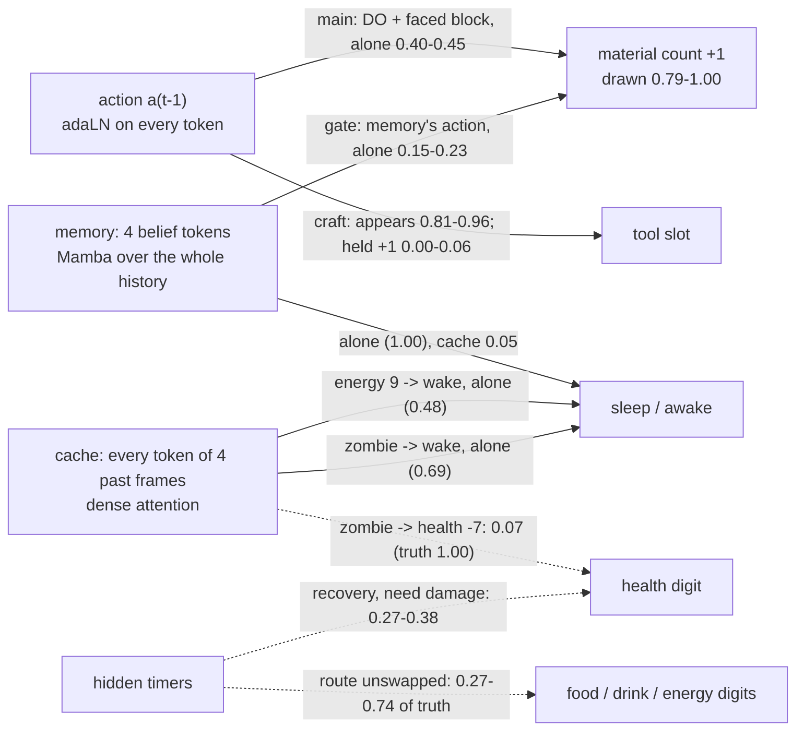

# P1-F4 follow-ups: results against PLAN.md's declared readings

## 1. Danger at K = 8: the trained world, not the sampler (`steps8.py`, `readings/k8/`)

Same checkpoint, populations, seeds, reader protocol and interface classes as F4's readout; only K = 4 -> 8.

| reading | K = 4 | K = 8 | truth / recorded | declared band |
|---|---|---|---|---|
| risky-class death (interface) | 0.036 | 0.043 | 0.128 | world: within 0.02 of K = 4 |
| ready zombie damages (curves) | 0.082 | 0.086 | 0.321 | world: within 0.04 |
| lethal hits (curves) | 0.040 | 0.050 | 0.335 | - |
| sleeping agent hit by a ready zombie | 0.099 | 0.133 | 1.00 | - |
| adjacent-class damage (interface) | 0.054 | 0.056 | 0.159 | - |

Verdict (declared rule): **the trained world** draws danger rarely at any step count; doubling the steps moves it by
<= 0.01-0.03. Unlike F3 (3 -> 16 steps: risky death 0.036 -> 0.088), F4's sampler is not the bottleneck. The gains are
step-invariant: false wakes 0.008-0.024 per stratum, woken at energy 9 1.00, coal / iron 0 -> 1 0.98 / 0.92,
increments unchanged, every interface unlock within 0.015 of K = 4 (sapling 0.06 -> 0.07). Woken beside a ready
zombie 0.54 (damaged 0.13), beside a cooling one 0.18 (truth 0.007): the wake / hit decoupling also persists.

## 2. Memory versus cache routes on F4 (`routes_f4.py`, `readings/routes_f4.json`)

842 pairs (exp 3's bank), 0 excluded; shams within exp 3's tolerances (tokens 0.023 < 0.04, belief 0.016 < 0.02, cache
0.006 < 0.011, 34 repeated generations bitwise); recorded successors read correctly in 100% of pairs. Cells are
(denoiser side, memory) from (d0, d1), event rates over K = 8 futures, episode-bootstrap 95%.

| family | 00 | 10 (denoiser side d1) | 01 (memory d1) | 11 | F3 cells 00 / 10 / 01 / 11 | declared reading |
|---|---|---|---|---|---|---|
| sleep: awake (d0 asleep, d1 woken) | 0.000 | 0.046 | 0.998 | 1.000 | 0.47 / 0.79 / 1.00 / 1.00 | Mamba CARRIES |
| energy: awake (d0 8, d1 9) | 0.000 | 0.478 | 0.000 | 0.477 | 0.34 / 0.34 / 0.34 / 0.34 | Mamba BYPASSED |
| coal: +1 (d0 DO, d1 NOOP) | 0.899 | 0.234 | 0.400 | 0.002 | 0.13 / 0.06 / 0.00 / 0.00 | shared |
| wood: +1 (d0 DO, d1 NOOP) | 0.994 | 0.153 | 0.448 | 0.000 | 0.86 / 0.52 / 0.00 / 0.00 | shared |

- **Sleep: the memory alone decides it.** Memory sufficiency 0.998 and necessity 0.954 CARRIES (F3: necessity NO
  EFFECT, 0.21); the cached frame's sufficiency 0.046 NO EFFECT (F3 0.32 UNRESOLVED; night 0.09, day 0.002). With both
  inputs asleep, 0.000 wake (F3 0.47): predicted, and the leak exp 3 left unresolved is gone. The dense route offers the
  cached awake frame one step away and the world does not use it.
- **Energy: only the cache carries it.** The cached energy-9 frame wakes 0.478 whatever the memory says; the memory's 9
  does nothing (sufficiency and necessity 0.000 / -0.001 NO EFFECT). Predicted: the energy token of frame t - 1 is one
  dense step away, and the belief recovered energy only partially in F3. Not resolved: with both inputs at 9 the
  edited pairs wake 0.48, while natural energy-9 rows wake 1.00 (curves): something in natural histories beyond the
  edited digit contributes.
- **Counts: the memory gate is gone; both action inputs carry the increment.** Both DO 0.90 / 0.99 (coal / wood); the
  denoiser's own action alone 0.40 / 0.45; the memory's action alone 0.23 / 0.15; neither 0.00. In F3 a NOOP memory
  removed every increment (0.000 / 0.003). My prediction "counts keep the memory gate" is REFUTED; "coal now near wood"
  holds (0.90 vs 0.99; F3 0.13 vs 0.86). The denoiser-side route here is the action conditioning (adaLN), not the dense
  attention: the cached frames are identical in both members.
- So the dense path does not supersede Mamba wholesale: it took over the one determinant Mamba never carried (energy),
  Mamba now carries sleep alone, and counts are shared. Caveats as declared: crossed cells are interventions; one
  world seed; F4's context is corrupted to signal 7 / 8.

## 3. Movement in F4's own token space: holds (`routes_f4.py movement`, `readings/movement_f4.json`)

T1's 64 pairs (64 episodes), K = 16 futures per member through F4's sampler: the move member moved in 1.00 of futures
and the NOOP member in 0.00; all 64 pairs both ways (F3: 1.00 / 0.00). Mean projection 0.10 for the move member (0 =
the move successor's tokens) and 0.98 for NOOP (1 = the NOOP successor's). Declared reading (>= 0.95 / <= 0.05): holds.

## 4. FlexAttention: correct, deterministic in the model, ~5% faster; the split was never the cost (`flex_bench.py`, `readings/flex/`)

Two failed attempts before the reading (both OOM in `correct`, committed fixes): the loaded model leaves activation
checkpointing off (train.p1 turns it on); with it on, the check ran at the training microbatch (8 rows x 64 frames).

- **Correctness** (8 rows, 2 spliced across an episode boundary, 2 bootstrap rows, bootstrap on): flex vs SDPA in fp32
  7.0e-7 (loss per frame) / 1.8e-6 (parameter gradients): the mask is exact on the GPU. In bf16 flex vs SDPA 0.0029 /
  0.0083, below SDPA's own bf16-vs-fp32 discrepancy 0.0057 / 0.064. Declared reading: holds.
- **Determinism** (two fresh processes per path, 4 updates, bootstrap from update 2): flex model 228 / 228 tensors
  bitwise (SDPA 224 / 228, 4.7e-18), optimizer 1.1e-13 (SDPA 1.1e-19), logged terms bitwise in both. Against the
  declared rule: the model meets it (better than SDPA), the optimizer does not (larger than SDPA's pair, though at
  F3's own pre-existing cross-process level 2.3e-13 and far inside checks.py's 1e-11).
- **Cost** (sec / update, final half; peak GiB):

| configuration | 64 steps, bootstrap off | 64 steps, on | 256 steps, on | peak |
|---|---|---|---|---|
| F3 at its split (1 / 4) | 1.68 | - | 6.08 | 4.24 |
| F3 at F4's split (2 / 8) | 1.69 | - | 6.21 | 2.29 |
| F4 SDPA at 2 / 8 (the run) | 1.92 | 2.15 | 7.81 | 2.54 |
| F4 flex at 2 / 8 | 1.77 | 2.00 | 7.74 | 2.42-2.59 |
| F4 flex at F3's split | 1.74 | 1.98 | 8.38 | 4.50-4.56 |

  The 256-step flex rows are compile-contaminated (per update 20.0 / 7.56 / 7.91 and 19.3 / 9.15 / 7.61: each new
  bootstrap sub-batch shape compiles once), so their steady state is ~7.6, not the table's mean. Projected training
  (checks.py's formula): F3 11.1 h; F4 SDPA 13.9 h; flex 13.3 h at 2 / 8 (13.2 h at steady state either split).
- What this says about the 30%: halving the microbatch costs 0.4% (64 steps) / 2% (256) on F3; SDPA's window
  implementation cost ~0.15 s / update at 64 steps (8%), which flex removes; what remains of F4's +2.8 h is the
  bootstrap (~1.1 h, intrinsic) and the dense layers' own compute (~1 h). Flex fits F3's split (4.56 <= 5.0 GiB) but
  buys no speed there. Declared reading: correctness and memory hold; determinism holds for the model, not for the
  optimizer by the strict rule; the gain is ~0.6-0.7 h per run.

## 5. Danger M1: the health token under-responds to every cause (`danger_m.py m1`, `readings/danger/m1.json`)

Sham R0: exp 2's zombie population regenerated under the canonical code equals F4's saved futures bitwise. Drawn vs
true P(health change) per future, ratio with episode bootstrap 95%:

| stratum (t - 1) | rows / episodes | drop drawn / true (ratio) | rise drawn / true (ratio) |
|---|---|---|---|
| arrow adjacent, asleep | 443 / 201 | 0.005 / 0.318 (0.02 [0.01, 0.03]) | 0.027 / 0.027 |
| arrow adjacent, awake | 1,000 / 337 | 0.009 / 0.069 (0.13 [0.08, 0.20]) | 0.012 / 0.014 |
| a need at 0, awake | 1,000 / 248 | 0.010 / 0.038 (0.27 [0.16, 0.45]) | 0.011 / 0 (false) |
| a need at 0, asleep | 1,000 / 131 | 0.009 / 0.008 (1.09 [0.56, 2.60]) | 0.023 / 0 (false) |
| needs met, health < 9, awake | 1,000 / 389 | 0.006 / 0 (false) | 0.013 / 0.041 (0.31 [0.21, 0.46]) |
| needs met, health < 9, asleep | 1,000 / 288 | 0.007 / 0 (false) | 0.036 / 0.095 (0.38 [0.30, 0.48]) |

Declared reading: need damage and recovery are both <= 0.5 (awake need damage 0.27, recoveries 0.31 / 0.38; asleep
need damage, at a true rate of 0.008, is the exception) -> **the health token is weak generally**, arrows worst
(0.02 / 0.13, below zombies' 0.11-0.26). Drawn changes also run the wrong way at 0.6-2.3% (rises where a need is 0,
drops where needs are met and nothing hostile is near): the drawn changes are weakly tied to their causes.

## 6. Danger M2: the hit's wake and drop share one route, the cache (`danger_m.py m2build / m2run`, `readings/danger/m2.json`)

232 pairs (232 episodes; 8 excluded: the edited member still lost health or woke); recorded successors read right in
100%; shams: tokens 0.021, belief 0.009, 10 generation repeats bitwise. Cells = (cache, memory) from (zombie, removed):

| event | both zombie | memory only | cache only | neither | cache-only share | memory-only share |
|---|---|---|---|---|---|---|
| woken (truth 1.00 vs 0) | 0.688 | 0.014 | 0.685 | 0.012 | 0.996 [0.989, 1.003] | 0.002 [0.000, 0.006] |
| health drop (truth 1.00 vs 0) | 0.072 | 0.006 | 0.054 | 0.005 | 0.736 [0.661, 0.810] | 0.016 [0.000, 0.041] |

Fresh arrivals: woken 0.73, drop 0.07; already beside: woken 0.21 (0.10 with the zombie removed at t - 1 only: it is
still in the earlier cached frames), drop 0.06. Declared reading: **H2 (different routes) refuted** - the wake is carried
by the cache alone (not the memory, unlike part 2's sleep edit), and so is what little drop the world draws. The same
cached zombie that wakes the agent in 69% of futures moves the health digit in 7%: the failure sits at the health
token's response, not at perceiving or routing the cause. (Against the true contrast every drop class is NO EFFECT:
the world's own effect is 0.07.)

## 7. Danger checks C1-C3, D1-D2 (`danger_checks.py`, `readings/danger/c1_f4, c2_f3, c3_f4, c3_f3, d1_d2.json`)

Shams: F3 under fa6edd1a's code regenerates exp 2's zombie futures bitwise (as F4 did under the canonical code). F3's
rows are drawn from the same populations but not the same rows as F4's M1 (rates, not paired differences).

| stratum (hidden timer or cause) | F4 drawn / true | F4 ratio | F3 drawn / true | F3 ratio |
|---|---|---|---|---|
| food -1, awake | 0.020 / 0.042 | 0.48 | 0.030 / 0.042 | 0.72 |
| food -1, asleep | 0.008 / 0.016 | 0.48 | 0.023 / 0.016 | 1.41 |
| drink -1, awake | 0.023 / 0.031 | 0.74 | 0.042 / 0.031 | 1.36 |
| drink -1, asleep | 0.012 / 0.020 | 0.59 | 0.032 / 0.020 | 1.61 |
| energy -1, awake | 0.010 / 0.019 | 0.54 | 0.020 / 0.019 | 1.03 |
| energy +1, asleep | 0.028 / 0.101 | 0.27 | 0.102 / 0.101 | 1.00 |
| health -2, arrow, asleep | 0.005 / 0.318 | 0.02 | 0.105 / 0.318 | 0.33 |
| health -2, arrow, awake | 0.009 / 0.069 | 0.13 | 0.022 / 0.061 | 0.36 |
| health -1, a need at 0, awake | 0.010 / 0.038 | 0.27 | 0.012 / 0.039 | 0.29 |
| health -1, a need at 0, asleep | 0.009 / 0.008 | 1.09 | 0.088 / 0.021 | 4.19 |
| health +1, recovery, awake | 0.013 / 0.041 | 0.31 | 0.026 / 0.036 | 0.72 |
| health +1, recovery, asleep | 0.036 / 0.095 | 0.38 | 0.055 / 0.077 | 0.71 |

Wrong-way changes (truth 0): F4 0.0003-0.027, F3 0.0003-0.064 (F3's largest: health drops while recovering asleep).
- **C1 (F4):** the other HUD timers are under-drawn too (0.27-0.74): not health-specific; by the declared bands most
  sit between T1's <= 0.5 and health-specific's >= 0.7 (food, energy and energy +1 inside T1's; drink outside).
- **C2 (F3):** F3 draws these changes at or above their rates (0.72-1.61, with more wrong-way changes), arrows 0.33-0.36
  and recovery 0.71-0.72; awake need damage is the same in both (0.29 / 0.27). Declared reading: an **F4 regression** for
  the arrow and recovery strata (F3 >= F4 + 0.2) and every timer; long-standing for awake need damage.
- **C3 (decision level, M2's 232 hit pairs; projection 0 = no-hit successor, 1 = hit successor):**

| model, level | health mean / > 0.5 | wake mean / > 0.5 |
|---|---|---|
| F4, pure noise (its first evaluation) | 0.03 / 0.00 | 0.56 / 0.70 |
| F4, final sample (K = 4) | 0.07 / 0.06 | 0.66 / 0.68 |
| F3, pure noise at sigma 5 (its sampler's start) | 0.37 / 0.32 | 0.63 / 0.68 |
| F3, pure noise at sigma 20 | 0.16 / 0.08 | 0.17 / 0.06 |
| F3, final sample (16 EDM steps) | 0.23 / 0.24 | 0.61 / 0.65 |

  Declared reading: F4's own estimate never leans to the hit (0.03 <= 0.2): its conditional for the health token lacks
  the cause, so sampling does not lose it (T3's sampling side ruled out for F4). F3's estimate leans to it (0.37) and
  its samples keep part of it (0.23). Both draw the wake from the same input alike (0.56-0.66).
- **D1 (data):** F4's drawn hit rate by starting health is flat (0.05-0.15) except full health (h9 0.39, h8 0.23), and
  does not follow each value's exposure (Spearman 0.11 < 0.7; F3 likewise higher everywhere): not a per-value data limit.
- **D2 (tools, per pass):** first tools 1,103-5,368; a held tool's 1 -> 2 208-1,296 (wood pickaxe 1,296), 2 -> 3 10-219.
  Tool counts are rendered as digits like materials' (Craftax renderer). Wood pickaxe 1 -> 2 at 1,296 / pass is drawn
  ~0.03, while iron's material increments at 3,130 / pass are drawn 0.88: each tool's + 1 is its own action-specific
  mechanism, the materials' + 1 one mechanism shared through DO (~140k / pass): the non-shared flavour, for tools.

## 8. Route map: where each consequence's cause enters F4 (all swap readings so far)

| consequence | cause enters through (F4, swaps) | drawn / truth on F4 | F3 (exp 3, C2) |
|---|---|---|---|
| material + 1 (mining) | action input, gated by memory's action | 0.79-1.00 (n <= 4) | memory's action only; 0.04-0.89 |
| sleep held / woken by an awake edit | memory alone | false wakes 0.6-2.3% | both, memory dominant; 0.42-0.52 false wakes |
| energy 9 -> wake | cache alone | 1.00 | no route; 0.04 contrast |
| zombie -> wake (asleep) | cache alone | 0.69 | - |
| zombie -> health drop | cache, weak | 0.07-0.11 of 1.00 | 0.37 at its decision level; 0.23-0.42 drawn |
| arrow -> health drop | unswapped | 0.02-0.13 of truth | 0.33-0.36 |
| HUD timers | unswapped | 0.27-0.74 of truth | 0.72-1.61 |
| tool appears / held tool + 1 | action input (unswapped) | 0.81-0.96 / 0.00-0.06 | 0.79-0.91 / 0.01-0.19 |

Reading of the map: F4 learned every consequence whose cause conditions the frame globally (the action) or changes many
tokens (sleep, wake), and lost ground on single HUD digits changed by anything else (an entity, a hidden timer),
where F3 had them at or above their rates. The cache carries the hit's cause (the wake proves it is seen and routed);
the health digit's own estimate does not depend on it.

## 9. Corrections after Codex's danger review (`../20261107_s2_danger_review/DANGER_REVIEW.md`; all verified)

- "Not routing" (section 8's last line) was too strong: the cache pathway carries the zombie (the wake shows it); how
  much reaches the health output is the open part. Section 10's attention reading measures it.
- "Data is not the limit" (D1) is withdrawn: split by state, F4's awake cells follow exposure (Spearman 0.64, 9 cells),
  asleep do not (-0.30); observational correlations cannot exclude data effects. The simple "hardly any examples"
  explanation is weakened, no more.
- Section 8's "every consequence whose cause conditions the frame globally" is too broad: sapling, eating, kills and a
  held tool's + 1 are action-triggered too and not all learned. A "shared DO increment mechanism" is a hypothesis.
- C2's health strata were not row-matched to F4's M1 (different RNG); the timer strata were (identical true rates).
- C3: first estimates and final samples used different seeds (descriptive, not a within-future mediation); F3's
  sigma 5 field is not its exact churned first evaluation.
- Ratios to zero truth are undefined: false changes are reported as absolute rates.

## 10. Danger readings R1-R3 and adversarial checks (`danger_readings.py`, `readings/danger/r1_*, r2_*, r3_*, zombie_brier.json`)

**R1, timer phase (same rows for every model): neither world learned a hidden timer.** Each timer's truth hazard is
~0 until it is due and spikes at the due bin; no model follows that profile:

| timer (due bin) | truth due / early | F4 (K = 4) | F3, 16 EDM steps | F3, 3 steps |
|---|---|---|---|---|
| food -1 awake (21-25) | 0.136 / 0.000 | flat 0.008-0.035 | flat 0.009-0.048 | ~0 (<= 0.006) |
| energy +1 asleep (6-10) | 0.176 / 0.000 | 0.051 / 0.016 | flat 0.067-0.167 | 0.000-0.051 |
| health +1 recovery awake (21-25) | 0.208 / 0.000 | flat 0.008-0.022 | flat 0.020-0.055 | ~0 |
| energy -1 awake (26-30) | 0.124 / 0.000 | flat 0.003-0.032 | flat 0.012-0.027 | ~0 |

Declared reading: F3 at 16 steps is flat at a higher rate (not a learned timer); F3 at 3 steps draws fewer timer
changes than F4. So **C2's "F4 regression on timers" is refuted**: F3's aggregate calibration came from its 16-step
stochastic sampler's base rate, not from timing it had learned (F3 at 16 also draws wrong-way energy changes asleep at
0.014-0.062). Both worlds fail the timing requirement (S2 N2). Whether the phase is available to them (it lies 11-31
steps back, beyond the denoiser's 8-frame reach: only the belief could carry it) is unmeasured.

**Zombie hits (saved data, then a proper score).** Discrimination ready minus cooling, fresh arrivals: F3 +0.105 /
+0.064, F4 +0.069 / +0.065 (awake / asleep): about equal, both far below the truth's +0.38 / +1.00. F3's higher rates
come with impossible drops (asleep cooling 0.30 vs truth 0.005). Under the expected Brier score weighted by the train
split's situations (awake ready 95.5k / cooling 89.7k rows per pass; asleep 6.7k / 5.9k): awake F3 0.140, F4 0.155
(K = 8 0.153); asleep F3 0.247, F4 0.433 (K = 8 0.401). F3 is better on danger by a proper score, mostly asleep, while
neither discriminates readiness. F3 at 3 steps on these strata is unmeasured.

**R2, attention at the decision level (descriptive).** F4: the health queries put little mass on the 4 cells beside the
player (spatial <= 0.033; dense b7 0.016 now + 0.008 past), comparable to the lighting queries' (dense b7 0.029), so the
declared "weak routing" criterion (health < a quarter of lighting) is not met; with the zombie removed, dense b7's
0.016 falls to 0.002. F4's health queries read mostly their own past (dense b3 0.32) and other HUD tokens (dense b7
0.72), alike with and without the zombie. F3: the health query's mass on the cells beside the player rises with the
zombie (spatial b6 0.118 vs 0.047 removed; F4 0.033 vs 0.031), and in its last time layer it turns from its own past to
its current value (self 0.60 vs 0.21 removed). F3 has a zombie-dependent re-weighting at the health token that F4 lacks.

**R3, reliance by signal level** (projection 0 = no-hit successor, 1 = hit; input = hit / no-hit successor at the level):

| F4 signal | health hit / no-hit input | wake | F3 sigma | health | wake |
|---|---|---|---|---|---|
| 0 (pure noise) | 0.029 | 0.564 | 5 | 0.46 / 0.02 | 0.89 / 0.01 |
| 2/8 | 0.32 / 0.01 | 0.97 / 0.01 | 2 | 0.55 / 0.01 | 0.97 / 0.00 |
| 4/8 | 0.68 / 0.00 | 0.99 / 0.00 | 1 | 0.69 / 0.01 | 0.98 / 0.00 |
| 6/8 | 0.99 / 0.00 | 1.00 / 0.00 | 0.5 | 0.88 / 0.00 | 0.99 / 0.00 |

Declared reading: F4's health output follows its input from signal 4/8 (own minus no-hit 0.68), the wake's from 2/8;
no level overrides a no-hit input toward the hit in either model. F4's sampler starts from its prior (0.03: copy) and
later steps follow what the trajectory already holds; the wake is decided at pure noise (0.56).

**Summary.** Not one regression but three findings: (1) hidden timers are learned by neither world (F3's rates were
its sampler); (2) zombie readiness is learned by neither, but F3 has a crude zombie-near-sleeper association at the
health token that F4 lacks, worth a better proper score on danger; (3) F4's health token commits to copy at its first
evaluation and needs more signal than the wake to follow its input.
