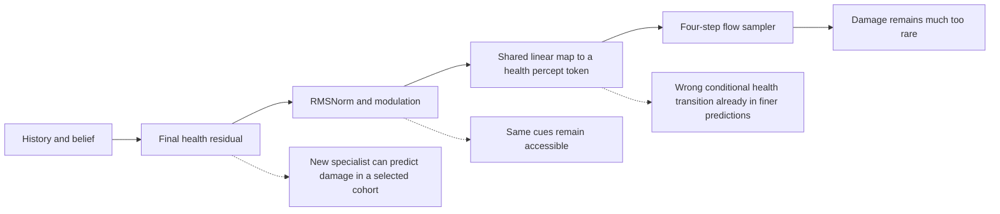

# Audit of 'zombie damage is lost at the final output layer'

2026-11-07 to 11-08, Codex. User asked to investigate the cause, adversarially test the interpretation, and leave
Claude's jobs untouched. Completed one bounded frozen-checkpoint campaign. No production model, loss, checkpoint,
training queue or Claude process was changed. All our processes completed.

## Verdict

**The new probe is useful, but 'output layer is the culprit; routing and sampler refuted' is not established.**
The strong result is that predictive cues about damage are accessible at the final health residual on the selected
awake/asleep adjacent-zombie populations. That is not equivalent to having computed a calibrated, globally usable
next-health transition that a final affine map merely fails to export.

Independent measurements establish:

1. RMSNorm and final modulation do not erase the specialist's hit signal.
2. Much of the apparent AP loss at the output is a current-digit/probe mismatch.
3. Supplying the specialist with its population (awake/asleep AND zombie-adjacent) materially changes what one can
   decode. A single natural-frequency linear hit reader on all situations is much weaker, especially asleep.
4. The finest data-trained prediction is already weak; the same-history two-finer-step continuation is weak too.
   K4's output is not simply suppressing an otherwise correct finer forecast.
5. An independently fitted shared affine output improves held-out regression a little and does not fix damage.
   A health-specific affine fit has a causal but small benefit, plus costs outside the adjacent population.

Thus the evidence supports **an underlearned conditional health transition/flow**, involving the organisation and
use of features as well as their readout. A small final-head contribution exists. A unique historical cause
(objective allocation, shared-feature interference, optimisation, or another source) is not identified by these
tests. Do not turn this into a proven new repair.

## What was run

F4 checkpoint `20261106_p1f4/run/ckpt_10.pt`, SHA recorded in capture/STAGES. Sources pinned in `PINS.json`.

- 17,619 DEV histories from all 1,009 DEV episodes, t>=8. Selected before looking at the outcome: 6,000 awake
  adjacent, all 1,619 asleep adjacent, 6,000 awake nonadjacent, 4,000 asleep nonadjacent. Inverse inclusion weights
  reconstruct the four populations' natural sizes: 22,502 / 1,619 / 219,633 / 54,081.
- Same encoded real prefixes, predicted beliefs, actions and eight corrupted cached frames as the actor-interface
  path. Skipped the independent glimpse stage only for physical sampling; physical outputs were bitwise identical
  to the complete sampler in both smoke and full collection shams. No actor/head semantics are substituted.
- Health reader: the original train400 reader recipe, not trained on generated tokens. Accuracy **1.000 on all
  305,907 real DEV states**. This qualifies real frames; generated-domain reader error remains a limitation.
- One native future for stage probes; four fresh independent futures per history per readout arm for the native
  intervention. All three arms share context/initial randomness, and are evaluated out of episode-fold.
- Five episode folds for every fit. No FINAL split. These are DEV diagnostic fits, not a new generalisation claim.

The affine fits target recorded percept tokens, not damage labels. They fit the actual post-normalisation,
post-modulation input to `out[0]`. Shared fit uses every periphery location, health-only uses health with no event
rebalancing. Fitting uses uniform finest-grid signal levels and ramp weights, with native lightly corrupted past
context. This is **not the full original P1 context distribution or bootstrap objective**. Limits are material.

## 1. Separate the operations the original probe skipped

`saccade/model.py:442-447`: final residual -> RMSNorm -> action/noise-dependent scale and shift -> shared linear
map. Damage AP, specialist fits just as in Claude's diagnostic:

| first evaluation, selected population | awake adjacent | asleep adjacent |
|---|---:|---:|
| raw final residual | .717 | .837 |
| after RMSNorm | .712 | .834 |
| after modulation, actual linear-map input | .714 | .837 |
| output token alone | .474 | .753 |
| output token with current-digit interactions | .633 | .821 |
| pre-linear feature component in output matrix's nullspace | .709 | .837 |

The last row shows unused predictive cues exist. It does not show those cues are already an appropriate next-token
representation. The output+digit control uses only CURRENT simulator digit as an evaluation supplement (fully
readable in coarse input); it is not a change to the native model. One classifier on a future digit alone is a poor
comparison with a feature that also encodes its past. The specialist AP loss cannot be called complete erasure.

AP is a ranking statistic. `(AP-action AP)/(memory AP-action AP)` is not a fraction of information retained;
values above one are not proof of 'more than all the belief's knowledge'.

## 2. The specialist is supplied with important context

The original code fits a different logistic probe for awake adjacent and asleep adjacent rows. The original
readout must work on all rows and all periphery locations, without that supplied membership.

Fit one weighted all-situation logistic health-drop predictor to the SAME final modulated health features, five
episode folds. C=1 as the original probes, then C=100 as a weaker-regularisation check:

| adjacent cohort read on held-out episodes | specialist AP | global AP C=1 / C=100 | true drop rate | global predicted rate C=1 / C=100 |
|---|---:|---:|---:|---:|
| awake | .714 | .590 / .578 | .161 | .116 / .121 |
| asleep | .837 | .570 / .592 | .504 | .131 / .153 |

The global fit predicts .152 / .186 on the sleeping rows that actually had a drop, rather than the specialised
memory probe's claimed .70 'calibrated lean'. Overall natural-weighted predicted rate .0218 vs observed .0205 can
look reasonable while the important sleeping-adjacent slice is missed.

This is an adversarial control on the **interpretation**, not proof that the representation contains no global
nonlinear solution. It demonstrates why a selected-population linear probe does not certify the trained world's
global health computation. C=100 does not remove the discrepancy.

## 3. The finer forecast is already weak

For the exact same initial noise, action, memory and native cached past, compare K4's first endpoint estimate with
the finest data-trained d=1/8 call and its two-step continuation. Mean projection toward each recorded hit's token:

| recorded-hit rows | K4 estimate | finest estimate | two-finer-step equivalent endpoint | final K4 estimate |
|---|---:|---:|---:|---:|
| awake | .205 [.192,.218] | .196 [.184,.209] | .205 [.193,.219] | .196 |
| asleep | .059 [.055,.065] | .048 [.044,.052] | .090 [.083,.098] | .095 |

The K4 estimate under-expresses even that local continuation by about .031 asleep, but its finer forecast is not
correct and waiting to be exported. Awake K4 closely matches the local two-step target.

**Scope of 'teacher':** this is the shortcut target formula under a fixed native history. The actual training
`shortcut_loss` also re-runs and advances previous noisy frames inside the chunk. This measurement does NOT
reconstruct that whole training target and is not evidence that every historical bootstrap target had this bias.

Source: `model.py:552-587`. d_min=1/8 is trained on data; d=1/4 is trained on the mean velocity of two finer model
steps. A finite-step endpoint estimate is not in general a class probability. See Dreamer 4 eq.3 and Shortcut
Models section3: https://arxiv.org/html/2509.24527 and https://arxiv.org/html/2410.12557v3 .

## 4. The claimed 'calibrated lean' is not generally calibrated

The original reference is a classifier's P(any health drop), but the measurement projects onto ONE realised
health-token displacement. Equality requires an appropriate two-endpoint mixture (and correctly conditioned,
calibrated reference). It is not guaranteed for different drop sizes or other token changes.

Exact counterexample: no drop .30, small drop .50, large drop .20. With orthogonal small/large token directions,
the correct mean projects .20 toward the large-drop endpoint even though P(any drop)=.70. `counterexample.json`.
This disproves the identity, not F4's actual adequacy. F4's generated damage deficit is independently real.

Actual recorded adjacent-hit deltas include 1/2/3/4 awake and 1..8 asleep (clipping at zero and simultaneous effects).
Different starting digits also imply different directions. This does not by itself prove the size of the
reference bias on F4; a conditional-distribution reference is required. Do not report .055/.70 as an established
'8% of the correct movement expressed'.

Nor does agreement of population mean lean with an event frequency prove the sampler is causally exonerated.
The prior exact-mixture-flow counterexample and F4's 75%-noise first update still apply. Existing K4/K8 evidence
rules out doubling sampler steps as a sufficient danger repair, not every sampler/learned-field interaction.

## 5. Actually intervene on the readout, not just probe it

Ridge residual refits of the frozen affine map, five episode folds, actual raw next-token targets. The shared map
keeps exactly the original parameterisation. Health-only applies the independently fitted affine map only at cell
63; it is a diagnostic capacity/objective separation, not a proposed domain-specific head.

Held-out ramp-weighted finest-step regression MSE:

| objective evaluated | original | shared refit | health-specific refit |
|---|---:|---:|---:|
| all periphery cells | .008621 | .008376 | only health replaced |
| health | .008975 | .008848 | .008685 |

Regularisation sensitivity 1e-6 to 1e-2 does not reveal a large missed solution. Solve residuals <=3.5e-9.
Reconstructed linear outputs versus actual bfloat16 outputs differ RMS .00210, far smaller than these prediction
errors; fitting uses the recorded exact pre-linear features and the checkpoint's weights/bias.

Native four-step futures, four samples each, newly fitted map only from the other episodes' folds:

| cohort | recorded damage | original | shared refit | health-specific refit |
|---|---:|---:|---:|---:|
| awake adjacent | .1612 | .0543 | .0542 | .0638 |
| asleep adjacent | .5040 | .0777 | .0761 | .0922 |

The shared refit leaves damage essentially unchanged. Specialising health closes **8.9%** of the awake deficit and
**3.4%** of the asleep deficit. Its fair ensemble Brier improves awake by -.00458 [CI -.00607,-.00324], asleep by
-.01534 [-.01994,-.01112]. Benefits are real but far from a repair. The nonadjacent awake Brier worsens +.000167
[0,.000395]; other health changes also increase. Entity counts are nearly unchanged under health-only refit.
Shared refit's adjacent Brier changes contain zero. `NATIVE.json` includes all intervals and the other cohorts.

Post-hoc pure-noise-only fits (same frozen finest-step features): an affine health readout moves hit lean from
.196 to .288 awake, .048 to .093 asleep. A 64-hidden-unit residual MLP, one fixed seed/50 epochs with fitting-episode
validation, gives .290 / .085. Natural overall token MSE improves only 2.2% / 2.7%, respectively. This bounded MLP
does not expose a large hidden repair; it cannot exclude stronger readers or different optimisation. No native MLP
sampler was tested, and no such architecture is adopted.

## 6. What this says about the cause

The **computational failure** is established: the learned conditional health flow fails to turn context into the
correct next-health distribution. Predictive clues reaching a feature do not mean that transformation is complete.
The positive head-only intervention establishes a small readout contribution, not a readout-only explanation.

Two measured facts make shared objective/feature organisation a credible training explanation:

- Frozen finest-step squared-loss gradients at the shared output are in conflict: cos(health, other cells)=-.152;
  cos(recorded health-drop rows, all periphery)=-.074. A local unpreconditioned descent direction on the bulk can
  worsen that subset. This is NOT a reconstruction of Adam, momentum, clipping or historical updates.
- In these naturally weighted measurements, health-drop rows' health coordinates contribute .54% of periphery-only
  flow squared loss; sleeping-adjacent hit rows contribute .059%. Those are measured loss shares, not gradient shares
  or the entire P1 objective. Ramp gives tau0 2.53% of the flow branch's coefficient mass; the exact deployed
  first-call code receives .47% of combined flow/bootstrap coefficient mass after warmup. Weight is not error or
  gradient, and positive weighting does not change the unlimited-capacity per-level minimiser.

This supports a finite-capacity/finite-training allocation and conditional-feature-binding hypothesis. It does
NOT prove that changing ramp, reweighting events or splitting the head will fix the full model. Bootstrapping can
carry an already weak fine predictor forward rather than manufacture a correct damage forecast.

One source-level caution for future design: bootstrap membership is sequence-level. Flow rows use fine step codes
at every frame, bootstrap rows coarse codes at every frame; deployed K4 queries use a coarse current code with a
finest-step, signal7/8 history cache. That exact step-code combination is absent from main bootstrap student rows.
The public Dreamer4 implementations use the same sequence-level split; this is an extrapolation fact, not an
implementation bug or a demonstrated cause. K8's continued danger deficit also prevents calling it the whole cause.

## What Claude's suggested measurement can prove

A successful held-out head-only intervention can establish a readout lever, if it respects the original shared
map, target, contexts and sampler and also checks false changes and other content. It cannot by itself identify
why joint training chose the old weights. A failed refit cannot uniquely prove 'interference': feature-target
binding, missing conditioning, fit capacity, regularisation and distribution differences remain possibilities.

Here we did a stronger version than a classification probe: affine fitting plus actual sampled futures and
controls. It yields a small contribution and no full repair. The right next discussion is how to supply learning
pressure for the conditional health transition, not a proven need to replace the final linear layer. No overnight
training or automatic followup has been launched.

Research on probes: https://aclanthology.org/D19-1275/ ; causal interventions rather than decodability alone:
https://proceedings.mlr.press/v162/geiger22a.html . These support methodological limits, not Saccade-specific causes.
