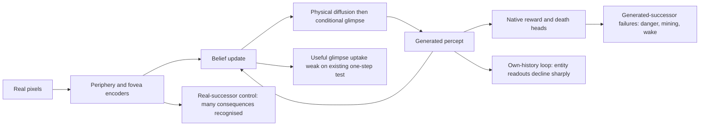
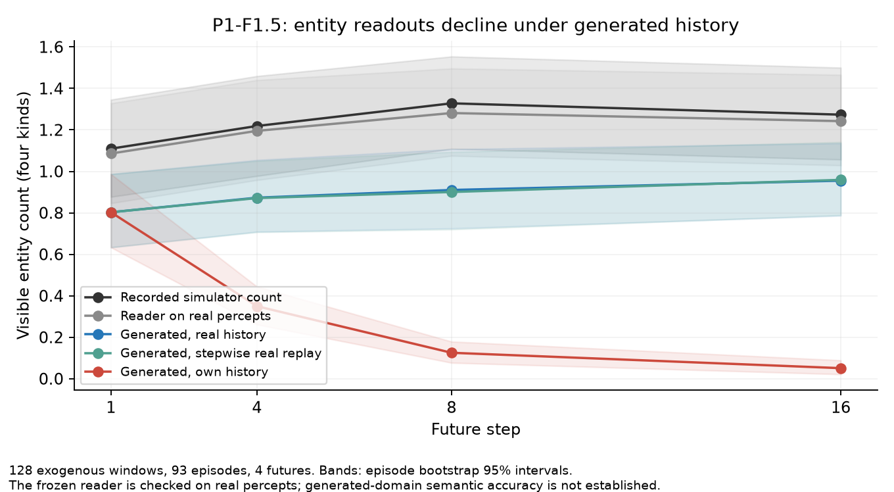

# P1-F1.5: readiness for P2

Discussion/diagnostic update (2026-11-02): the user correctly distinguishes P1's real-input
training from P2's self-feeding requirement. The latter's failure is a P2 starting condition,
not an architectural veto. Outcome/query consistency is parked; extra sampling is a partial
improvement, not a repair. The bounded useful-evidence and four decision-2 checks are now
reported in [UPTAKE_RESULTS.md](../../artifacts/experiments/20261102_p1f15_readiness/UPTAKE_RESULTS.md).
Fine content is readable and its path is connected, but the native local next-prediction
benefit is negligible in the tested scenes. Conditional redundancy versus weak acquisition/
export/readout is unresolved; no memory/loss repair was selected. The direct chooser's
measured collection cost also prevents assuming an ordinary overnight budget.
P2's terminal-inclusive index and coverage audit are prepared in
[P2_DATA.md](../../artifacts/experiments/20261102_p1f15_readiness/P2_DATA.md).
P1 never used the restricted exogenous bank. Advanced-state coverage remains a separate gap.

2026-11-02. Owned by Codex at the user's request. This is an evidence map, not launch approval
or a replacement recipe. Active protocol: `artifacts/experiments/20261102_p1f15_readiness/PLAN.md`.

## Current evidence

| Interface | What is established | Remaining question |
|---|---|---|
| Real frame to percept | S3 perception blocker passes; real digits/icons decode | Does additional fine evidence change future predictions usefully? |
| Belief/history to next physical percept | Current-query invariance by mask; wood/drink/table improve | Wake, mining, combat and danger remain weak |
| Physical percept to conditional glimpse | Cascade is implemented and mechanically checked | Conditional robustness and unreadable generated digits are not isolated by latent MSE alone |
| Generated percept to native outcomes | Real-successor heads recognise coal/iron near .99, generated successors .10/.03 | Generation/readout interface still fails; not explained solely by an external probe |
| Query to reward distribution | Physical marginal is invariant | Reward means still vary with query in some rewarding contexts; whole-world invariance is not established |
| Own generated history | New native 16-step pilot shows severe entity-readout decline; real-percept replay does not | How much is semantic loss versus generated-domain reader failure? |
| P2 implementation | Curriculum and objective specified | No P2 trainer or nonzero-gradient implementation check exists yet |

The old P1-F and F1.5 changed fixation curriculum and factorization together. They cannot identify the separate
contribution or interaction. Inference-time architectural changes are out of distribution and do not fill the
missing matched training arms. Their differences are descriptive, not a causal decomposition.

Readiness for a **bounded P2 experiment** does not require a perfect starting world: P2 is intended to improve
own-history behavior. Readiness for reliable actor training is a stronger claim. A passing perception check,
decreasing monitor loss or a completed checkpoint does not establish it. Results and remaining decisions will be
added below. No learner/recipe was changed and no training was launched in this diagnosis.

## One picture of the current problem

The physical mask removes the current-query shortcut. It does not ensure useful memory uptake, correct
conditional glimpses/outcomes, or recursive stability. These are separate learning requirements.

## 1. What losing guidance actually changes

P1-F had rule placement on 13.13% of training frames. F1.5 uses the uniform prior everywhere. From the saved
training-corpus manipulation check, expected coverage of the specified event's cells changes as follows:

| Target event | P1-F rule, q=1 | Uniform |
|---|---:|---:|
| Drink increase | 100% | 12.24% |
| Wood increase | 100% | 12.26% |
| Sapling increase | 98.41% | 12.29% |
| Table placed | 98.80% | 18.43% |
| Zombie hit | 78.38% | 4.35% |
| Any declared target | 95.19% | 11.19% |

These are expected crop exposures, not gradient or causal-effect estimates. Uniform fixation redistributes the
same crop budget across the screen; it does not remove that budget. The two completed recipes cannot tell us
what fraction of a particular regression this redistribution caused. The factorization package also changes
attention, independent physical/glimpse noise levels and cascade inference; the saved one-seed comparison does
not isolate those pieces. Faithful reconstruction/TSP is unchanged between F and F1.5, so there was no new loss
switch in this comparison, although interactions with the changed curriculum/architecture remain possible.

Evidence: `artifacts/experiments/20261102_p1f15_readiness/coverage.json`; underlying rule in
`20261030_fovea_placement/map.json`, whose q=.5 expected mixture is algebraically converted to q=1.

## 2. Did the fovea's gradients disappear?

No. New measurements use checkpoint 5 and 10 of each world, their native carried states/fixations and exact P1
losses/weights, eight two-stream blocks x 64 new frames per checkpoint (1,024 frames). Scene/action/outcome arrays
match between worlds; histories and fixation targets legitimately differ. Common seeds are used, but the extra
factorized sigma draw means these are not identical cross-world noise tensors. This is descriptive route
accounting, not a matched training intervention.

Checkpoint 10, median weighted gradient norms:

| Loss route -> receiving parameters | P1-F | F1.5 | Change |
|---|---:|---:|---:|
| Glimpse G1 -> shared denoiser | .1728 | .1530 | -11% |
| Fovea reconstruction -> fovea encoder | .0550 | .0510 | -7% |
| TSP -> periphery/light encoder | .4583 | .2811 | -39% |
| Physical G1 -> past fovea encoder, through belief | .00470 | .00263 | -44% |
| Glimpse G1 -> memory projection | .00413 | .00231 | -44% |

The glimpse G1 route's signed projection onto the shared denoiser's total gradient is .202 versus .259 (medians):
its relative contribution there did not disappear. Norms are not additive shares; alignment and cancellation
matter. G1 still allocates 576/1880 = 30.64% of its equally weighted scalar coordinates to the glimpse, unchanged
by factorization. This dimensional fraction is not a gradient fraction.

A frozen one-step AdamW differential, preserving saved moments, learning rates, decay and global clipping,
compares the full objective with an explicit graph omitting glimpse G1, TSP, reconstruction and their noise fit.
The median difference relative to the full update is 20.4% -> 14.9% for shared denoiser parameters, 26.3% -> 8.6%
for the memory projection, and 11.7% -> 12.2% for the fovea encoder. These are local microbatch optimizer
sensitivities, including clipping effects; they are not percentages of useful learning or full-run treatment effects.

Instrumented full losses and full gradients match native computation exactly. Summing separately backpropagated
routes has up to 2.30% relative residual under native bf16 arithmetic, so route shares are approximate. The Adam
formula was independently checked against torch AdamW using saved moments (max parameter discrepancy 2.38e-7,
within four float32 ulps). Full checkpoint-5/10 results, block variability and raw outputs are retained.

Concern: training the fine encoder remains substantial, while teaching the future physical prediction through
memory is weak. Existing reading 5 finds no detectable useful-glimpse improvement in whole-map one-step loss.
That statistic can dilute local effects; it is not a proof that all fine evidence is ignored or useless for decisions.
An explicit recency trace would change where the eye goes, not repair this learning path by itself.

Evidence: `20261102_p1f15_readiness/gradients/summary.json`, `analysis.json`, `adam_check.json`.

## 3. External reader artifact versus a functional generation problem

Keep three claims separate:

1. The frozen counter reader returns unknown for 29-46% of generated digits. Its reliability on real tokens does
   not establish its reliability on generated tokens. Unknown is not synonymous with missing information.
2. The same world's native reward/death interface also fails on generated successors while recognising the real
   successors of the same histories. This is a functional imagination problem even if an alternative reader could
   recover more information. It does not uniquely separate malformed percepts from insufficient outcome-head
   robustness to those percepts.
3. A probe-independent coordinate check also finds distribution mismatch, but not wholesale norm collapse:
   inverse-tanh channel-mean error in random physical tokens is .000049 real versus .002048 generated; for glimpse
   tokens the combined mean/moment tolerance fails on 0% real versus 37.8% generated. Eight-step sampling reduces
   the latter to 28.1%. The threshold is descriptive, not a semantic gate. The unit-second-moment part fails even
   on about half the real periphery tokens because LayerNorm epsilon matters for low raw variance; it is therefore
   invalid as an absolute periphery gate. No post-hoc normalization repair is justified by this check.

The original C2ST accuracy .946 establishes strong distinguishability under its validated instrument; it does not
say which differences matter to the actor. Native outcome errors supply that missing practical consequence.

### Frozen sampler test

First 200 dev episodes, fixed histories, K=4 futures, native heads/encoders/beliefs only. Random/risky cohorts cap
256, wake 196, coal 82, iron 70. Exact reward-marginal death probability. The following achievement cohorts are
outcome-selected recall diagnostics, not unconditional event calibration. Risk is defined before the outcome.

| Readout | Recorded | Head on real successor | Production 3 steps/churn 1 | 8 steps/churn 0 | 32 steps/churn 1 |
|---|---:|---:|---:|---:|---:|
| Death in risky contexts | .1445 | .1445 | .0103 | .0761 | .0712 |
| Wake reward >.5 | .8776 | .8621 | .5369 | .6058 | .5827 |
| Coal reward >.5 | 1 | .9978 | .0690 | .2142 | .2588 |
| Iron reward >.5 | 1 | .9942 | .0233 | .1699 | .1899 |

Eight-step minus production: risky death +.0657 [+.0483,+.0835]; coal +.1452 [+.1061,+.1856]; iron +.1466
[+.0998,+.1894]; wake +.0689 [+.0241,+.1136]. Intervals cluster episodes, conditional on this trained world.
Fair finite-K Brier corrections are retained. Natural random-scene reward probability rises .0514 -> .0672 versus
.0430 recorded; its Brier change has an interval spanning zero. More steps are not a uniform calibration fix.
The residual failures remain large, including with 32 steps. No production sampler setting was changed.

This connects to the previous investigation: the numeric sampler recovers part of a consequence deficit, while
other conditional-generation/readout weaknesses remain. The old beta-TSP intervention changed noise retention
without uniformly repairing semantics; current evidence still does not identify nuisance noise as the sole cause.

Evidence: `20261102_p1f15_readiness/solver/`, `geometry/`, `analysis.json`; prior
`20261101_regression_localization/REPORT.md` and `SAMPLER_RESULTS.md`.

## 4. Native own-history test: the important new P2 finding

128 exogenous 16-step windows from 93 dev episodes, four independent futures each. Full real-prefix beliefs,
uniform seeded gaze, production cascade, native sampled rewards/termination, absorbing free-running convention.
Compare real-history conditioning, free running, and the same stepwise update fed real percepts/outcomes.

Mean visible entity counts, all four kinds combined:

| Future step | Simulator recording | Reader on real percept | Generated with real history | Stepwise real replay | Free running |
|---|---:|---:|---:|---:|---:|
| 1 | 1.109 | 1.086 | .803 | .803 | .803 |
| 4 | 1.219 | 1.195 | .873 | .871 | .350 |
| 8 | 1.328 | 1.281 | .910 | .900 | .125 |
| 16 | 1.273 | 1.242 | .955 | .959 | .051 |

At step 16, free-minus-real-history is -.904 [-1.077,-.740]. Mean across all 16 steps: real-reader 1.229,
real-history generation .900, free running .225. The first forecast matches exactly in all three model paths.
The real replay's belief RMS discrepancy against full-episode encoding is at most .0108 under bf16; its forecasts
stay close to the real-history path. This argues against an update-loop implementation error causing the decline.
Only .2% of branches have terminated by step 16, so absorption does not explain it.

These are **entity readouts**, not simulator truth for generated worlds. Reader domain failure remains possible;
the decline is nevertheless a severe operational failure of the tested representation/readout loop. This pilot
does not separate beliefs versus temporal context as the mediator, does not establish causal object identity,
and is not the full predeclared S2 gate. It contains no recorded deaths and therefore cannot assess mortality.
Complete-window eligibility also selects on future episode length. The readout/control contrasts diagnose the
model's response to generated inputs; this pilot is not an unbiased predictive-calibration test across terminal
and nonterminal futures. The window-admission issue is detailed below.

Evidence: `20261102_p1f15_readiness/recursion/`, including the preserved initial pilot and the replay-control rerun.

## 5. P2 needs an explicit discussion of credit and coverage

The current contract freezes the encoder, continues G1/G3 on real streams, and adds a space-time/global energy
score on self-generated trajectories. Only the last two generated world steps receive pathwise gradients.
Reward and termination draws are detached. This was agreed, but its limitation matters now:

    loss = ||[z(theta), stop_gradient(r(theta))] - [z_real, r_real]||

Its gradient contains the z derivative, not the r derivative. A wrong reward changes the distance/weight but does
not supply its missing derivative or the score-function term for a sampled discrete outcome. Absorbing terminal
branch selection has the same discrete-credit limitation. Therefore putting rewards/deaths in the score does not
by itself train their sampling probabilities correctly. One-step G3 updates heads on real evidence; it does not
by itself supervise their forecast distribution on generated evidence. Truncated gradients further separate the
optimized update from the full trajectory-score gradient. No P2 implementation check has yet been run.

The actual training split's exogenous support is also thin for the hardest consequences. Count **all sliding
starts**, not merely stride-H windows, and count distinct observed events once:

This is not a general absence from P1's data: the full training split (monitor excluded) contains 3,398 coal
unlocks, 2,249 iron unlocks and 4,300 zombie defeats. The long-exogenous-window filter discards almost all of
that support. Counts: `20261102_p1f15_readiness/full_train_achievement_counts.json`.

| Horizon | Eligible windows | Coal unlocks in their union | Iron unlocks | Zombie defeats |
|---|---:|---:|---:|---:|
| 2 | 402,557 | 40 | 12 | 62 |
| 4 | 290,447 | 10 | 0 | 19 |
| 8 | 260,599 | 3 | 0 | 1 |
| 16 | 244,096 | 1 | 0 | 0 |

At 24,000 uniformly sampled windows per phase (1,500 x 16), expected event exposures are coal 2.98/1.65/1.38/.29
and iron .72/0/0/0. These are corpus/sampling expectations, not a proposed event-rebalanced curriculum. Death has
1,915 distinct examples in the all-sliding 16-step support (125 in the canonical stride-16 bank), unlike this small
pilot, so a dedicated risk/terminal reading remains necessary. G1/G3 real-stream learning and generalization can
still help, but broad mining/combat recovery cannot be presumed from this G4 coverage.

**Additional admission problem:** every termination in the complete H-step banks occurs at step H. In all 244,096
sliding 16-step train windows, termination counts by position are zero at steps 1-15 and 1,915 at step 16.
The stride-16 bank similarly has only 125 at step 16. Requiring H recorded actions admits only futures that
last that long, so the target distribution is conditioned on future episode length. This is not repaired simply
by declaring an absorbing convention after termination: those early-terminal real targets were excluded before
padding. The P2 loader is not implemented. Its admission/padding/action-schedule contract must avoid that future
selection (including how exogenous actions are specified if a counterfactual branch survives a recorded death).
Neither an independently drawn valid early death nor its absence should be scored against a survival-selected
reference as though it were an unbiased future. This is a new P2 design gap, not a cause of F1.5's P1 regression.

Before P2 implementation, decide what gives semantic forecast errors credit: retain the declared score with its
limits, add a forecast-space proper outcome score, or use a justified discrete-gradient estimator. These differ
in objective and variance; none is adopted here. A forecast-space score would assess the native outcome-chain
distribution marginalized over generated successors, not force every independent future to carry the recorded
reward/death. Marginal calibration alone would still not prove within-trajectory consequence coherence.
Do not add records/store just to conceal a failure already
present at the next-frame interface. Longer revisit and hidden-state memory remain separate measured needs.

Evidence: `20261102_p1f15_readiness/exogenous_coverage.json`, `terminal_censoring.json`, actual CURRICULUM/LOSSES
contracts. Sliding-start terminal counts are independently enumerated and also reproduced by `coverage.py`.

## 6. What the papers support

- [DIAMOND §5.2](https://arxiv.org/html/2405.12399): one denoising estimate can average multimodal outcomes;
  iterative sampling resolves modes in their experiments. This motivates our native solver check, not a universal
  claim that three steps are sufficient here.
- [JEDI §3.2 and algorithm](https://arxiv.org/html/2605.13013v1): online latent learning, three Euler steps and
  stochastic switching of a denoised estimate into later conditioning. Its algorithm reconstructs a noisy version
  of an observed target; it is not permission to insert an independent stochastic future and match it pointwise
  to the recording. We dropped switching and P1's belief reads real percepts.
- [Dreamer 4 §3.2-3.3](https://arxiv.org/html/2509.24527): noisy-context training and sampling, learned shortcut
  steps, and reward/policy adaptation on noisy representations. Supports robustness training; does not validate
  our fine-view cascade, isolated Mamba uptake, or one particular P2 energy objective.
- [Self Forcing §3.2-3.3](https://arxiv.org/html/2506.08009): train on autoregressive model outputs with video-level
  DMD/SiD/GAN objectives. It truncates denoising/cache gradients and notes long-range limits. Our energy score and
  last-two-world-step gradient rule are adaptations, not their demonstrated recipe.
- [Pacchiardi et al. §3.2, §5.2](https://jmlr.org/papers/v25/23-0038.html): patched scores plus a positive strictly
  proper global term can retain strict propriety; small Monte Carlo sample counts work in their experiments.
  This is a population-objective statement, not a guarantee of sensitivity to our rare events or correctness of
  detached/truncated gradients.
- [NeuralGCM training](https://arxiv.org/html/2311.07222v1): growing unrolls was critical, with extended
  backpropagation and physics-based structure. Supports a horizon curriculum, not transfer of its guarantees to
  our short-gradient latent world.

## 7. Decision 2 and the overnight experiment

P1-F1.5 is a useful **architectural baseline for a fixation-curriculum comparison**. It is not a demonstrated
reliable 16-step imagination world. F2 should remain baseline + chooser if the scientific question is whether
emergent fixation teaches better; silently combining sampler, outcome objective and controller changes would
lose that attribution. The chooser may improve fixed-target grounding even before the belief learns to use
extra fine evidence, so a teaching benefit and a VoI benefit must be read separately.

Before building: settle the behavioral role of persistent action contingency versus fading prediction error;
score normalization/weights/floor and recency behavior; reconcile clean versus augmented chooser inputs in real
and imagined steps; measure collection cost; retain fixation history/carry exactly once through collection and
training; invalidate parameter-dependent caches after updates; use an independent chooser RNG. Check full
reward-distribution consistency at held-out fixation policies, not just physical invariance.

The user asked to decide the lasting contingency bias after these diagnostics. No weight, trace, loss repair or
launch was chosen by this review. The next discussion should separate the controller's intended behavior from
the P2 rollout/outcome-credit question, using the failures above as readouts rather than promises of repair.

## 8. Conditional fine information: completed follow-up (2026-11-02)

The previously missing full-context control has now run. Evidence and limitations:
[conditional campaign](../../artifacts/experiments/20261102_foveal_information/RESULTS.md),
[cheap chooser research](../../artifacts/experiments/20261102_foveal_information/CHOOSER_RESEARCH.md).
24 matched frozen-world readout fits, 360/40 train episodes and 250 dev episodes. Adding
raw fine tokens improves night macro recall in every reader fit (+3.3 to +8.9 points),
even with full coarse scene, eight-frame physical context, prior emissions and action.
Thus complete fine-evidence redundancy is rejected in these readout families.

Paired genuine crops: eight strict conditional-useful entity queries (three zombies, one
cow, four skeletons); source selection only, not a population frequency estimate. Updated
belief/memory gains are much smaller and reader-dependent; some are positive. Aggregate
readers disagree about where information is accessible, so no memory-erasure curve or
unique Mamba defect is established. A further frozen-carry query probe fails to generalize
despite fitting training labels, while matched raw-fine controls improve; its null cannot
prove absence of hidden information. The first observed accessibility gap is already at
whole-crop input mixing, before the sampler. This is not solely a self-feeding symptom.

No new repair, foveation rule or overnight launch selected. Distilled sparse native C/S
priority and direct coarse-history action-conditioned expectation heads are candidates.
A main-belief-conditioned cheap head alone would retain sequential collection cost:
forecast calls account for only ~7.2 of the ~22.5 extrapolated extra hours. The corpus stays
unchanged. Next discussion separates fine-to-belief routing/learning pressure from the
chooser estimator, preserving the user's P2/self-feeding and parked-sampler decisions.

Batching qualification: a block-start native belief plus coarse-only within-block history
is another explicit candidate; it delays fine feedback rather than dropping all fine
history. Block length and own-history behavior need validation. See CHOOSER_RESEARCH.md
for the computational contract; it is not equivalent to the per-frame full-belief chooser.

## 11-02: future predictive value and cheap chooser feasibility

Completed user-authorized readings: [direct chooser](../../artifacts/experiments/20261102_direct_chooser/RESULTS.md),
[foveal prediction](../../artifacts/experiments/20261102_foveal_prediction/RESULTS.md).
The two-seed direct coarse expectation head forecasts ordinary frames well but loses
remote action localization and all four actual-policy counter-mass gates, replicated
on disjoint development episodes. Not adopted; no automatic distillation/P1 run.
Fine evidence has now shown future predictive value: next fine error at current entity
cells drops about26% with raw fine, versus2–3% for its mixed contribution and about0%
for projected memory in the bounded instruments. Native memory nevertheless improves
coarse forecasts. Raw-fine coarse-target gains are small/seed-dependent; coarse readout
only slightly beats copying in the primary no-scroll stratum. The fine instrument does
not receive the next coarse frame, unlike the native cascade: remaining conditional
value is unresolved. No route repair, unique-cause claim or architecture amendment.

## 11-02: input projection survival audit (Test 2)

The user deferred future-periphery conditioning and authorized a bounded projection
audit. [Results](../../artifacts/experiments/20261102_projection_audit/RESULTS.md)
materially narrow the input-loss interpretation. Frozen F1.5ck10; sixteen matched
future-fine prediction fits, with original base/raw control error arrays reproduced
bit for bit. A per-fixation pseudoinverse re-expresses only the information already
in the256D fine projection as576 crop-relative coordinates. It restores no null
component. Confirmation entity-cell prediction gain is19.0/22.0% versus2.7/2.8%
from the native fine vector and26.4/25.9% from raw fine. Recovery from the actual
BF16 mixture after subtracting KNOWN coarse content gives18.5/22.3%.

Thus a large part of the measured input gap is reversible accessibility, not
demonstrated irreversible destruction. Raw retains a smaller significant advantage;
rank loss or reader limitations remain possible for it. The generous conditional
instrument has current coarse tokens separately, whereas native Mamba receives
only their sum with fine evidence. These results do not establish native acquisition
or future prediction benefit from a new route, nor sufficiency of256D for all
joint scene content. Precision is not lossless, but does not explain this large
input-stage prediction gap. Future-loss pressure and joint mixing remain plausible.

This supports a short joint test of shared local nonlinear evidence fusion before
compression, preserving the existing fine residual. It is not a selected or built
repair. No native objective, architecture, chooser, corpus or overnight run changed.

### Subsequent user decision: from-scratch P1-F1.6
After the projection audit, the user chose a from-scratch comparison instead of the
short continuation. Further discussion rejected the optional16D correction/raw-fine
bypass. Approved arm: shared88->128->64 joint local fusion REPLACES raw fine inputs
to belief; ordinary coarse path/256D projection remain. Existing out_map normalizes
the joint feature scale. Recipe, budget, sampler, uniform gaze and corpus match F1.5.
All63 regression tests and3 queue tests pass; sustained native200-update smoke,
full monitor,256-phase accumulation and exact resume/reload passed. The arm is
running as`saccade-p1f16`, with automatic same-protocol F1.5 evaluation afterwards.
This updates launch status, not the earlier world's readiness or evidence. No
semantic repair is yet demonstrated and no P2/actor follows. See the
[protocol](../../artifacts/experiments/20261102_p1f16/PLAN.md) and
[checks](../../artifacts/experiments/20261102_p1f16/CHECKS.md).

### 2026-11-03: completed F1.6 review
The run and full queued readings finished. See the
[complete dissection](../../artifacts/experiments/20261103_p1f16_review/RESULTS.md)
for paired consequences, every counter transition, readout/representation limits
and source checks. A new fixed58-scene native comparison finds local informative-
look loss change−0.00217%[−0.00770,+0.00381%]; the40-scene common fine-readable
subset is also negligible. Simple local fusion alone did not demonstrate the
desired evidence-use repair. Several consequences/reconstruction improve, but
risky damage5.35→2.93% and death1.75→1.09% regress against real12.75/12.77%.
This is a generated-percept/outcome-path finding, not unique identification of
the denoiser rather than its consumer's generated-latent generalization.

No F1.6 native own-history/S2 pass is supplied by this review. P1 self-feeding
remains a P2 training target; weak useful-look uptake on REAL prefixes is a
separate issue. Learned fixation may teach through supervision placement even
without proven belief acquisition. Discuss the next baseline and objective;
do not silently turn this result into a demonstrated repair or a new P2 contract.
